# 1. Storia del Judo

Nessuna arte marziale moderna può vantare una storia meglio documentata del judo: un fondatore identificabile, una data di fondazione precisa, un percorso istituzionale tracciabile quasi anno per anno. Eppure, come vedremo, anche la storia del judo custodisce i suoi passaggi in cui il documento cede alla memoria orale e alla leggenda. Per chi si prepara a un esame di alto grado — e a maggior ragione per chi insegna — saper distinguere l'uno dall'altra non è pignoleria filologica: è parte della stessa cultura della disciplina.

## 1.1 Il Giappone di Meiji e il jūjutsu

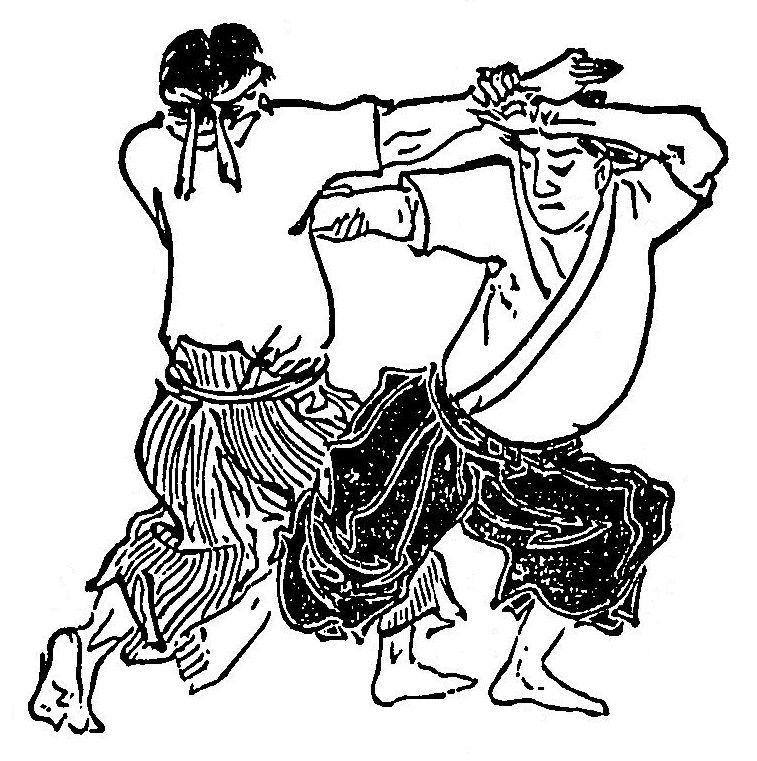

*Illustrazione storica del Tenjin Shinyō-ryū, una delle due scuole studiate da Kanō (immagine di pubblico dominio)*

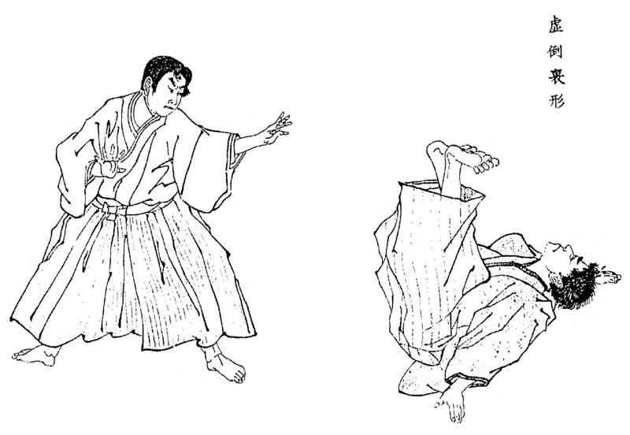

*Il Kitō-ryū jūjutsu: la tecnica kodaore (foto: Arai Tomosada, CC0)*

Per comprendere la nascita del judo bisogna partire dal tramonto di un mondo. Con la Restaurazione Meiji (1868) il Giappone abbandona in pochi decenni l'ordinamento feudale: il ceto dei samurai (*bushi*, 武士) perde status, stipendi e infine — con l'editto *haitōrei* del 1876 — il diritto stesso di portare la spada. La rivolta di Satsuma del 1877 segna militarmente la fine della classe guerriera. In un Paese che si dota di ferrovie, esercito di leva e fucili, le arti marziali classiche (*koryū bujutsu*, 古流武術) perdono la loro ragion d'essere pratica e cadono in discredito. Molte scuole sopravvivono solo organizzando spettacoli a pagamento, talvolta incontri truccati tra praticanti di jūjutsu e lottatori di sumō: una vera e propria "prostituazione delle arti marziali", che Kanō Jigorō citerà fra le ragioni per cui rifiutò il nome *jūjutsu* per il suo metodo. Negli anni Settanta dell'Ottocento l'arte era considerata "in via di estinzione": quando il medico tedesco Erwin Baelz propose di introdurre l'educazione fisica nelle scuole, gli fu risposto che il jūjutsu sarebbe stato un ottimo metodo di esercizio — peccato fosse caduto completamente in disuso.

Il jūjutsu (柔術), va detto, non era un'arte unica ma un nome ombrello per centinaia di scuole (*ryū*, 流), con repertori assai diversi: leve, proiezioni, strangolamenti, percosse, uso di piccole armi. Tecniche troppo pericolose per la pratica libera, trasmesse quasi esclusivamente attraverso i *kata* (形), le forme codificate. Due di queste scuole furono decisive per il giovane Kanō.

La prima fu il **Tenjin Shinyō-ryū (天神真楊流)**, fondato nell'Ottocento da Iso Mataemon e specializzato negli *atemi-waza* (tecniche di percossa) e nel *katame-waza*, il combattimento di controllo al suolo. Kanō lo apprese tra il 1877 e il 1878 sotto Fukuda Hachinosuke e poi Iso Masatomo.

La seconda fu il **Kitō-ryū (起倒流)**, scuola del XVII secolo, specializzata in *nage-waza* (proiezioni) e nella pratica del *randori* (乱取り), l'esercizio libero. Kanō lo studiò sotto Iikubo Tsunetoshi, dal quale ricevette il diploma di trasmissione completa (*menkyo kaiden*). «Il Kitō era molto diverso dal Tenjin Shinyō», riferì lo stesso fondatore: «comprendeva una vasta gamma di efficaci tecniche di proiezione, con proiezioni di sacrificio, proiezioni di piede e di anca che non avevo mai visto» (Kanō, *Judo Memoirs*).

Perché Kanō cercò un maestro di jūjutsu? La risposta ufficiale della IJF è disarmante nella sua semplicità: piccolo di statura e vittima dei soprusi dei compagni, il diciassettenne Jigorō — che nel 1877 entrava all'Università Imperiale di Tokyo — voleva irrobustire il corpo e imparare a difendersi. Ma dalla pratica ricavò presto una convinzione più profonda: i maestri che frequentava presentavano l'arte come una mera collezione di tecniche, e «nessuno percepiva il principio guida del jūjutsu». Kanō cercò allora il principio sotteso a ogni azione — «che si applicasse sia nel colpire sia nel proiettare» — e lo individuò nell'**uso più efficiente dell'energia fisica e mentale**. Era già, in nuce, il judo.

## 1.2 Kanō Jigorō e la fondazione del Kōdōkan (1882)

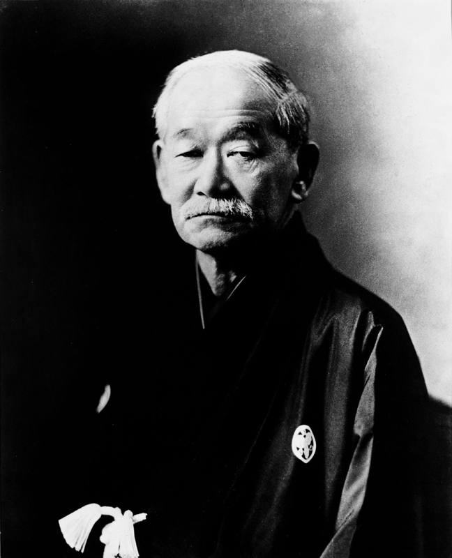

*Kanō Jigorō (1860-1938), fondatore del judo Kōdōkan (foto d’epoca, pubblico dominio)*

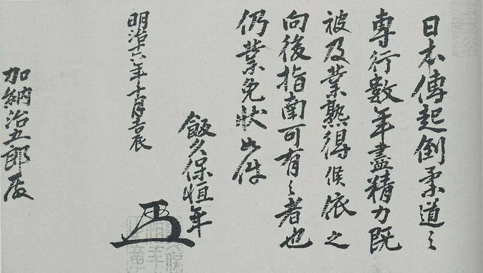

*Il diploma (menjo) di Kitō-ryū conseguito da Kanō (pubblico dominio)*

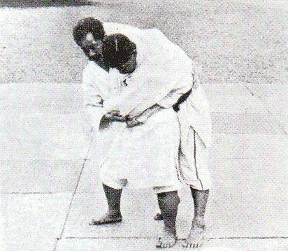

*Kanō (a sinistra) esegue uki-goshi su Yamashita Yoshiaki nel Nage-no-kata (foto d’epoca, pubblico dominio)*

Kanō Jigorō (嘉納治五郎) nacque il 28 ottobre 1860 a Mikage, presso Kobe, e morì il 4 maggio 1938, a bordo del piroscafo *Hikawa Maru*, di ritorno dalla sessione del Comitato Internazionale Olimpico al Cairo in cui aveva ottenuto per Tokyo l'assegnazione delle Olimpiadi del 1940. Si laureò nel 1881 in letteratura, scienze politiche ed economia, parlava fluentemente inglese, e fu — questo è il punto decisivo per capire la sua opera — **un educatore di professione**: preside per oltre due decenni della Scuola Normale Superiore di Tokyo, insegnante alla Gakushūin, la scuola dei Pari, e tra i fondatori dell'educazione fisica moderna giapponese. Nel 1911 il judo entrò nei programmi scolastici nazionali. Non fu dunque un "campione" che fondò una scuola di combattimento, ma un pedagogista che costruì un metodo educativo servendosi del patrimonio tecnico del jūjutsu.

Nel maggio 1882, a 21-22 anni, Kanō fondò la sua scuola in un locale del tempio buddhista **Eishō-ji (永昌寺)**, nel quartiere di Shitaya a Tokyo: una sala di **dodici tatami con nove allievi** (fonte: IJF). Il nome scelto, Kōdōkan (講道館), significa «luogo dove si studia la Via»: *kō*, studio; *dō*, via; *kan*, edificio.

Anche la scelta della parola *jūdō* (柔道) fu un gesto programmatico. Kanō sostituì *dō* (道, "via", cammino di perfezionamento) a *jutsu* (術, "tecnica") per due ragioni dichiarate: molte scuole di jūjutsu usavano pratiche violente e gli allievi anziani maltrattavano i più giovani, sicché l'arte era considerata roba da attaccabrighe; e la reputazione del jūjutsu era ormai compromessa dagli spettacoli a pagamento. «Volevo mostrare che ciò che insegnavo non era pericoloso… e che era "judo", una cosa completamente diversa» (Kanō). Onestà storiografica impone una precisazione: Kanō non fu il primo a usare il termine — la scuola Jikishin-ryū si definiva *jūdō* già nel Settecento — e per questo parlava sempre di "Kōdōkan jūdō". Negli statuti del 1884 la definizione è limpida: «Raccogliendo tutti i meriti che ho acquisito dalle varie scuole di jūjutsu e aggiungendo le mie invenzioni, ho fondato un nuovo sistema per la cultura fisica, l'allenamento mentale e la vittoria nei combattimenti. Questo io chiamo Kōdōkan Jūdō».

Le innovazioni metodologiche furono coerenti con quel programma: eliminazione delle tecniche pericolose (le percosse sopravvissero solo nei kata); sistemazione delle cadute (*ukemi*, 受身); adozione del judogi come superficie di presa; formalizzazione della sequenza **kuzushi–tsukuri–kake** (squilibrio–inserimento–esecuzione); pratica del randori a piena forza ma senza infortuni, affiancato al kata come deposito della tradizione. Sul piano della classificazione, nel **1895** Kanō e i suoi allievi più anziani codificarono il primo syllabus didattico di proiezioni, il *Gokyō no waza* (五教の技) di 42 tecniche, revisionato nel **1920** nelle 40 tecniche del nuovo Gokyō, ordinate anzitutto in funzione della sicurezza delle cadute del principiante. Il syllabus sarebbe stato ampliato molto più tardi con le categorie *habukareta-waza* e *shinmeisho no waza* (新名称の技) del **1982 e del 2017**, fino alle 67-68 proiezioni ufficiali odierne (fonte: De Crée, *Revista de Artes Marciales Asiáticas*).

Nel **1883** Kanō introdusse il sistema dei gradi *dan/kyū*, mutuato dai gradi del gioco del go, promuovendo **Tomita Tsunejirō (富田常次郎) e Saigō Shirō (西郷四郎)** a primo dan: i primi cintura nera della storia. Per mantenere la scuola, nei primi anni, Kanō accettava persino traduzioni dall'inglese: la fotografia che lo ritrae nel Nage-no-kata mentre proietta in *uki-goshi* il gigante Yamashita Yoshitsugu (noto anche come Yoshiaki) dice più di ogni ritratto ufficiale che cosa significasse, per un uomo minuto come lui, il principio della cedevolezza.

## 1.3 La consacrazione: i tornei di Polizia e la diffusione in Giappone

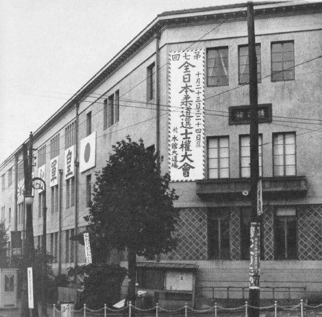

*Il Kōdōkan nel 1937 (pubblico dominio, Kodansha)*

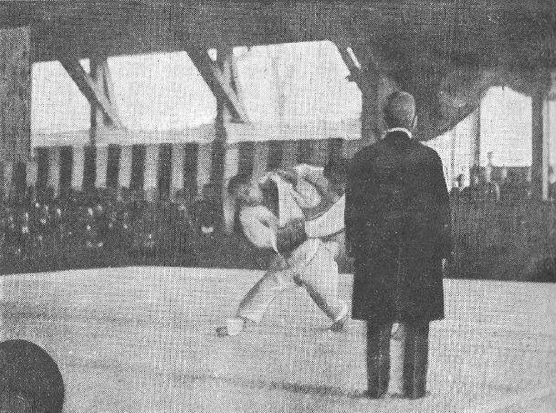

*La finale dello Shōwa Tenran Jiai del 1929 (pubblico dominio, Kodansha)*

Verso la metà degli anni Ottanta la rivalità tra il piccolo Kōdōkan e le scuole tradizionali — in particolare la **Totsuka-ha Yōshin-ryū** di Totsuka Hikosuke, adottata dalla polizia — sfociò in tornei organizzati sotto l'egida del Capo della Polizia Metropolitana di Tokyo. È **fatto documentato**, riferito dallo stesso Kanō: «Ciascuna scuola mandò 15 uomini scelti; il Kōdōkan vinse tutti gli incontri eccetto due, finiti in parità. Quella brillante vittoria stabilì una volta per tutte la supremazia del Kōdōkan Jūdō». La data più accreditata è il **1886**; secondo Koizumi Gunji il punteggio finale fu di nove vittorie e una parità. Le fonti divergono sui particolari, «il che conferisce a questi tornei un carattere quasi mitico», ma che il Kōdōkan sia stato il vincitore schiacciante è indiscutibile (USJJF, *Early History of Ju-Jitsu*).

Va invece segnalato come **tradizione** l'episodio più famoso: Saigō Shirō che sconfigge Terushima Tarō con la tecnica leggendaria **yama-arashi (山嵐, "tempesta di montagna")**. Lo *yama-arashi* non è mai entrato nella nomenclatura ufficiale del Kōdōkan — è stato assimilato a *seoi-nage* o *tai-otoshi* — e il romanzo *Sugata Sanshirō* (1942-43) di Tomita Tsuneo, figlio di Tomita Tsunejirō, da cui Kurosawa trasse il film del 1943, ha definitivamente mitizzato la figura di Saigō. I quattro campioni di quella stagione — Tomita, Saigō, Yokoyama Sakujirō e Yamashita Yoshitsugu — passarono alla storia come i Quattro Re Celesti (*shitennō*, 四天王).

La conseguenza pratica fu decisiva: la polizia adottò il judo e il prestigio del Kōdōkan crebbe enormemente. Nel 1922 Kanō fondò la Società Culturale del Kōdōkan e fissò le due massime ufficiali del metodo — *Seiryoku Zenyō* (精力善用, "il miglior impiego dell'energia") e *Jita Kyōei* (自他共栄, "mutuo benessere e prosperità") —; nel 1923 aprì la sezione femminile, guidata da valori tecnici e kata, senza competizione (fonte: IJF). Il judo divenne ormai istituzione nazionale: la fotografia del Kōdōkan nel 1937 mostra un edificio che nulla ha più della stanzetta di dodici tatami dell'Eishō-ji.

Nel dopoguerra, dopo la sospensione del budō imposta dalle autorità di occupazione, la ripresa agonistica giapponese riprese il **2 maggio 1948** con il primo Campionato nazionale individuale del dopoguerra, vinto da Matsumoto Yasuichi; l'anno seguente l'Associazione dei Dan del Kōdōkan si trasformò nella All Japan Judo Federation, presieduta da Kanō Risei, figlio di Jigorō. Le grandi kermesse interne — come lo Shōwa Tenran Jiai, disputato alla presenza dell'imperatore — testimoniano l'ormai piena centralità del judo nella cultura sportiva del Paese.

## 1.4 Dal Giappone al mondo: missioni, Olimpiadi, IJF

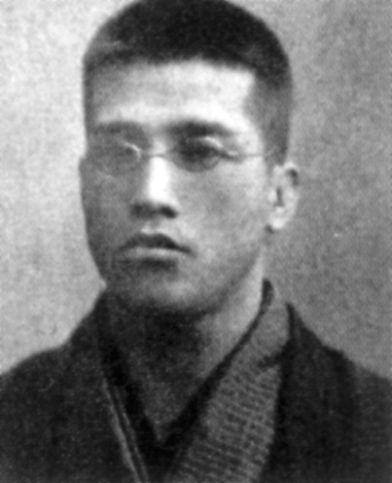

*Yamashita Yoshiaki, tra i primi maestri a portare il judo negli Stati Uniti (pubblico dominio)*

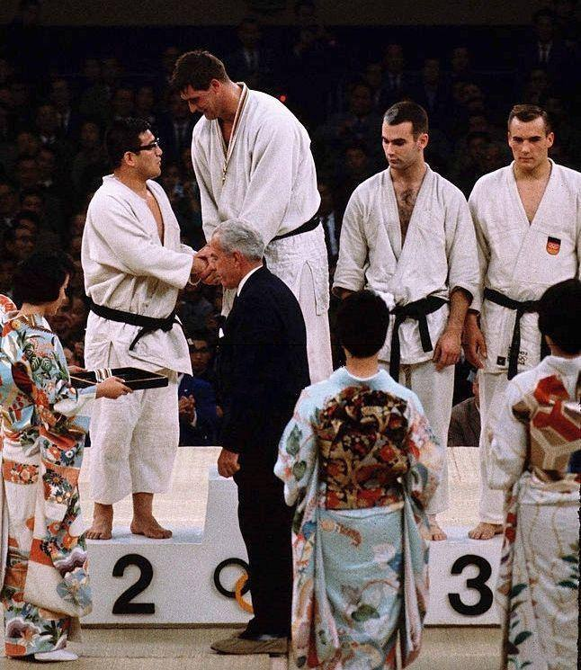

*Il podio della finale olimpica di Tokyo 1964: Kaminaga, Geesink, Boronovskis e Glahn (pubblico dominio, Giappone)*

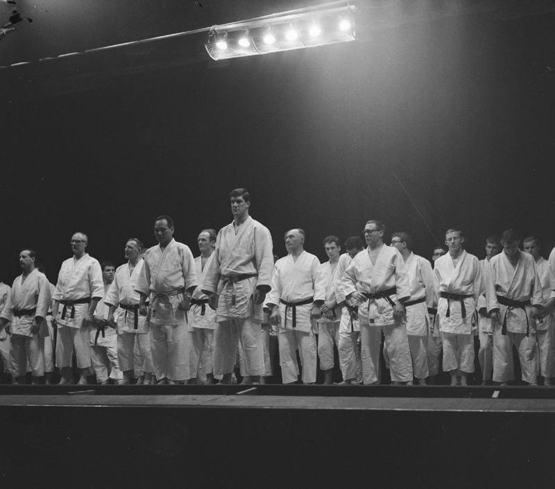

*Anton Geesink, il primo campione olimpico non giapponese (foto: Jack de Nijs / Anefo, CC0)*

Kanō viaggiò per la prima volta in Europa nel **1889**, per studiarne i sistemi educativi, e non smise più. Nel **1909** fu cooptato nel Comitato Internazionale Olimpico, primo membro asiatico della sua storia; nel 1938 ottenne per Tokyo i Giochi del 1940 — con il judo previsto come sport dimostrativo — che la guerra avrebbe annullato. Accanto a lui lavorò una generazione straordinaria di maestri-missionari.

Negli **Stati Uniti** sbarcò nel 1903 Yamashita Yoshitsugu: dalla sua esibizione a Seattle nacque il più antico dojo americano; tra il 1904 e il 1906 insegnò a Washington, anche alla Casa Bianca al presidente Theodore Roosevelt, e alla U.S. Naval Academy di Annapolis. Tomita Tsunejirō aprì un club a Broadway nel 1905, dichiarando alla stampa: «Il ju-jitsu è un'arte quasi estinta, e selvaggia, che è meglio sia estinta. La vera arte della difesa è il ju-do».

In **Europa** la testa di ponte fu Londra: Tani Yukio vi giunse nel 1899, Koizumi Gunji nel 1906; il 26 gennaio **1918** Koizumi fondò il Budokwai, il più antico club di judo fuori dal Giappone, che nel 1920 — in occasione di una visita di Kanō — divenne formalmente base europea del Kōdōkan. In Francia si stabilì nel 1935 Kawaishi Mikinosuke, la cui "Méthode Kawaishi" occidentalizzò l'insegnamento e rese popolare il sistema delle **cinture colorate**, elaborato in Inghilterra a metà degli anni Venti e approvato da Kanō nel 1938 (fonte: IJF). In **Brasile**, dal 1914, Maeda Mitsuyo — il "Conde Koma" — insegnò a Carlos Gracie: da quel tronco di judo Kōdōkan, ricco di lotta al suolo, sarebbe nato per evoluzione il Brazilian Jiu-Jitsu.

Sul piano istituzionale: la **EJU** (European Judo Union) fu rifondata a Londra il **28 luglio 1948**; la **IJF** (International Judo Federation) nacque a Londra l'**11-12 luglio 1951**, trasformando il congresso europeo in congresso mondiale, con primo presidente l'italiano **Aldo Torti**, cui succedette nel 1952 Kanō Risei. I primi Campionati del Mondo si tennero a Tokyo nel **1956**.

Il riconoscimento supremo arrivò con le Olimpiadi: ammesso al programma nella sessione CIO di Roma dell'agosto 1960, il judo maschile esordì a **Tokyo 1964**. Ed è qui che la storia regala una delle sue pagine più ricordate: nella categoria open l'olandese **Anton Geesink** sconfisse il giapponese Kaminaga Akio davanti al pubblico di casa. Fu, per dirla con le cronache dell'epoca, uno choc per il Giappone — ma anche la dimostrazione che il judo era ormai uno sport universale, come Kanō aveva voluto. Assente a Città del Messico 1968, il judo fu definitivamente in programma da Monaco 1972; il **judo femminile** fu sport dimostrativo a Seul 1988 e divenne olimpico ufficiale a **Barcellona 1992**.

## 1.5 Il judo in Italia e la nascita della FIJLKAM

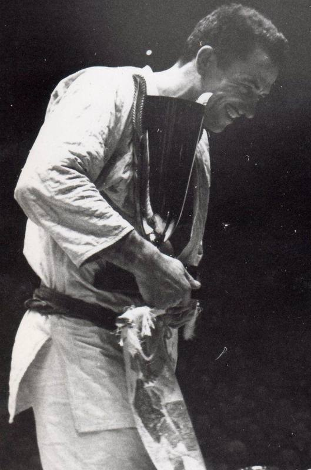

*Mikinosuke Kawaishi agli Europei del 1951, introduttore delle cinture colorate in Europa (foto: Al2h, CC BY-SA 3.0)*

La storia italiana del judo — documentata dalla stessa FIJLKAM — inizia in mare: nel **1906** il Ministro della Marina Mirabello fece stipulare un contratto con un maestro giapponese per un corso di jūjutsu a bordo dell'incrociatore **Marco Polo**, in acque cinesi. Il **30 maggio 1908**, a Villa Corsini a Roma, due sottufficiali di Marina eseguirono la prima dimostrazione pubblica di jūjutsu fatta da italiani, replicata poi al Quirinale per Vittorio Emanuele III.

Il **30 marzo 1924** ventotto società fondarono a Roma la **Federazione Jiu-Jitsuista Italiana (FJJI)**, il cui regolamento riconosceva «quale metodo ufficiale… il metodo Kano»; il 20-21 giugno dello stesso anno si disputò il **primo campionato italiano**. Nel 1927 la FJJI divenne Federazione Italiana Lotta Giapponese, e nel luglio 1928 **Kanō Jigorō in persona** intervenne a Roma a una manifestazione della federazione, di ritorno dalle Olimpiadi di Amsterdam. Sciolta nel 1931 e assorbita dalla Federazione Atletica, la disciplina riprese nel dopoguerra: primo campionato a Lanciano nel maggio 1948 e, da ottobre, Gruppo Autonomo Lotta Giapponese (poi Gruppo Autonomo Judo) presieduto da Aldo Torti — lo stesso che avrebbe presieduto EJU e IJF: l'Italia fu protagonista, e non comprimaria, della rinascita internazionale. L'arrivo dei maestri giapponesi Ōtani (1953) e Koike (1956) diede l'impulso tecnico decisivo; di quella stagione europea resta iconica la figura di Kawaishi, introduttore delle cinture colorate nel nostro continente.

La vicenda delle denominazioni federali va memorizzata con precisione, perché è classico oggetto d'esame. La federazione da cui discende l'attuale FIJLKAM nacque a Milano nel **1902** come federazione di lotta e pesistica (per questo il centenario fu celebrato nel 2002); nel **1930** prese il nome di Federazione Italiana Atletica Pesante (FIAP); nel **1974** divenne **FILPJ** (Federazione Italiana Lotta Pesi Judo); con l'ingresso del karate come quarto settore, dal **1995** fu **FILPJK**; infine, il **1° luglio 2000**, separandosi dalla pesistica, nacque la **FIJLKAM — Federazione Italiana Judo Lotta Karate Arti Marziali**. Nel 1992 il solo settore Judo contava 1.187 società e oltre 64.000 tesserati, e oggi la Federazione è stabilmente tra le prime FSN italiane per tesseramenti; il Centro Olimpico "Matteo Pellicone" di Ostia è la casa del judo italiano.

Chiudiamo con il palmarès olimpico, che ogni cintura nera italiana dovrebbe conoscere: **19 medaglie**, di cui **5 ori**. Gli ori portano i nomi di **Ezio Gamba** (Mosca 1980), **Pino Maddaloni** (Sydney 2000), **Giulia Quintavalle** (Pechino 2008), **Fabio Basile** (Rio 2016) e **Alice Bellandi** (Parigi 2024). La prima medaglia in assoluto fu il bronzo di Felice Mariani a Montreal 1976. Dal corso sull'incrociatore Marco Polo al trionfo di Parigi sono passati centodiciotto anni: un arco che inizia con due sottufficiali di Marina che si inchiodano a terra a Villa Corsini e finisce con un'atleta italiana sul tetto del mondo. È la misura concreta di che cosa è diventato, in un secolo e mezzo, il metodo nato in dodici tatami di un tempio di Tokyo.
