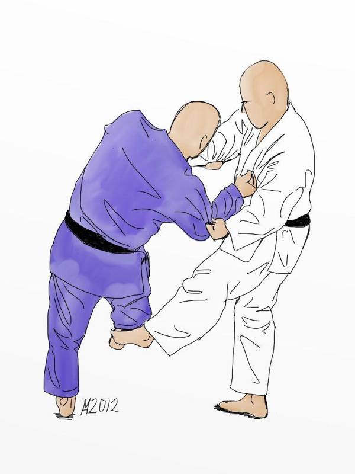
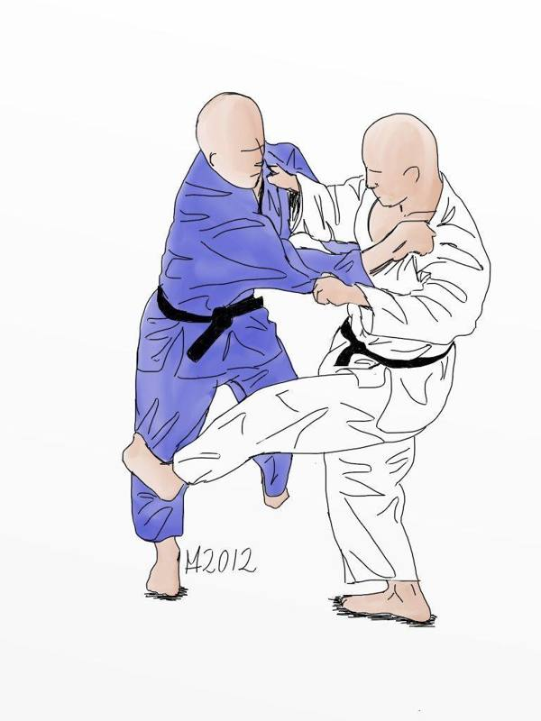
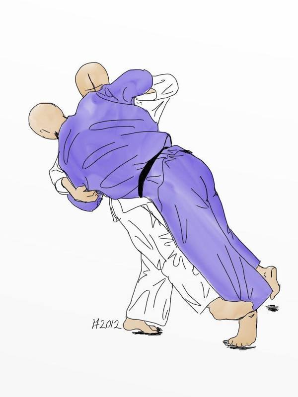
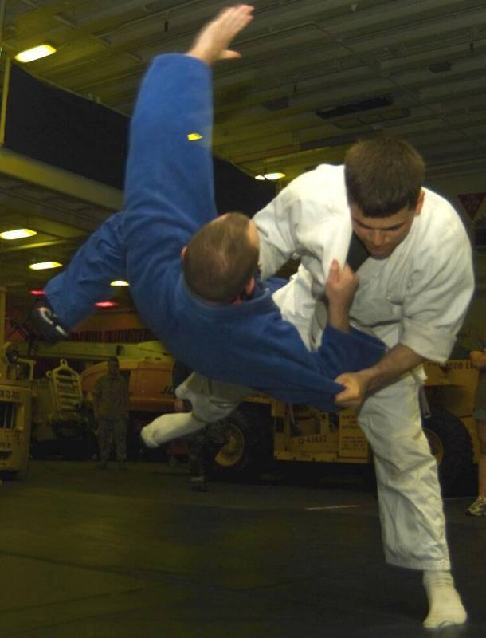
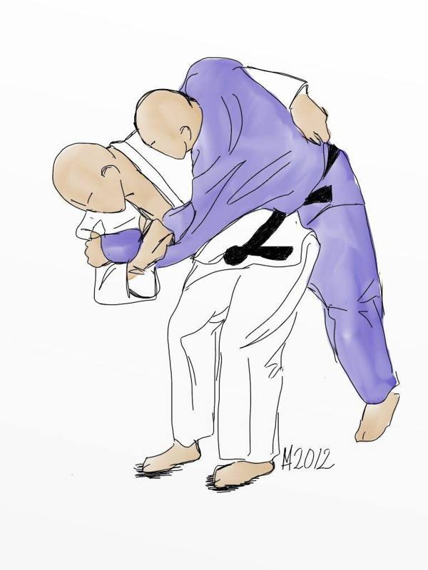
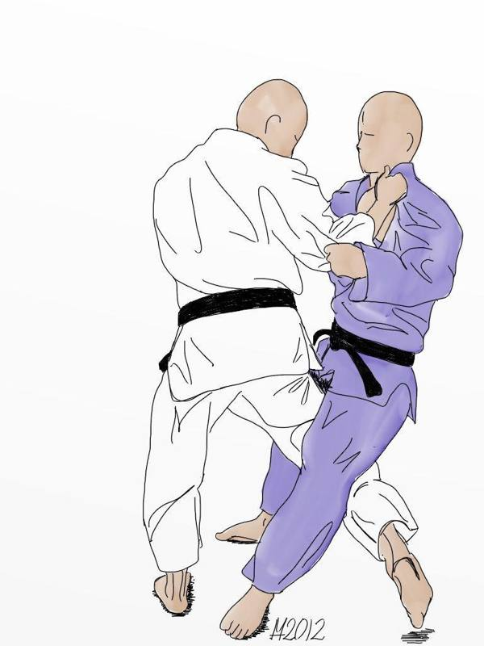
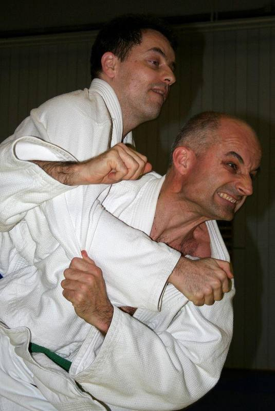
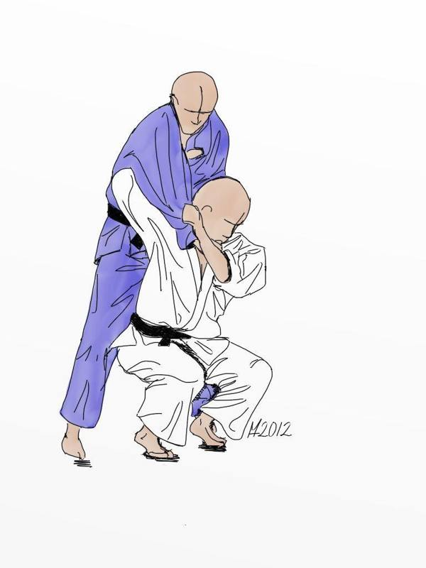

# 5. Gokyo Dai-ikkyō — il primo gruppo

Il *Gokyō no waza* (五教の技, «le cinque serie di principi tecnici») è il sistema con cui il Kōdōkan ordinò didatticamente le proiezioni fondamentali del judo. Stipulato nel **1895** con 42 tecniche, fu rivisto nel **1920** in 40 tecniche, otto per ciascuno dei cinque gruppi, secondo una logica sequenziale: ogni movimento prepara il successivo o ne è la contro-tecnica, e i gruppi procedono per difficoltà crescente di esecuzione e per durezza della caduta. Il *Dai-ikkyō* (第一教, primo gruppo) insegna i fondamenti: le spazzate di tempismo, la rotazione attorno a un fulcro fisso, le falciate dirette, il primo caricamento sull'anca e la prima proiezione di braccia.

Due annotazioni storiche essenziali per l'esame. Nella revisione del 1920 **de-ashi-barai sostituì hiza-guruma come tecnica d'apertura** del gruppo: la caduta «scivolata» di de-ashi-barai era ritenuta più sicura e formativa per il principiante. E l'*uki-goshi* (浮腰) era il *tokui-waza* (得意技, tecnica prediletta) del fondatore **Kanō Jigorō**: proprio dalla fuga di Shiro Saigō — che saltava in avanti liberando la gamba dall'anca di Kanō — nacque per adattamento del fondatore lo *harai-goshi*, che studieremo nel capitolo del Dai-nikyō.

Ogni tecnica va analizzata nelle tre fasi canoniche: *kuzushi* (崩し, rottura dell'equilibrio), *tsukuri* (作り, costruzione dell'entrata) e *kake* (掛け, esecuzione). Kuzushi e tsukuri non sono movimenti separati ma due aspetti dello stesso gesto. Convenzione adottata: *tori* esegue a destra, con presa standard da *shizentai* (mano destra al bavero = *tsurite*, mano sinistra alla manica = *hikite*), e le direzioni di squilibrio seguono lo schema *happō-no-kuzushi* (八方の崩し, le otto direzioni).

## 5.1 De-ashi-barai (出足払)

*De-ashi-barai: la falciata sul piede avanzato (illustrazione: M. Hultström, CC BY-SA 3.0)*

**Nome e origine.** *De* 出 (che esce, che avanza) + *ashi* 足 (piede) + *barai/harai* 払 (spazzare): «spazzata del piede che avanza». Famiglia: *ashi-waza* (足技, tecniche di gambe e piedi). Presente fin dal primo Gokyo del 1895; dal 1920 è la tecnica d'apertura del gruppo, in sostituzione di hiza-guruma. È considerata la tecnica-base per l'apprendimento del *debana* (momento-opportunità) e del timing, pur essendo tra le più difficili da applicare nel *randori* di alto livello.

**Il principio.** Il kuzushi è laterale e circolare, verso il punto in cui il piede di uke sta per appoggiare o ha appena appoggiato senza ancora caricare il peso. Nel tsukuri tori resta fuori dalla linea d'attacco, ruotando il busto e tirando con entrambe le mani nella direzione della spazzata. Nel kake la pianta del piede di tori, con la punta rivolta all'interno, colpisce tallone/caviglia di uke con un movimento arcuato. Il fulcro non è un punto fisso ma l'istante di «vuoto di carico» del piede avversario; il vettore di caduta è laterale-posteriore. Il segreto meccanico è spazzare il piede mentre è in fase di trasferimento del peso: leggero, «galleggiante».

**Esecuzione da fermo.**

1. Presa standard; si induce uke ad avanzare il piede destro.
2. Al passo di uke, l'hikite tira la manica verso il fianco sinistro e la tsurite solleva il bavero in direzione circolare: kuzushi verso il lato destro di uke.
3. Il piede sinistro di tori spazza con la pianta la caviglia/tallone destro di uke nell'istante in cui tocca terra senza carico.
4. Tori accompagna la rotazione del busto a sinistra, proiettando uke su un fianco, con *zanshin*.

**Esecuzione in movimento.** È la tecnica per antonomasia in movimento: si applica sul passo avanti, sul passo indietro (spazzando il piede che arretra) e sul passo laterale. Il timing è tutto: spazzare troppo presto, col piede ancora in aria e dotato di slancio, o troppo tardi, col piede già caricato, annulla la tecnica. In *tsugi-ashi* si spazza il piede che segue; in *ayumi-ashi* il piede che incrocia.

**Varianti.** Spazzata del piede avanzato o del piede d'appoggio; forma incrociata (destra su piede sinistro); combinazione classica de-ashi-barai → o-soto-gari. Contro-tecnica canonica: *tsubame-gaeshi*.

**Errori comuni.** (1) Colpire con la gamba rigida anziché con la pianta in arco («calcio» invece di spazzata); (2) spazzare quando il peso è già sul piede bersaglio; (3) trascurare l'azione delle mani, che da sole possono proiettare se il timing è corretto.

## 5.2 Hiza-guruma (膝車)

*Hiza-guruma: la ruota sul ginocchio (illustrazione: M. Hultström, CC BY-SA 3.0)*

**Nome e origine.** *Hiza* 膝 (ginocchio) + *guruma* 車 (ruota): «ruota del ginocchio». Famiglia: ashi-waza. Era la **prima tecnica del Gokyo originale del 1895**; nel 1920 cedette l'apertura a de-ashi-barai. È la prima ashi-waza del *Nage-no-kata* e appartiene alle proiezioni «di rotazione», meccanicamente affine a sasae-tsurikomi-ashi.

**Il principio.** Kuzushi verso l'angolo anteriore destro di uke, in diagonale e rotatorio. Tsukuri: tori arretra il piede sinistro e ruota il busto a sinistra, portando uke a sbilanciarsi in avanti-lateralmente. Kake: la pianta del piede destro di tori si applica contro l'esterno del ginocchio destro di uke, appena sotto la rotula, fungendo da perno. Il fulcro è il ginocchio bloccato; il vettore è una rotazione di uke attorno a quel perno, con caduta in avanti-laterale. Mani e piede agiscono come le due estremità di una ruota che gira di 180°.

**Esecuzione da fermo.**

1. Presa standard; si induce uke a caricare il piede destro avanzato.
2. Tori indietreggia col sinistro, tirando la manica in basso-rotazione e sollevando il bavero: kuzushi all'angolo anteriore destro.
3. La pianta del piede destro si posa sull'esterno del ginocchio destro di uke.
4. Rotazione completa del busto a sinistra: uke ruota attorno al ginocchio bloccato e cade in avanti.

**Esecuzione in movimento.** Efficace quando uke avanza il piede destro o quando, spinto all'indietro, reagisce raddrizzando il ginocchio; si applica anche sul passo laterale, «catturando» il ginocchio nel momento del caricamento. Il tempismo segue la logica di sasae: il ginocchio deve essere teso e caricato, altrimenti non esiste fulcro.

**Varianti.** Applicazione al ginocchio interno (rara); entrata con salto del piede di blocco; impiego come contropiede su attacchi in avanti. Combinazioni classiche: hiza-guruma → uchi-mata, → hane-goshi.

**Errori comuni.** (1) Premere il ginocchio quando è flesso; (2) bloccare la rotula frontalmente invece che lateralmente, perdendo la rotazione; (3) dimenticare la trazione rotatoria delle mani, riducendo la tecnica a uno sgambetto.

## 5.3 Sasae-tsurikomi-ashi (支釣込足)

*Sasae-tsurikomi-ashi: il blocco del piede in avanzata (illustrazione: M. Hultström, CC BY-SA 3.0)*

**Nome e origine.** *Sasae* 支 (sostenere, bloccare) + *tsuri* 釣 (sollevare) + *komi* 込 (tirare dentro) + *ashi* 足: «blocco del piede sollevando-tirando». Famiglia: ashi-waza. Presente fin dal primo Gokyo del 1895; è la prima tecnica del gruppo in cui il piede di tori tocca realmente uke e fa parte del Nage-no-kata. Fu tecnica prediletta di **Anton Geesink** (oro olimpico 1964) e di **Wilhelm Ruska** (doppio oro 1972).

**Il principio.** Kuzushi all'angolo anteriore destro, ottenuto da un'azione di sollevamento (*tsuri-komi*) prima che di blocco: le mani portano uke sulle punte, poi la pianta del piede destro blocca la caviglia o lo stinco basso di uke creando un perno fisso. Il fulcro è la caviglia ancorata; il vettore è rotatorio in avanti-laterale: uke «inciampa in alto» sul proprio piede vincolato. A differenza di de-ashi-barai, il piede non viene rimosso ma **ancorato**.

**Esecuzione da fermo.**

1. Presa standard; si induce uke ad avanzare il piede destro.
2. Tori tira in alto e in avanti con entrambe le mani (azione tsuri-komi), portando uke sulle punte.
3. Il piede destro blocca la caviglia destra di uke: pianta contro malleolo/stinco basso, mai sul ginocchio.
4. Tori si inclina all'indietro ruotando il busto a sinistra e tirando la manica: uke cade oltre il punto di blocco.

**Esecuzione in movimento.** Il momento ideale è quando uke avanza o spinge in avanti (azione-reazione); ci si adatta anche al passo laterale bloccando il piede d'arrivo. La coordinazione «solleva-poi-blocca» è prioritaria rispetto alla forza: invertire la sequenza equivale a rinunciare al kuzushi.

**Varianti.** Entrata diretta o con passo incrociato; esecuzione contro avversario in *jigotai* che spinge; combinazioni classiche sasae → o-soto-gari, → harai-goshi, → tai-otoshi. Contro-tipiche: o-uchi-gari, ko-uchi-gari.

**Errori comuni.** (1) «Scalciare» la gamba invece di appoggiare la pianta come fermo; (2) bloccare troppo in alto, al ginocchio, perdendo la leva; (3) bloccare prima del sollevamento delle mani, invertendo la sequenza kuzushi → tsukuri.

## 5.4 Uki-goshi (浮腰)

**Nome e origine.** *Uki* 浮 (fluttuante, galleggiante) + *goshi* 腰 (anca, vita): «anca fluttuante». Famiglia: *koshi-waza* (腰技, tecniche d'anca). Tra le tecniche storiche più documentate: discende dallo *yoroi kumi-uchi*, la lotta in armatura dei guerrieri medievali, ed era il **tokui-waza di Kanō Jigorō**, che la eseguiva a sinistra. È la prima koshi-waza del Nage-no-kata. Proprio dalla difesa di Shiro Saigō contro questa tecnica Kanō elaborò lo harai-goshi, come vedremo nel Dai-nikyō.

**Il principio.** Kuzushi verso l'angolo anteriore destro. Tsukuri: tori gira di schiena inserendo l'anca destra contro l'addome di uke e avvolgendo il braccio destro attorno alla sua vita. Kake: **senza alzare l'anca né flettersi in avanti** — differenza chiave con o-goshi — tori ruota busto e anche a sinistra «facendo galleggiare» uke sull'anca e rovesciandolo. Il fulcro è il fianco destro di tori; il vettore è rotatorio in avanti. Meccanicamente è una proiezione di **torsione**, non di leva in altezza.

**Esecuzione da fermo.**

1. Presa standard; kuzushi in avanti-destro tirando la manica e sollevando il bavero.
2. Tori ruota sul piede sinistro entrando di schiena, anca destra contro il basso addome di uke; il braccio destro cinge profondamente la vita.
3. Le gambe restano relativamente distese: nessun abbassamento marcato.
4. Rotazione del busto e delle anche a sinistra con trazione della manica: uke fluttua e cade in avanti.

**Esecuzione in movimento.** Ideale quando uke avanza o spinge in avanti: è il contropiede naturale sulla pressione frontale. L'entrata a giro si adatta al passo avanti di uke sfruttandone l'inerzia; può anche discendere da una finta di koshi-waza più profonda.

**Varianti.** Entrata con passo singolo o con giro completo (*mawari-komi*); uki-goshi «alta» come finta verso harai-goshi. Contro-tecnica canonica: *ushiro-goshi*; efficaci anche o-goshi, utsuri-goshi, tani-otoshi.

**Errori comuni.** (1) Abbassare troppo l'anca, trasformandola in un o-goshi scorretto; (2) cingere la vita superficialmente (il braccio deve avvolgere il più possibile); (3) tirare con le sole braccia senza rotazione del busto.

## 5.5 O-soto-gari (大外刈)

*O-soto-gari in allenamento (foto: Cpl. Jeff Sisto, USMC, pubblico dominio)*

**Nome e origine.** *O* 大 (grande) + *soto* 外 (esterno) + *gari/kari* 刈 (falciare, mietere): «grande falciata esterna». Famiglia: ashi-waza. Presente fin dal primo Gokyo del 1895, con nomi antichi documentati: *Gyaku-gama*, *Kaeri-nage*, *Ke-kaeshi*. Tra i primi insegnamenti del Kōdōkan storico e tuttora tra le prime tecniche dei corsi base. Utilizzatori celebri: **Masahiko Kimura**, la cui o-soto-gari è studiata per la trazione verso il fianco e il bloccaggio totale della gamba, **Yasuhiro Yamashita** (in combinazione con o-uchi-gari), Anton Geesink, Wilhelm Ruska, Hitoshi Saito, Ingrid Berghmans, David Douillet. È la proiezione tipica dei judoka alti e pesanti.

**Il principio.** Kuzushi verso l'angolo **posteriore destro** di uke: tutto il peso deve caricare il tallone destro. Tsukuri: tori porta il piede sinistro accanto al piede destro di uke, allineando le spalle, petto contro petto. Kake: la gamba destra falciata all'indietro colpisce la parte posteriore della coscia/ginocchio destro di uke mentre il busto spinge in avanti e in basso: azione a **forbice di coppia** (busto avanti, gamba indietro). Il fulcro è la gamba falciante; il vettore è posteriore con rotazione.

**Esecuzione da fermo.**

1. Presa standard; kuzushi: si carica uke sul tallone destro con trazione del bavero e spinta circolare.
2. Tori avanza il piede sinistro a fianco del piede destro di uke, petto contro petto.
3. La gamba destra si slancia tra le gambe di uke e falcia energicamente all'indietro contro la sua coscia destra.
4. Spinta del busto in avanti e trazione della manica verso il basso: uke cade di schiena. Zanshin.

**Esecuzione in movimento.** Si applica quando uke indietreggia o quando il peso gli si sposta sul tallone, per esempio in reazione a una spinta; sul passo laterale si «insegue» il piede d'appoggio. È spesso l'arrivo di combinazioni da spazzate in avanti (de-ashi-barai → o-soto-gari).

**Varianti.** O-soto-gari «laterale» alla Kimura; *o-soto-otoshi* (si blocca la gamba calando la propria, senza falciata); *o-soto-guruma*; contropiede *o-soto-gaeshi*. Combinazioni: → harai-goshi, → o-uchi-gari, → okuri-ashi-barai.

**Errori comuni.** (1) Tirare uke lateralmente invece di caricarlo sul tallone; (2) falciare col piede invece che con tutta la gamba tesa; (3) restare distanti col busto, senza pressione antero-posteriore.

## 5.6 O-goshi (大腰)

*O-goshi: la grande proiezione d’anca (illustrazione: M. Hultström, CC BY-SA 3.0)*

**Nome e origine.** *O* 大 (grande) + *goshi* 腰: «grande anca». Famiglia: koshi-waza. Presente fin dal primo Gokyo del 1895; insieme a o-soto-gari è tradizionalmente tra le prime proiezioni insegnate nel Kōdōkan e nei corsi base di tutto il mondo, per la semplicità del concetto di «caricare l'avversario sull'anca».

**Il principio.** Kuzushi in avanti o all'angolo anteriore destro. Tsukuri: tori entra di schiena inserendo l'anca destra **in basso**, sotto il baricentro di uke, col braccio destro attorno alla vita. Kake: a differenza di uki-goshi, tori **solleva l'anca e si flette in avanti**, caricando uke sulla schiena e rovesciandolo con rotazione. Il fulcro è l'anca destra, perno di una leva di primo genere: l'anca sotto il baricentro di uke, le braccia applicano la forza, la rotazione scarica il carico. Il vettore è in avanti-alto e poi al suolo.

**Esecuzione da fermo.**

1. Presa standard; kuzushi in avanti-destro.
2. Tori ruota entrando di schiena, piedi davanti ai piedi di uke, ginocchia flesse, anca destra sotto l'addome di uke; il braccio destro cinge la vita.
3. Estensione delle gambe: l'anca solleva uke da terra.
4. Flessione del busto in avanti e trazione rotatoria delle mani: uke rovescia in avanti.

**Esecuzione in movimento.** Sfrutta uke che avanza o che alza il baricentro in reazione a una spinta; l'entrata a giro si sincronizza sul passo avanti. Nel randori funziona come tecnica «di incontro» contro la pressione frontale: più uke spinge, più il caricamento è rapido.

**Varianti.** Entrata *mawari* (giro completo) o a passo singolo; presa alla manica opposta; transizioni o-goshi → harai-goshi. Contropiedi tipici: yoko-guruma, ushiro-goshi, tani-otoshi.

**Errori comuni.** (1) Non abbassare l'anca sotto il baricentro di uke: carico impossibile; (2) confondersi con uki-goshi — in o-goshi l'anca **si alza**, in uki-goshi no; (3) cingere il braccio troppo alto, sulle costole, invece che sulla vita.

## 5.7 O-uchi-gari (大内刈)

*O-uchi-gari: la mietitura interna (illustrazione: M. Hultström, CC BY-SA 3.0)*

**Nome e origine.** *O* 大 + *uchi* 内 (interno) + *gari* 刈: «grande falciata interna». Famiglia: ashi-waza. Presente fin dal primo Gokyo del 1895. La letteratura tecnica la descrive come una «proiezione leggera», non un colpo di forza: ideale per avviare l'attacco e aprire la difesa di avversari chiusi. Utilizzatori celebri: **Yasuhiro Yamashita**, nella famosa combinazione con o-soto-gari, **Peter Seisenbacher** (doppio oro olimpico 1984-1988), Katsuhiko Kashiwazaki, Paul Maruyama. Risultò tra le tecniche più vincenti ai Mondiali 1999.

**Il principio.** Kuzushi verso l'angolo **posteriore sinistro** di uke (per l'attacco destro): si abbassa il proprio baricentro e si porta uke a caricare la gamba sinistra. Tsukuri: la gamba destra di tori si inserisce tra le gambe di uke. Kake: la gamba destra falcia circolarmente verso l'esterno-indietro l'interno della coscia/polpaccio sinistro di uke mentre le mani spingono-tirano nella direzione opposta: coppia di forze. Il fulcro è la gamba interna falciante; il vettore è posteriore con forte componente rotatoria verso il basso. La caratteristica è l'azione «a cucchiaio» della gamba, che **solleva e rovescia** la gamba caricata.

**Esecuzione da fermo.**

1. Presa standard; si porta uke a caricare il piede sinistro (kuzushi all'angolo posteriore sinistro).
2. Tori avanza tra le gambe di uke col piede destro, abbassandosi leggermente.
3. La gamba destra falcia l'interno della gamba sinistra di uke verso l'esterno e verso tori.
4. Spinta del busto e trazione della manica verso il basso: uke cade di schiena-fianco.

**Esecuzione in movimento.** Molto efficace quando uke indietreggia o allarga la base: si applica «inseguendo» il passo indietro, oppure come reazione a un suo avanzamento deviato. È l'innesco classico delle combinazioni di Yamashita: o-uchi-gari → o-soto-gari e viceversa.

**Varianti.** Forma diretta o «in tuffo»; *ko-uchi-gari* come versione minore; *o-uchi-gaeshi* come contro. Combinazioni documentate: → ko-uchi-gari, → uchi-mata, → tai-otoshi.

**Errori comuni.** (1) Falciare una gamba non caricata: nessun effetto; (2) usare solo la gamba senza la spinta del busto nella direzione opposta; (3) entrare troppo alti, senza abbassare il proprio baricentro sotto quello di uke.

## 5.8 Seoi-nage (背負投) e le varianti ippon e morote

*Esecuzione della tecnica (immagine di pubblico dominio / Wikimedia Commons)*

*Esecuzione della tecnica (immagine di pubblico dominio / Wikimedia Commons)*

**Nome e origine.** *Seoi* 背負 (portare sulla schiena) + *nage* 投 (proiezione). Famiglia: *te-waza* (手技, tecniche di braccia). Presente fin dal primo Gokyo del 1895; è la prima te-waza del Nage-no-kata. Varianti ufficiali Kōdōkan: **morote-seoi-nage** (両手背負投, «a due mani», forma base del Gokyo) e **ippon-seoi-nage** (一本背負投, «con un braccio», tecnica autonoma della lista delle 68); la presa al bavero sopra la spalla dà l'*eri-seoi-nage*. Specialisti celebri: **Isao Okano** (oro olimpico 1964), **Toshihiko Koga** (oro 1992, ippon-seoi «in piedi» con inserimento della gamba e presa all'ascella), **Hifumi Abe**, Kim Jae-bum e la scuola coreana. È tra le proiezioni più decisive delle categorie leggere; la *drop-seoi-nage* domina il livello olimpico moderno e i judoka di bassa statura risultano avvantaggiati nella velocità esecutiva.

**Il principio.** Kuzushi in avanti-alto: si «solleva» uke sulle punte tirando in alto-in avanti. Tsukuri: rotazione di 180° con la schiena contro il petto di uke, la cintura di tori **sotto** quella di uke, il/i braccio/i che vincolano il braccio destro di uke sopra o alla spalla. Kake: estensione delle gambe, flessione del busto in avanti e trazione delle braccia: leva a fulcro su spalla/schiena; il vettore è verticale, poi rotatorio in avanti. Le analisi biomeccaniche mostrano che il momento verticale nel tsukuri è il parametro discriminante.

**Esecuzione da fermo (morote-seoi-nage).**

1. Presa standard; trazione della manica in alto-avanti: uke si sbilancia sulle punte.
2. Tori ruota sul piede sinistro entrando di schiena; il braccio destro passa sotto l'ascella/sopra la spalla di uke mantenendo il bavero.
3. Piedi paralleli davanti a quelli di uke, ginocchia flesse, schiena aderente al suo petto.
4. Estensione delle gambe + flessione del busto + trazione delle braccia: uke ruota oltre la spalla e cade in avanti.

**Ippon-seoi-nage.** Il braccio destro di tori si aggancia all'interno del gomito/braccio destro di uke (o con presa all'ascella, alla Koga), mentre la mano sinistra controlla la manica; l'entrata può essere classica, a piedi uniti, o «con inserimento della gamba» destra profonda tra le gambe di uke, nello stile di Koga, Tchoullouyan ed Ebinuma.

**Esecuzione in movimento.** Si adatta a uke che avanza, che spinge o che alza il baricentro in reazione a una finta frontale, per esempio dopo una finta di o-uchi-gari; il tempismo ideale è l'istante in cui uke «restituisce» la spinta. Molto efficace sul passo avanti laterale, con entrata a giro rapida.

**Varianti.** Morote, ippon, eri-seoi-nage, *seoi-otoshi* (caduta in ginocchio, tecnica autonoma Kōdōkan), drop-seoi-nage, morote con presa incrociata, wide-split sleeve seoi.

**Errori comuni.** (1) Entrare con la schiena non aderente o la cintura troppo alta: uke non si carica; (2) piegare le ginocchia senza abbassare realmente il baricentro sotto quello di uke; (3) tirare il braccio di uke senza kuzushi in avanti, trasformando la tecnica in una lotta di forza.
