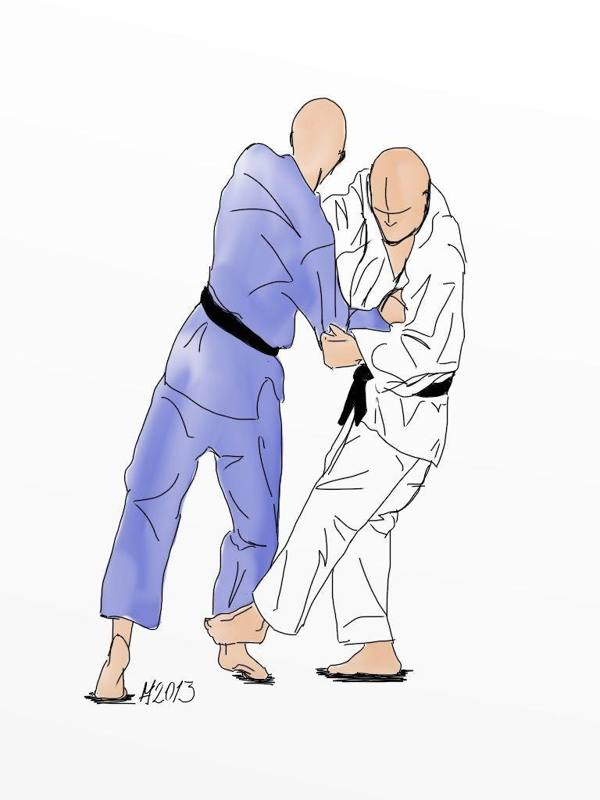
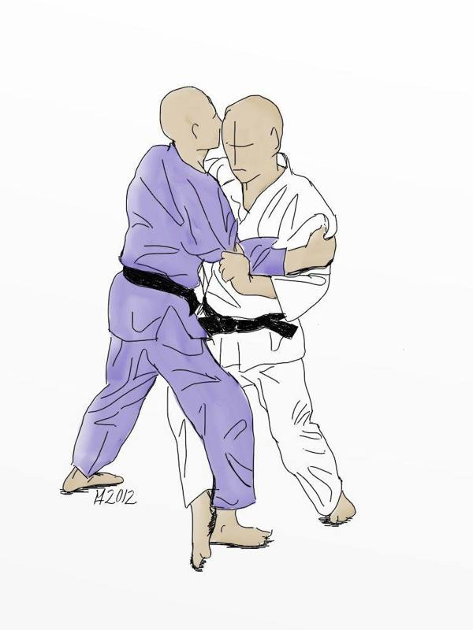
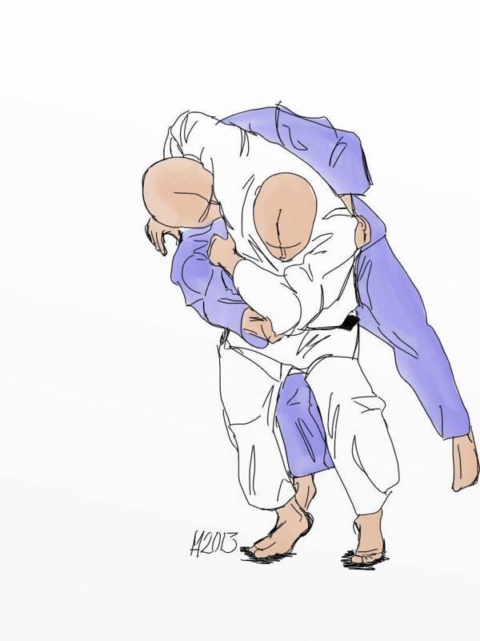
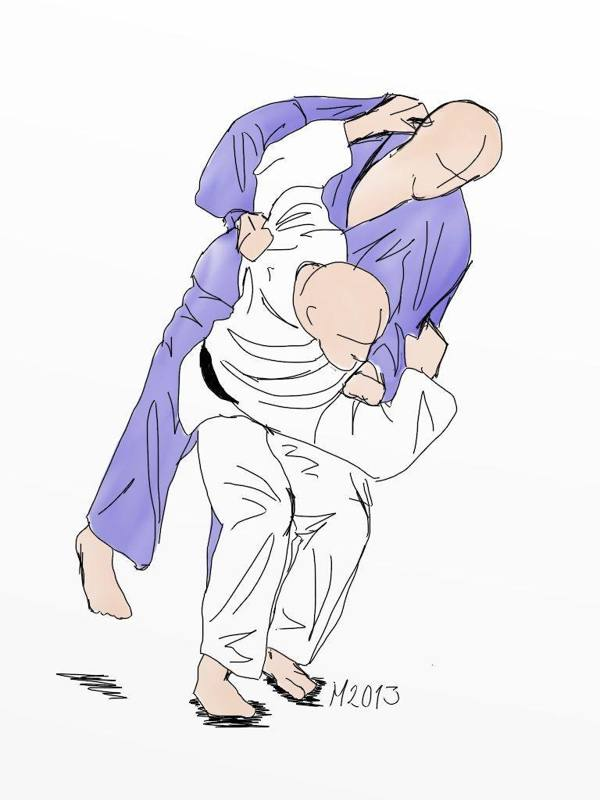
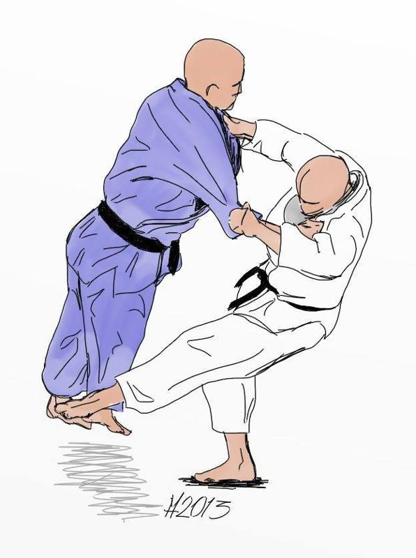
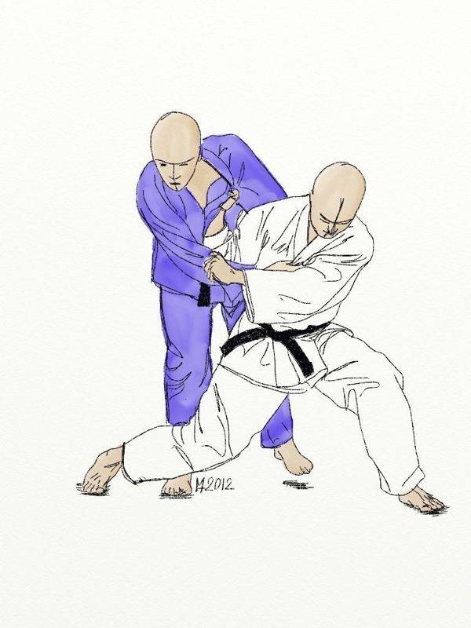
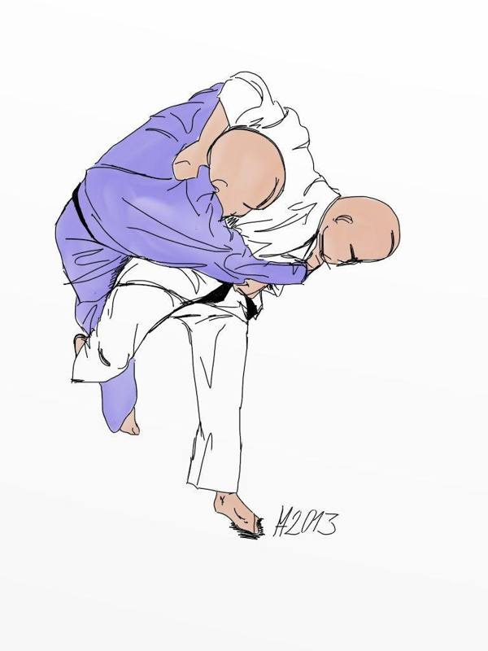
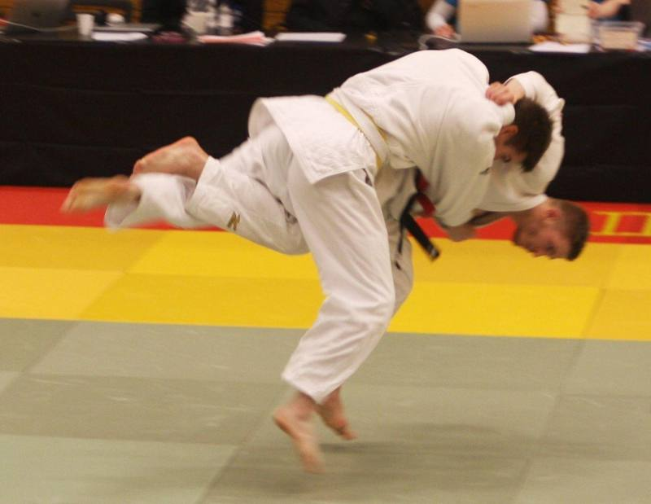

# 6. Gokyo Dai-nikyō — il secondo gruppo

Il *Dai-nikyō* (第二教, "secondo insegnamento") è il secondo dei cinque gruppi in cui il Kōdōkan ordinò le proiezioni fondamentali del *Gokyō no waza* (五教の技), il sistema didattico stipulato nel 1895 e revisionato nel 1920 con otto tecniche per gruppo. Se il primo gruppo introduce i fondamenti — spazzate di tempismo, falciate dirette, il primo carico sull'anca, la prima proiezione di braccia — il secondo gruppo **completa le tecniche di base che costituiscono il programma tecnico di 1° dan FIJLKAM**: il candidato a cintura nera deve padroneggiare tutte e sedici le forme dei primi due gruppi. Al grado di 4° dan, naturalmente, non basta l'esecuzione: è richiesta la comprensione del principio, la padronanza delle tre fasi canoniche — *kuzushi* (崩し, rottura dell'equilibrio), *tsukuri* (作り, costruzione della posizione) e *kake* (掛け, esecuzione) — e la capacità di spiegare perché ogni tecnica occupa proprio quel posto nella progressione.

La logica del gruppo è leggibile con chiarezza: si aprono le versioni "minori" delle due falciate (*ko-soto-gari*, *ko-uchi-gari*), si passa alle proiezioni d'anca con caricamento più profondo e raffinato (*koshi-guruma*, *tsurikomi-goshi*), si incontra la spazzata laterale a due piedi dal timing più severo (*okuri-ashi-barai*), e si chiudono i due colpi rotatori per eccellenza del repertorio (*tai-otoshi*, *harai-goshi*, *uchi-mata*). Due annotazioni storiche che all'esame vanno conosciute con precisione: *tsurikomi-goshi* **non** figurava nel Gokyō del 1895 — fu inserito verso la fine dell'era Meiji, intorno al 1911 — e *harai-goshi* nacque, nel racconto dello stesso Kanō Jigorō, per contrastare la fuga in avanti di Shiro Saigō dal suo *uki-goshi*. Il gruppo si chiude con *uchi-mata*, la tecnica statisticamente più efficace della gara moderna. Le descrizioni seguono la didattica standard: *tori* esegue a destra (*migi*), da presa standard in *shizentai* (postura naturale), con *tsurite* (mano al bavero) e *hikite* (mano alla manica).

## 6.1 Ko-soto-gari (小外刈)

▶ **Video Kōdōkan × IJF Academy:** [Ko-soto-gari](https://www.youtube.com/watch?v=jeQ541ScLB4) *(canale ufficiale KODOKAN)*

*Ko-soto-gari: la mietitura esterna sul tallone (illustrazione: M. Hultström, CC BY-SA 3.0)*

**Nome e origine.** *Ko* 小 (piccolo), *soto* 外 (esterno), *gari* 刈 (mietere/falciare): "piccola mietitura esterna". Famiglia: *ashi-waza* (足技, tecniche di gambe e piedi). Presente fin dal primo Gokyō del 1895, è la versione minore di *o-soto-gari*; nella didattica moderna è insegnata soprattutto come tecnica di reazione e di combinazione, e in competizione compare frequentemente nella forma *off-the-grip*, sulla gamba d'appoggio in uscita di presa.

**Il principio.** Il *kuzushi* è all'angolo posteriore destro di uke: tutto il peso deve caricare il tallone destro, come in *o-soto-gari*, ma senza la grande entrata frontale — tori resta più esterno, di fianco. Il *tsukuri* colloca il piede destro di tori dietro il tallone e il polpaccio destro di uke. Il *kake* è una falciata corta, rasoterra, "a uncino", che sottrae la gamba caricata mentre le mani spingono e tirano uke all'indietro. Fulcro: il contatto tallone-polpaccio. Vettore: posteriore e basso. La differenza biomeccanica rispetto alla forma maggiore è la falciata breve dal basso, senza il passaggio della gamba di tori davanti al corpo di uke.

**Esecuzione da fermo.**

- Presa standard; con trazione e spinta circolare si carica uke sul tallone destro.
- Tori si dispone leggermente di lato, piede sinistro a fianco del piede destro di uke.
- Il piede destro di tori aggancia dall'esterno il tallone e il polpaccio destro di uke.
- Falciata breve verso tori e contemporanea spinta delle mani all'indietro: uke cade di schiena.

**Esecuzione in movimento.** La tecnica eccelle quando uke avanza il piede destro caricandolo, oppure quando indietreggia portando il peso sul tallone: si "raccoglie" il piede d'appoggio nel momento del massimo carico. In uscita di presa si sfrutta il raddrizzamento posturale di uke, che per un istante cristallizza la gamba sotto il baricentro.

**Varianti.** *Ko-soto-gake* (gancio esterno del terzo gruppo), con appoggio più alto e caduta accompagnata; forma con presa incrociata alla manica; combinazione classica con *de-ashi-harai*.

**Errori comuni.**

- Falciare una gamba scarica: nessun effetto.
- Sollevare la falciata troppo in alto, trasformandola in un *ko-soto-gake* scorretto.
- Spingere con le mani senza aver prima caricato uke sul tallone bersaglio.

## 6.2 Ko-uchi-gari (小内刈)

▶ **Video Kōdōkan × IJF Academy:** [Ko-uchi-gari](https://www.youtube.com/watch?v=3Jb3tZvr9Ng) *(canale ufficiale KODOKAN)*

*Ko-uchi-gari: la piccola mietitura interna (illustrazione: M. Hultström, CC BY-SA 3.0)*

**Nome e origine.** *Ko* 小 (piccolo), *uchi* 内 (interno), *gari* 刈: "piccola mietitura interna". Famiglia: *ashi-waza*. Presente fin dal Gokyō del 1895, è descritta dalle fonti tecniche come virtualmente inarrestabile quando combinata con buon *kuzushi* e buon *debana* (tempismo); per la sua discrezione e il basso dispendio energetico è tra le falciate più utilizzate nel judo contemporaneo.

**Il principio.** Il *kuzushi* è in avanti o all'angolo anteriore destro: si porta uke a caricare il piede destro **avanzando**. Il *tsukuri* inserisce il piede destro di tori tra i piedi di uke. Il *kake* è una falciata corta con la pianta e l'arco del piede contro il tallone interno destro di uke, verso l'esterno e leggermente in avanti, mentre le mani spingono uke nella direzione della gamba sottratta. Fulcro: il contatto pianta-tallone. Vettore: antero-laterale — uke perde l'appoggio anteriore e cade in avanti o sul fianco. È l'opposto speculare di *o-uchi-gari*: qui si sottrae la gamba che sta **ricevendo** il peso durante il passo.

**Esecuzione da fermo.**

- Presa standard; si induce uke ad avanzare il piede destro.
- Al momento dell'appoggio, *kuzushi* in avanti-destro con entrambe le mani.
- Il piede destro di tori falcia il tallone destro di uke dall'interno, verso l'esterno.
- Spinta-rotazione del busto: uke cade in avanti.

**Esecuzione in movimento.** Il campo d'elezione è proprio il movimento: si applica sul passo avanti di uke, mietendo il piede che arriva, ma anche come reazione a un proprio passo indietro provocato (azione-reazione). Il tempismo coincide con l'appoggio, non con la fase aerea del piede: è questo il dettaglio che distingue l'esecutore maturo.

**Varianti.** *Ko-uchi-makikomi*, con avvitamento e caduta accompagnata (forma prediletta di Toshihiko Koga); *ko-uchi-gaeshi* come contropiede; combinazioni canoniche *ko-uchi-gari* → *morote-seoi-nage* (*renzoku-waza*, direzioni opposte) e *ko-uchi-gari* → *o-uchi-gari* (*renraku-waza*, stessa direzione).

**Errori comuni.**

- Falciare troppo presto, col piede di uke ancora in volo e senza carico.
- Calcio laterale invece di falciata "a rastrello" con la pianta.
- Mani passive: senza spinta anteriore uke recupera semplicemente il passo.

## 6.3 Koshi-guruma (腰車)

▶ **Video Kōdōkan × IJF Academy:** [Koshi-guruma](https://www.youtube.com/watch?v=SU7Id6uVJ44) *(canale ufficiale KODOKAN)*

*Koshi-guruma: la ruota d’anca con la testa fuori (illustrazione: M. Hultström, CC BY-SA 3.0)*

**Nome e origine.** *Koshi* 腰 (anca), *guruma* 車 (ruota): "ruota dell'anca". Famiglia: *koshi-waza* (腰技, tecniche d'anca); è la prima tecnica nella lista Kōdōkan delle *koshi-waza*. Presente fin dal Gokyō del 1895, è una delle proiezioni storiche del *jūjutsu* assorbite nel repertorio canonico, apprezzata dagli insegnanti classici per l'adattabilità a ogni corporatura. Nell'era moderna Toshihiko Koga la impiegava volentieri contro i mancini, specialmente quando stavano piegati in avanti.

**Il principio.** Il *kuzushi* è in avanti. Il *tsukuri* è l'entrata di schiena come in *o-goshi*, ma con due differenze decisive: il braccio destro cinge **il collo e la nuca** di uke (non la vita) e i fianchi di tori passano oltre il centro di uke. Il *kake* flette il busto e ruota: uke gira attorno all'anca di tori come una ruota attorno al mozzo. Fulcro: l'anca destra. Vettore: rotatorio in avanti, con centro di rotazione più alto rispetto a *o-goshi* — sono testa e spalle di uke a trascinare il capovolgimento. È una rotazione imposta dalla testa: la leva sul collo accelera la caduta.

**Esecuzione da fermo.**

- Presa standard; *kuzushi* in avanti.
- Tori entra di schiena — anca destra contro l'addome di uke, ginocchia flesse — passando il braccio destro attorno al collo di uke.
- Anca sotto il baricentro, schiena aderente al petto di uke.
- Flessione del busto in avanti e trazione del collo e della manica: uke ruota oltre l'anca e cade.

**Esecuzione in movimento.** È ideale contro uke che avanza basso o che spinge con la testa in avanti; funziona anche come contropiede immediato su attacchi frontali, "ricevendo" l'attacco con un giro sotto la linea d'entrata. Sul passo laterale si adatta bene all'entrata incrociata contro i mancini, nel caso reso celebre da Koga.

**Varianti.** Entrata con passo singolo o a giro completo (*mawari*); forma "da terra", in ginocchio, utile nelle transizioni al *ne-waza*; presa alla nuca o alla testa; combinazione con *o-uchi-gari* (finta in avanti, poi rotazione).

**Errori comuni.**

- Cingere la vita invece del collo: la tecnica ridiventa *o-goshi*.
- Entrare con l'anca troppo alta, senza caricare uke.
- Tirare il collo con la sola forza delle braccia: rischio di reazione di uke e di sollecitazioni pericolose al rachide; la rotazione deve sempre coinvolgere tutto il corpo.

## 6.4 Tsurikomi-goshi (釣込腰)

▶ **Video Kōdōkan × IJF Academy:** [Tsurikomi-goshi](https://www.youtube.com/watch?v=McfzA0yRVt4) *(canale ufficiale KODOKAN)*

*Tsurikomi-goshi: l’anca che solleva e attira (illustrazione: M. Hultström, CC BY-SA 3.0)*

**Nome e origine.** *Tsuri* 釣 (sollevare/pescare), *komi* 込 (tirare dentro), *goshi* 腰 (anca): "anca che solleva e tira dentro". Famiglia: *koshi-waza*. Dato storico essenziale per l'esame: **non era inclusa nel Gokyō del 1895**; fu aggiunta verso la fine dell'era Meiji, intorno al **1911**, ed è stabilmente presente nella revisione del 1920. È la seconda delle *koshi-waza* del *Nage-no-kata* (投の形).

**Il principio.** Come dice il nome, la chiave è il *tsuri-komi*: un sollevamento-tirata delle mani che porta uke sulle punte e in avanti (*kuzushi* frontale-alto) **prima** dell'entrata dell'anca. Nel *tsukuri* tori gira di schiena, braccio destro attorno alla vita (o mantenendo il bavero), anca destra sotto l'addome di uke. Il *kake* unisce estensione delle gambe, flessione del busto e trazione continua delle mani. Fulcro: l'anca. Vettore: verticale, poi rotatorio in avanti. Rispetto a *o-goshi* il *kuzushi* è più "in alto" (sollevamento marcato); rispetto a *uki-goshi* l'entrata è più profonda e l'anca si alza.

**Esecuzione da fermo.**

- Presa standard; trazione energica in alto e in avanti con entrambe le mani: uke sale sulle punte (*tsuri-komi*).
- Rotazione di schiena: il piede destro davanti al piede destro di uke, poi il sinistro completa il giro; il braccio destro cinge la vita.
- Anca destra sotto il baricentro di uke, schiena aderente.
- Estensione delle gambe, flessione del busto, trazione: uke si rovescia in avanti.

**Esecuzione in movimento.** È perfetta contro uke che avanza o che risponde a una trazione raddrizzandosi: il sollevamento sfrutta la sua stessa estensione. Il momento ideale è quando uke è già in fase ascendente, sulle punte: l'entrata arriva sotto il suo baricentro senza fatica, e il peso sembra "salire da solo" sull'anca.

**Varianti.** Con braccio attorno alla vita o con presa mantenuta al bavero; *sode-tsurikomi-goshi*, con doppia presa alla manica, tecnica autonoma della lista Kōdōkan, celebre nella versione di Koga; entrata diretta o a giro completo.

**Errori comuni.**

- Entrare senza il sollevamento preliminare: manca il *tsuri-komi*, cuore della tecnica.
- Girare troppo lontano da uke, lasciando spazio tra la propria schiena e il petto di uke.
- Alzare l'anca interrompendo la trazione delle braccia nel *kake*.

## 6.5 Okuri-ashi-barai (送足払)

▶ **Video Kōdōkan × IJF Academy:** [Okuri-ashi-barai](https://www.youtube.com/watch?v=nw1ZdRjrdRI) *(canale ufficiale KODOKAN)*

*Okuri-ashi-barai: la spazzata laterale dei due piedi (illustrazione: M. Hultström, CC BY-SA 3.0)*

**Nome e origine.** *Okuri* 送 (inviare/accompagnare), *ashi* 足 (piede), *barai* 払 (spazzata): "spazzata del piede che accompagna" (grafia Kōdōkan corrente: *okuri-ashi-harai*). Famiglia: *ashi-waza*. Presente fin dal Gokyō del 1895 e compresa nel *Nage-no-kata*, è universalmente considerata una delle proiezioni dal timing più difficile dell'intero repertorio: spazzare due piedi in fase di traslazione laterale richiede un sincronismo perfetto.

**Il principio.** Il *kuzushi* è laterale puro: uke si muove lateralmente — o viene spostato lateralmente dalle mani di tori — e i suoi due piedi si avvicinano. Nel *tsukuri* tori segue il movimento mantenendo la distanza e **accelerando** la traslazione con le mani (sollevamento-tirata laterale). Il *kake*: la pianta del piede di tori spazza **entrambi** i piedi di uke nel breve istante in cui sono uniti e scarichi, o in fase di ricongiungimento, nella direzione stessa del movimento. Non esiste un fulcro statico: è una spazzata "di massa" su entrambi gli appoggi. Vettore: laterale, nella direzione dello spostamento di uke, che cade sul fianco.

**Esecuzione da fermo.**

- Presa standard; si induce il movimento laterale di uke verso la propria destra.
- Le mani tirano e sollevano nella direzione dello spostamento, prolungandolo.
- Quando i piedi di uke si congiungono, il piede sinistro di tori li spazza entrambi con la pianta, verso destra.
- Rotazione del busto e trazione delle braccia: uke cade sul fianco destro.

**Esecuzione in movimento.** È tecnica esclusivamente dinamica: si applica sul passo laterale in *tsugi-ashi*, spazzando il piede che segue mentre raggiunge il piede guida, oppure sul cambio di direzione. Alcuni esecutori la applicano anche sull'avanzamento, spazzando i piedi al momento dell'incrocio.

**Varianti.** Spazzata con il piede destro o sinistro a seconda della direzione; forma "in salto", con spazzata aerea nella fase sospesa dello spostamento; combinazione con *de-ashi-harai* per la doppia minaccia di spazzata.

**Errori comuni.**

- Spazzare quando i piedi di uke sono separati e caricati.
- Mancare l'accelerazione delle mani: senza prolungare il movimento laterale, i piedi non si uniscono mai.
- Colpire con il collo del piede invece che con la pianta, perdendo superficie di contatto.

## 6.6 Tai-otoshi (体落)

▶ **Video Kōdōkan × IJF Academy:** [Tai-otoshi](https://www.youtube.com/watch?v=4x6S3Q-Ktv8) *(canale ufficiale KODOKAN)*

*Tai-otoshi: la caduta del corpo (illustrazione: M. Hultström, CC BY-SA 3.0)*

**Nome e origine.** *Tai* 体 (corpo), *otoshi* 落 (far cadere): "caduta del corpo". Famiglia: *te-waza* (手技, tecniche di braccia). Presente fin dal Gokyō del 1895, è la seconda *te-waza* del *Nage-no-kata*. È la tecnica simbolo del principio di "cedere per vincere" e la matrice delle proiezioni frontali a sacrificio parziale; la tradizione didattica la collega al gesto leggendario del *kūki-nage* ("proiezione dell'aria") di Mifune Kyūzō, 10° dan, in cui uke veniva proiettato quasi senza contatto delle gambe, per puro dominio del *kuzushi*: forma estrema dello stesso principio. Nell'agonismo moderno è diffusa la versione *drop*, in ginocchio.

**Il principio.** Il *kuzushi* è all'angolo anteriore destro, rotatorio e in avanti. Nel *tsukuri* tori gira a sinistra portando il piede sinistro fuori dal piede destro di uke e **distende la gamba destra davanti e oltre la gamba destra di uke** come barriera: non una falciata attiva, ma un vincolo passivo. Il *kake* è la trazione rotatoria delle mani — la manica flette verso il basso, il bavero solleva e guida — che rovescia il corpo di uke oltre la gamba-barriera. Fulcro: la gamba distesa di tori. Vettore: rotatorio in avanti; uke "cade del proprio peso" oltre l'ostacolo. È classificata *te-waza* perché l'agente principale è l'azione di braccia e busto.

**Esecuzione da fermo.**

- Presa standard; *kuzushi* all'angolo anteriore destro di uke.
- Tori ruota sul piede sinistro disponendosi di fianco, a mezza schiena rispetto a uke.
- La gamba destra si distende davanti e oltre la gamba destra di uke, piede esterno, senza caricarla.
- Trazione rotatoria della manica in basso e guida del bavero: uke si rovescia oltre la gamba e cade in avanti.

**Esecuzione in movimento.** Eccellente quando uke avanza o reagisce a una finta frontale portandosi in avanti: la tempistica sfrutta l'istante in cui il peso di uke transita oltre il suo piede anteriore. Contro un avversario che indietreggia si può inseguire con un'entrata più profonda, mantenendo la direzione di caduta.

**Varianti.** Forma classica in piedi; *drop tai-otoshi*, con caduta sul ginocchio sinistro durante l'entrata; versione con presa incrociata; combinazioni verso *o-uchi-gari* e *ko-uchi-gari*; nelle tabelle di *kaeshi-waza* compare *yoko-wakare* come contropiede.

**Errori comuni.**

- Caricare peso sulla gamba-barriera: deve restare leggera, o se uke preme tori crolla.
- Bloccare con la gamba senza rotazione del busto: uke inciampa e recupera.
- Posizionare la gamba troppo corta, davanti alla propria linea invece che oltre la gamba di uke.

## 6.7 Harai-goshi (払腰)

▶ **Video Kōdōkan × IJF Academy:** [Harai-goshi](https://www.youtube.com/watch?v=qTo8HlAAkOo) *(canale ufficiale KODOKAN)*

*Harai-goshi: l’anca che spazza (illustrazione: M. Hultström, CC BY-SA 3.0)*

**Nome e origine.** *Harai* 払 (spazzare), *goshi* 腰 (anca): "anca che spazza". Famiglia: *koshi-waza*. La genesi è narrata dallo stesso Kanō Jigorō: il celebre allievo **Shiro Saigō** trovava sempre una contromossa a ogni tecnica, e contro l'*uki-goshi* del fondatore imparò a **saltare in avanti** liberando la gamba e sfuggendo. Kanō elaborò allora un modo per spazzare la gamba di fuga durante l'anca: nacque così *harai-goshi*. Anton Geesink la impiegò con efficacia nella vittoria olimpica di Tokyo 1964. È la terza *koshi-waza* del *Nage-no-kata*, tradizionalmente adatta a judoka alti e forti; testo di riferimento classico: *Harai Goshi* di Jean-Luc Rougé (Judo Masterclass).

**Il principio.** Il *kuzushi* è in avanti-alto, da presa alta al bavero o alla nuca. Il *tsukuri* è l'entrata di schiena come in *o-goshi*, ma l'anca carica uke **in alto sul fianco** e la gamba destra di tori resta libera di oscillare. Il *kake*: la gamba destra spazza all'indietro e in alto contro la coscia anteriore-esterna destra di uke — "mandare il tallone al soffitto" — mentre il busto si flette e ruota a sinistra. Fulcro: l'anca destra. Il vettore combina sollevamento d'anca, pendolo della gamba e rotazione del busto: una coppia di forze a tre leve.

**Esecuzione da fermo.**

- Presa alta; *kuzushi* in avanti.
- Tori ruota entrando di schiena, anca destra contro l'anca e l'addome di uke, ginocchia flesse.
- Estensione: uke è caricato sull'anca; la gamba destra di tori si slancia tra le gambe di uke e spazza all'indietro la coscia destra di uke.
- Busto flesso e ruotato a sinistra, sguardo al tatami, trazione delle braccia: uke rovescia in avanti.

**Esecuzione in movimento.** Il momento ideale è il **passo obliquo in avanti** di uke: la gamba che avanza viene spazzata in fase di scarico. Contro un avversario che si raddrizza in reazione a una spinta, l'entrata sotto il baricentro è immediata.

**Varianti.** Forma classica con spazzata della coscia; versione a spazzata di entrambe le gambe (verso *o-guruma*); *harai-makikomi*, con avvitamento; contropiedi canonici: *harai-goshi-gaeshi*, *te-guruma*, *ushiro-goshi*, *tani-otoshi*.

**Errori comuni.**

- Bloccare la gamba di uke senza averla caricata sull'anca: la spazzata da sola non proietta.
- Spazzare troppo basso, al polpaccio, perdendo la leva sulla coscia.
- Busto eretto nel *kake*: senza flessione in avanti la gamba non può pendolare in alto.

## 6.8 Uchi-mata (内股)

▶ **Video Kōdōkan × IJF Academy:** [Uchi-mata](https://www.youtube.com/watch?v=iUpSu5J-bgw) *(canale ufficiale KODOKAN)*

*Uchi-mata in gara (foto: Ari Kyllönen, CC BY-SA 4.0)*

**Nome e origine.** *Uchi* 内 (interno), *mata* 股 (coscia/inguine): "interno coscia". Famiglia: *ashi-waza*, a chiusura del secondo gruppo. Presente fin dal Gokyō del 1895 e compresa nel *Nage-no-kata*; non risulta attribuibile con certezza a un singolo perfezionatore antico. Ciò che la documentazione moderna attesta senza equivoci è il suo primato statistico: **uchi-mata è la proiezione più decisiva della gara contemporanea**, prima per numero di finali olimpiche risolte. Tra gli specialisti verificati: Yasuhiro Yamashita (versione *ken-ken*, decisiva contro i non giapponesi), Kosei Inoue, Shohei Ono, Joshiro Maruyama, Hidehiko Yoshida, Naoya Ogawa, Teddy Riner, Ilias Iliadis, Anton Geesink. I dati scientifici indicano maggiore velocità esecutiva nei judoka alti e pesanti.

**Il principio.** Il *kuzushi* è in avanti-alto, spesso da presa alta dominante. Nel *tsukuri* tori gira di schiena entrando con l'anca destra, gamba destra tesa tra le gambe di uke. Il *kake*: la gamba destra **risale con la parte interna-posteriore della coscia contro l'interno coscia di uke**, in un movimento a frusta verso l'alto, mentre il busto si flette e ruota e le braccia tirano. Fulcro: l'anca di tori e l'interno coscia di uke. Vettore: rotazione in avanti sopra la gamba sollevata — uke "vola" oltre la gamba-frusta.

**Esecuzione da fermo.**

- Presa alta; *kuzushi* in avanti: uke sale sulle punte.
- Tori ruota entrando di schiena, piede sinistro tra i piedi di uke, anca destra contro l'anca destra di uke.
- La gamba destra tesa entra tra le gambe di uke e frusta in alto l'interno della coscia sinistra.
- Busto flesso e ruotato a sinistra, sguardo al tatami, trazione delle braccia: uke ruota oltre la gamba e cade di schiena.

**Esecuzione in movimento.** Si adatta a uke che avanza, che spinge o che allarga la base in *jigotai* (postura difensiva); la versione *ken-ken* consente di inseguire l'avversario in movimento continuo, a saltelli sul piede d'appoggio. È efficacissima come reazione all'*o-uchi-gari* di uke — si salta la falciata e si entra — e in combinazione dopo il proprio *o-uchi-gari*.

**Varianti.** Forma classica (busto molto flesso, gamba alta); *ashi-uchi-mata* (dominanza della gamba); *ken-ken*; *uchi-mata-makikomi*; interpretazione "alla coreana". Contropiedi: *uchi-mata-gaeshi* e *uchi-mata-sukashi*, entrambe tecniche autonome Kōdōkan, più *sumi-gaeshi* e *tani-otoshi*.

**Errori comuni.**

- Frustare la gamba senza aver caricato uke in avanti: la gamba colpisce a vuoto.
- Colpire la coscia sbagliata, o troppo in basso verso il ginocchio, perdendo la leva.
- Busto verticale: senza flessione-rotazione la frusta della gamba non ha potenza né direzione.
