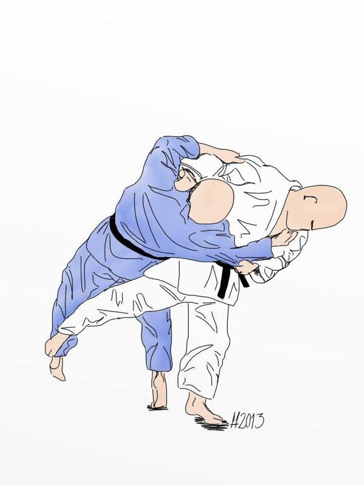
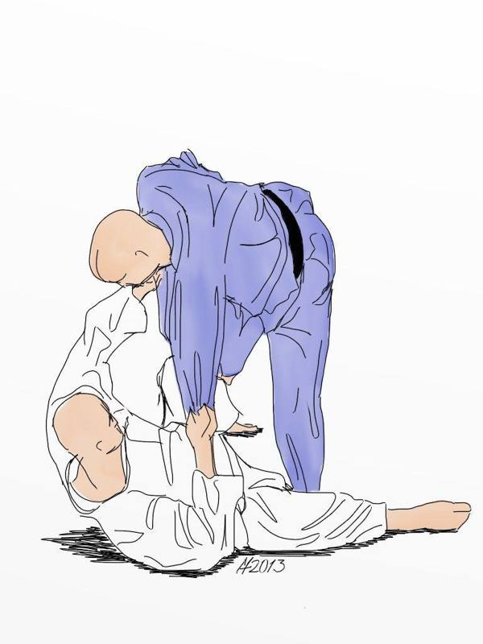
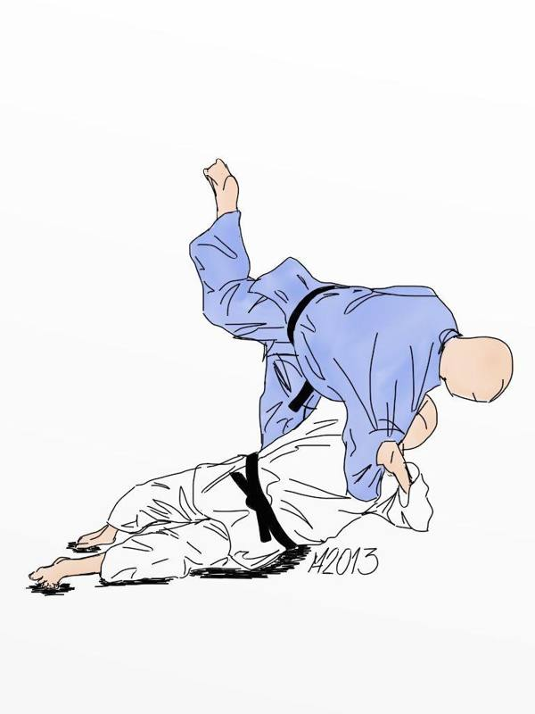
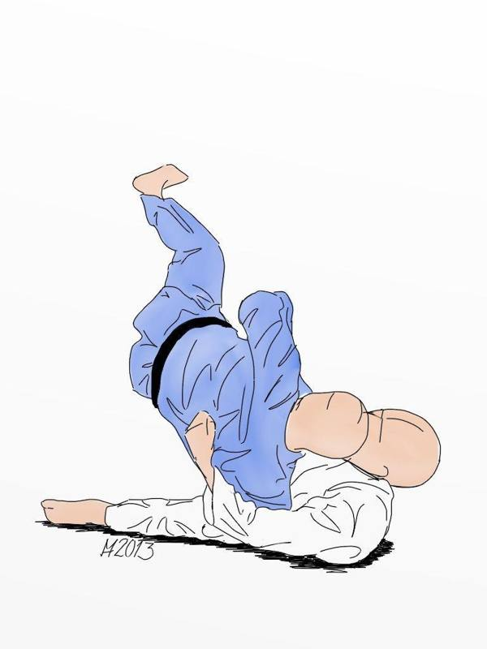
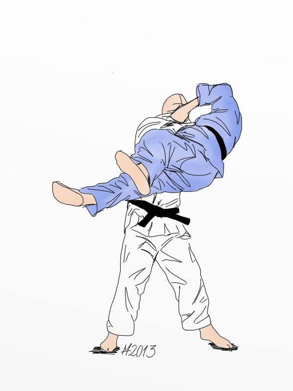
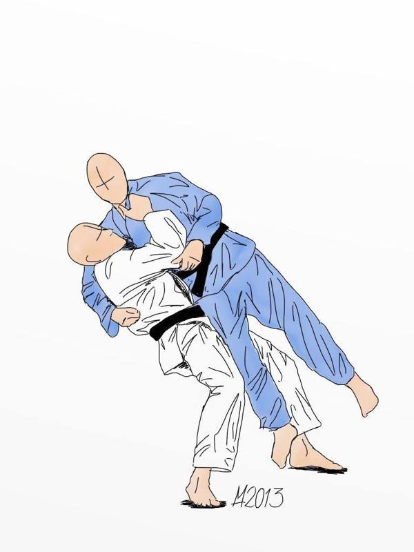
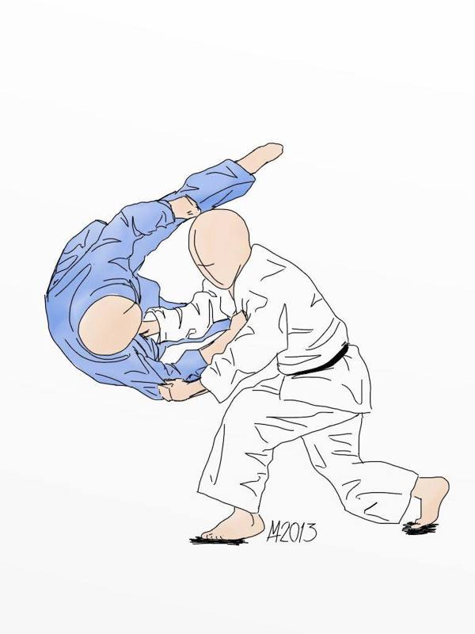
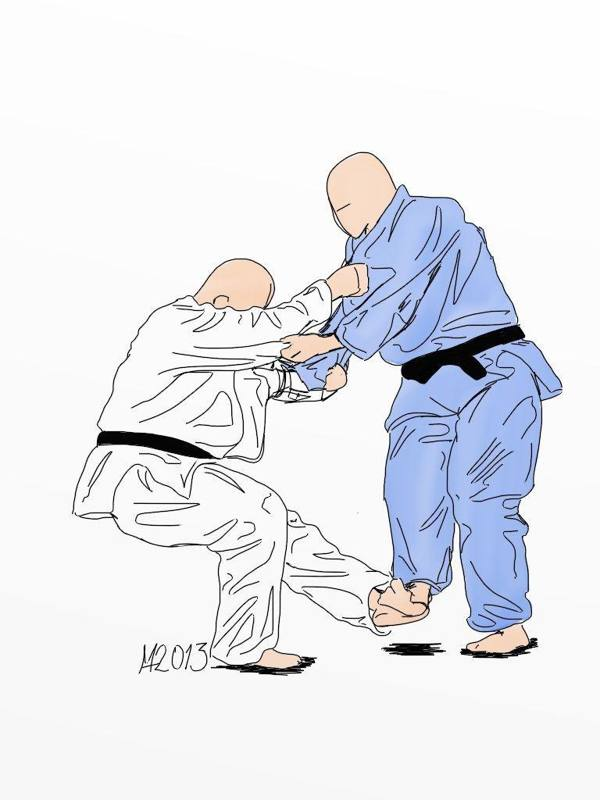

# 9. Gokyo Dai-gokyō — il quinto gruppo

Il *Dai-gokyō* (第五教, «quinto gruppo») è l'ultima tavola del *Gokyo no waza* (五教の技), istituito nel **1895** e revisionato nel **1920**. Per il candidato al 4° dan è la parte **veramente nuova** dell'esame: i primi quattro gruppi si ripresentano come consolidamento — con *renraku* (連絡, combinazioni), *gaeshi* (返, controtiri) e difese — mentre il quinto è la richiesta specifica del gradino. La FIJLKAM vi annovera Sumi-otoshi (*te-waza*, 手技), Ushiro-goshi (*koshi-waza*, 腰技), O-soto-guruma (*ashi-waza*, 足技) e ben cinque *sutemi-waza* (捨技, di sacrificio): Uki-waza, Yoko-wakare, Yoko-guruma, Ura-nage, Yoko-gake.

Due avvertenze. Primo: molte tecniche del gruppo sono **«di risposta»**: Ushiro-goshi, Ura-nage e Yoko-guruma nascono come controtiri alle proiezioni di bacino e presuppongono di saper *ricevere* un attacco senza opporre forza cieca; la commissione valuterà proprio questo. Secondo: la tavola odierna è quella del **1920**: nel Gokyo del 1895 O-soto-guruma, Yoko-wakare, Yoko-guruma e Yoko-gake erano già nel 5° gruppo, ma **Ushiro-goshi e Ura-nage erano nel 3°** e **Uki-waza nel 4°**; **Sumi-otoshi è l'unica aggiunta del 1920**.

## 9.1 O-soto-guruma (大外車)

▶ **Video Kōdōkan × IJF Academy:** [O-soto-guruma](https://www.youtube.com/watch?v=92KbCm6pQeI) *(canale ufficiale KODOKAN)*

*O-soto-guruma: la grande ruota esterna (illustrazione: M. Hultström, CC BY-SA 3.0)*

**Nome e origine.** 大 (*ō*, grande) + 外 (*soto*, esterno) + 車 (*kuruma/guruma*, ruota): «grande ruota esterna». È *ashi-waza* pur essendo tori in piedi: la gamba di attacco funge da fulcro. Nel 5° gruppo fin dal Gokyo del 1895; nessun inventore documentato.

**Il principio.** *Kuzushi* (崩, squilibrio) verso il **posteriore** di uke: peso sui talloni, busto inclinato indietro. *Tsukuri* (作り, costruzione): piede sinistro profondo a lato del piede destro di uke, gamba destra di tori **diagonale dietro entrambe le gambe** di uke. *Kake* (掛, applicazione): leva con fulcro nella gamba destra; uke ruota all'indietro attorno a quell'asse, spinto dalla *tsuri-te* (釣手, mano al bavero che solleva) e tirato dalla *hiki-te* (引手, mano alla manica che tira). A differenza di o-soto-gari la gamba **non falcia**: resta fissa come asse e blocca entrambe le gambe.

**Esecuzione da fermo.**

1. Attirare uke in avanti, poi spingere con la destra così che raddrizzi il busto e carichi i talloni.
2. Abbassare il baricentro e avanzare profondamente il piede sinistro a lato del piede destro di uke.
3. Sollevare-tirare con la tsuri-te stringendo i petti, completando lo squilibrio all'indietro.
4. Oscillare la gamba destra e porla di traverso dietro entrambe le gambe di uke.
5. Spingere con la destra, tirare la sinistra verso l'ascella, flettersi ruotando a sinistra: uke «ruota» attorno al fulcro e cade all'indietro.

**Esecuzione in movimento.** Ideale quando uke, arretrando, assume posizione stretta sui talloni, o quando alza un piede per riportarlo indietro e tori gli impedisce il trasferimento del peso.

**Uso da controtiro (kaeshi).** Non è un *kaeshi-waza* (返技) classico: è la **continuazione** di o-soto-gari quando uke difende chiudendo le gambe — si bloccano entrambe invece di falciarne una. Combinazioni: o-soto-gari → o-soto-guruma; sasae-tsurikomi-ashi → o-soto-guruma; rifinitura con tani-otoshi. In senso inverso può subire o-soto-gaeshi.

**Errori comuni.** 1. Gamba-fulcro troppo alta o su una sola gamba: diventa o-soto-gari e si perde la «ruota». 2. Kuzushi posteriore insufficiente: uke fa perno o si siede sottraendo il fulcro. 3. Piede d'appoggio troppo vicino o lontano: non si regge la rotazione.

## 9.2 Uki-waza (浮技)

▶ **Video Kōdōkan × IJF Academy:** [Uki-waza](https://www.youtube.com/watch?v=weVOpJ63gII) *(canale ufficiale KODOKAN)*

*Uki-waza: la tecnica fluttuante (illustrazione: M. Hultström, CC BY-SA 3.0)*

**Nome e origine.** 浮 (*uki*, fluttuante) + 技 (*waza*, tecnica): «tecnica fluttuante». *Yoko-sutemi-waza* (横捨技, sacrificio laterale): tori cade sul **fianco sinistro**. Nel Gokyo del 1895 era nel 4° gruppo; figura nel 5° gruppo del *Nage no Kata* (投の形). È la tecnica di **Nagaoka Hidekazu** (10° dan): di lui si diceva «la tecnica è sutemi, l'uomo è Nagaoka».

**Il principio.** Kuzushi verso l'**angolo anteriore destro** di uke (*migi-mae-sumi*), caricato **sulla punta del solo piede destro**. Tsukuri: il piede destro di tori blocca il rientro del piede sinistro di uke, la gamba sinistra si stende davanti al piede destro di uke e tori cade sul fianco sinistro. Kake: coppia delle braccia (la destra solleva, la sinistra descrive un grande arco verso il petto) sommata al **momento della caduta**; fulcro: la punta del piede destro di uke, attorno a cui uke ruota verso la spalla sinistra di tori. Il Kodokan avverte: proiettare «torcendo con le braccia» snatura la tecnica — il motore è il sacrificio.

**Esecuzione da fermo.**

1. Attirare uke verso il suo angolo anteriore destro finché si irrigidisce sulla punta del piede destro.
2. Allentare la trazione destra inducendo uke ad arretrare il piede sinistro; appena si solleva, entrare col proprio piede destro accanto a esso.
3. Sollevare da sotto con la destra e tirare in alto con la sinistra: uke resta «fluttuante» su una gamba.
4. Aprire il corpo a sinistra, stendere la gamba sinistra davanti al piede destro di uke e cadere sul fianco sinistro.
5. Con la sinistra descrivere un ampio arco verso il proprio petto: uke rotea oltre la spalla sinistra.

**Esecuzione in movimento.** Si sfrutta il ritmo «tre passi avanti — rientro»: l'attacco scatta quando uke inizia a **retrocedere** per riassestarsi. È tecnica di **tempistica**, non di forza: l'arma dei tecnici contro avversari più fisici.

**Uso da controtiro (kaeshi).** Classica contro le proiezioni di bacino e di spalla che caricano l'attaccante sul fianco di tori: nel *Canon of Judo*, tra le «repulsioni» di **o-goshi**, Mifune prescrive di mutare istantaneamente in **hidari-uki-waza** (uki-waza sinistro). Per identità di squilibrio è tra le risposte a **seoi-nage**.

**Errori comuni.** 1. Proiettare con la sola torsione delle braccia invece di lasciarsi cadere (errore segnalato dal Kodokan). 2. Cadere piatti sulla schiena invece che sul fianco sinistro: si perde la leva. 3. Non bloccare il rientro del piede sinistro di uke: uke riappoggia e la tecnica muore.

## 9.3 Yoko-wakare (横分)

▶ **Video Kōdōkan × IJF Academy:** [Yoko-wakare](https://www.youtube.com/watch?v=bp1tscHlePI) *(canale ufficiale KODOKAN)*

*Yoko-wakare: la separazione laterale (illustrazione: M. Hultström, CC BY-SA 3.0)*

**Nome e origine.** 横 (*yoko*, lato) + 分 (*wakare*, da *wakareru*, separarsi): «separazione laterale». *Yoko-sutemi-waza*: tori cade su schiena-fianco sinistro e finisce **perpendicolare** a uke. Nel 5° gruppo fin dal 1895; il Judo Encyclopedia la collega a *Kuruma-gaeshi* e *Mizu-ire* del *Koshiki no Kata* (古式の形) e dell'*Itsutsu no Kata* (五の形).

**Il principio.** Kuzushi verso l'angolo anteriore destro (o dritto in avanti), sulla punta del piede destro. Tsukuri: entrambe le gambe di tori **scivolano sotto/di fianco al piede destro di uke** e tori cade all'indietro-laterale. Kake: tecnica di **momento**: le braccia tirano-sollevano mentre il corpo di tori, cadendo, fa da **barriera** che impedisce il passo di recupero e convoglia uke in traiettoria **centrifuga** oltre il corpo esteso di tori, in rotazione attorno alla gamba tesa.

**Esecuzione da fermo.**

1. Squilibrare uke in avanti-angolo destro fino alla punta del piede destro.
2. Nell'istante in cui uke avanza, scivolare con la gamba lato tsuri-te oltre la gamba omologa di uke, torcendo il corpo di fianco.
3. Accostare la seconda gamba (ginocchio appena flesso) e cadere all'indietro sul fianco, tirando forte in basso con la hiki-te.
4. Ruotare attorno alla gamba estesa come centro: uke passa **oltre** il corpo di tori, «separato» lateralmente.

**Esecuzione in movimento.** Il momento classico è **l'avanzata aggressiva** di uke: lo si induce ad attaccare squilibrandolo dapprima all'indietro, poi si entra appena prima che il suo piede tocchi il tatami.

**Uso da controtiro (kaeshi).** Controtiro documentato contro **uki-otoshi, o-goshi e seoi-nage**; nella tradizione scandinava è kaeshi di **tai-otoshi**: si scavalca la gamba tesa gettandosi in rotazione sulla schiena. Come principio è affine a uchi-makikomi e ude-gaeshi.

**Errori comuni.** 1. Cadere prima di aver completato lo tsukuri: uke scavalca la barriera con un passo e la tecnica si sgonfia. 2. Gambe non tese come sbarramento: uke crolla addosso a tori. 3. Angolo finale sbagliato: tori deve finire **perpendicolare** a uke, non parallelo.

## 9.4 Yoko-guruma (横車)

▶ **Video Kōdōkan × IJF Academy:** [Yoko-guruma](https://www.youtube.com/watch?v=MehP6I5cY2c) *(canale ufficiale KODOKAN)*

*Yoko-guruma: la ruota laterale (illustrazione: M. Hultström, CC BY-SA 3.0)*

**Nome e origine.** 横 (*yoko*, lato) + 車 (*guruma*, ruota): «ruota laterale». *Yoko-sutemi-waza*: tori cade sul fianco sinistro e uke «ruota» sopra di lui. Nel 5° gruppo fin dal 1895; 2ª tecnica del 5° gruppo del Nage no Kata.

**Il principio.** Kuzushi in avanti, sulle punte di entrambi i piedi, quando uke **si piega in avanti per difendersi** da una tecnica di bacino. Tsukuri: la gamba destra di tori **striscia sul tatami** tra le gambe di uke, il corpo si apre a sinistra e il braccio sinistro **prende profonda la parte posteriore della cintura**. Kake: coppia — la sinistra tira la cintura, la destra al bavero **spinge in alto** — sincronizzata con la caduta sul fianco sinistro: uke ruota attorno al corpo di tori e passa **oltre la spalla sinistra**.

**Esecuzione da fermo (forma da kaeshi del testo Kodokan).**

1. Uke attacca hane-goshi destro: tori **abbassa il bacino** e porta l'anca sinistra contro il dorso dell'anca destra di uke; sinistra profonda sulla cintura dietro, destra al bavero.
2. Uke si difende piegandosi in avanti: tori avvicina il piede sinistro al destro e spinge il dorso del bacino di uke col braccio sinistro, squilibrandolo sulle punte.
3. Tori entra davanti a uke facendo **strisciare la gamba destra** tra le sue gambe.
4. Piegata la destra e distesa la sinistra, tori apre il corpo a sinistra e **cade sul fianco sinistro**.
5. Tirando con la sinistra e spingendo in alto con la destra, uke rotea oltre la spalla sinistra.

**Esecuzione in movimento.** Quasi sempre applicata **in risposta**: il momento ottimale è quando uke si piega in avanti per difendersi da una proiezione di bacino; la stessa posizione offre ura-nage o ushiro-goshi come alternative intercambiabili.

**Uso da controtiro (kaeshi).** È **il controtiro laterale per eccellenza**: contro **hane-goshi** (forma canonica Kodokan e Nage no Kata), contro **o-goshi** e, nella tradizione didattica, contro o-soto-gari e o-uchi-gari quando uke si squilibra in avanti col bacino scoperto. Ha deciso incontri olimpici proprio come kaeshi.

**Errori comuni.** 1. Entrare davanti a uke con movimento troppo ampio — espressamente sconsigliato dal Kodokan: ci si espone e si perde il tempo. 2. Lasciare il dorso di uke aderente al proprio petto in difesa: la sua forza prevale. 3. Presa di cintura superficiale: non si controlla il «rimbalzo» e la ruota non gira.

## 9.5 Ushiro-goshi (後腰)

▶ **Video Kōdōkan × IJF Academy:** [Ushiro-goshi](https://www.youtube.com/watch?v=ORIYstuxYT8) *(canale ufficiale KODOKAN)*

*Ushiro-goshi: l’anca posteriore, difesa e controtiro contro le koshi-waza (illustrazione: M. Hultström, CC BY-SA 3.0)*

**Nome e origine.** 後 (*ushiro*, dietro) + 腰 (*goshi/koshi*, anca): «anca posteriore». *Koshi-waza*: l'anca di tori è il fulcro del sollevamento. Nel Gokyo del **1895** era nel **3° gruppo**, insieme a ura-nage; figura nel *Gonosen no Kata* (後の先の形, kata dei controtiri), dove risponde a kubi-nage.

**Il principio.** Kuzushi verso il **posteriore** di uke, mentre questi carica in avanti per una proiezione di bacino. Tsukuri: tori **abbassa il proprio bacino sotto quello di uke**, preme l'anca sinistra contro il dorso dell'anca destra di uke e **circonda profondamente la vita** col braccio sinistro. Kake: tori distende le gambe **inarcandosi** — leva d'anca che stacca uke da terra — poi riapre a sinistra e lo **abbatte dritto davanti a sé**. Prima si «spegne» l'attacco abbassandosi, poi si ribalta il vettore dal basso verso l'alto e infine verso il basso.

**Esecuzione da fermo.**

1. Uke entra per una proiezione di bacino (es. hane-goshi): tori abbassa il baricentro e blocca.
2. Braccio sinistro profondo attorno alla vita; la destra stringe il busto di uke al proprio petto.
3. Spingere l'anca contro il dorso dell'anca di uke squilibrandolo all'indietro.
4. Distendere le ginocchia inarcandosi: **sollevare** uke staccandogli entrambi i piedi.
5. Aprire a sinistra con un piccolo passo indietro e tirare in basso: uke cade dritto davanti a tori, che resta in piedi.

**Esecuzione in movimento.** Tutto dipende dal **tempismo sulla carica**: l'ingresso avviene mentre uke sta ancora completando il proprio tsukuri. In randori si «invita» la tecnica di bacino (postura alta, fianco offerto) e ci si abbassa all'ultimo istante.

**Uso da controtiro (kaeshi).** È **il controtiro di bacino per antonomasia**: contro **hane-goshi** (forma canonica), **o-goshi, harai-goshi, koshi-guruma, uki-goshi, tsuri-goshi/tsurikomi-goshi, sode-tsurikomi-goshi e seoi-nage**; nel Gonosen no Kata risponde a kubi-nage.

**Errori comuni.** 1. Non abbassare il bacino **sotto** quello di uke: il sollevamento diventa sforzo di schiena e fallisce. 2. Presa di vita debole: uke scivola e riprende la sua proiezione. 3. Abbattere uke **senza averlo davvero sollevato**: senza il «galleggiamento» manca il momentum della ricaduta.

## 9.6 Ura-nage (裏投)

▶ **Video Kōdōkan × IJF Academy:** [Ura-nage](https://www.youtube.com/watch?v=Fgi9b8DJ5sQ) *(canale ufficiale KODOKAN)*

*Ura-nage: la proiezione di rovescio (illustrazione: M. Hultström, CC BY-SA 3.0)*

**Nome e origine.** 裏 (*ura*, rovescio) + 投 (*nage*, proiezione): «proiezione di rovescio». *Ma-sutemi-waza* (真捨技, sacrificio **supino**): tori cade **sulla schiena** — unica ma-sutemi del gruppo. Nel Gokyo del **1895** era nel **3° gruppo**; è la 2ª tecnica del 4° gruppo (ma-sutemi) del Nage no Kata.

**Il principio.** Kuzushi verso il posteriore di uke, sfruttandone la carica in avanti. Tsukuri: come ushiro-goshi — braccio sinistro profondo attorno alla vita, anca contro anca, busto di uke aderente al petto — ma con intenzione di sacrificio. Kake: tori distende le gambe inarcando il bacino, **solleva uke con momentum** e **in un solo respiro cade supino**: il suo corpo diviene fulcro sul tatami e uke è proiettato in grande rotazione **oltre la spalla sinistra**.

**Esecuzione da fermo.**

1. Uke attacca hane-goshi destro: tori abbassa il bacino e blocca.
2. Piede sinistro verso il retro di uke, braccio sinistro profondo attorno alla vita, anca contro la natica destra di uke, petto contro il suo busto.
3. Squilibrare uke all'indietro sollevandolo con la distensione delle gambe e l'inarcamento.
4. Nello stesso respiro, cadere sulla schiena.
5. Proiettare uke oltre la propria spalla sinistra in ampia rotazione, mantenendo le prese.

**Esecuzione in movimento.** Richiede la **carica convinta** di uke: più l'attacco è deciso, maggiore il momentum disponibile. La via didattica è ushiro-goshi → ura-nage: prima il sollevamento in piedi, poi il sacrificio.

**Uso da controtiro (kaeshi).** Controtiro classico contro **hane-goshi** (forma canonica), **harai-goshi, uchi-mata, tsuri-goshi/tsurikomi-goshi e o-soto-gari**. Il denominatore: uke espone il fianco e carica il baricentro in avanti-alto; tori lo accoglie, lo solleva e lo «restituisce» oltre la propria spalla.

**Errori comuni.** 1. Cadere sulla schiena **prima** di aver sollevato uke: si finisce schiacciati sotto il suo peso. 2. Braccio sinistro non profondo attorno alla vita: si perde il «carico» a metà rotazione. 3. Proiettare in linea retta anziché **oltre la spalla sinistra**: la traiettoria è diagonale, mai centrale.

## 9.7 Sumi-otoshi (隅落)

▶ **Video Kōdōkan × IJF Academy:** [Sumi-otoshi](https://www.youtube.com/watch?v=lLU9wv52ni0) *(canale ufficiale KODOKAN)*

*Sumi-otoshi: la caduta d’angolo (illustrazione: M. Hultström, CC BY-SA 2.0)*

**Nome e origine.** 隅 (*sumi*, angolo) + 落 (*otoshi*, far cadere): «caduta nell'angolo». *Te-waza*: nessuna gamba, nessun sacrificio. È **l'unica delle otto assente nel Gokyo del 1895**, introdotta con la **revisione del 1920**. Celebre la fotografia di **Kyūzō Mifune a settant'anni in un perfetto sumi-otoshi**; il «lancio aereo» (*kūki-nage*, 空気投) con cui atterrò un lottatore di sumo è identificato da taluni con sumi-otoshi, da altri con uki-otoshi.

**Il principio.** Kuzushi verso l'**angolo posteriore destro** di uke (*migi-ushiro-sumi*), l'angolo «cieco» dell'appoggio: uke rigido sul **tallone destro**, col piede sinistro sospeso. Tsukuri: grande passo del piede sinistro **all'esterno** del piede destro di uke, *tai-sabaki* (体捌) con apertura a sinistra; la destra cambia presa sulla manica sinistra di uke. Kake: coppia di forze — la destra spinge il gomito di uke in alto ad arco, la sinistra tira dritto in basso; **fulcro: il tallone destro di uke**, attorno a cui uke descrive un ampio cerchio. Tori **non** usa il proprio corpo come fulcro: è la tecnica più «di mano» del gruppo.

**Esecuzione da fermo.**

1. Spingere uke verso il suo angolo posteriore sinistro per provocarne la **reazione di spinta** di ritorno.
2. Quando uke risponde spingendo, rilasciare la destra dal bavero e prendere la **manica sinistra interna-bassa** di uke.
3. Attirare il piede sinistro di uke in avanti e, appena prima che appoggi, spingere il suo gomito sinistro in alto, in diagonale, ad arco.
4. Grande passo col piede sinistro all'esterno del piede destro di uke, portando il destro dietro il sinistro.
5. Con la destra che spinge-solleva e la sinistra che tira in basso, **in un solo respiro** abbattere uke nel suo angolo posteriore destro.

**Esecuzione in movimento.** Si basa interamente sull'**azione-reazione**: si spinge per essere spinti. Funziona quando uke resiste rigidamente a una pressione frontale o arretra irrigidendosi. La coordinazione tai-sabaki/mani è il punto di massima difficoltà (testo Kodokan). Mifune la consiglia come **cambio immediato** quando ko-soto-gake non riesce.

**Uso da controtiro (kaeshi).** Non è un kaeshi «di risposta a una proiezione» in senso stretto, ma una tecnica che **sfrutta la reazione di spinta**: efficace contro chi oppone resistenza rigida alle pressioni frontali. Da non confondere con **sumi-gaeshi** (隅返), *sutemi-waza* in cui tori cade proiettando uke oltre la propria testa: sumi-otoshi è te-waza pura e tori resta in piedi.

**Errori comuni.** 1. Tirare **con la forza delle braccia** invece di usare tai-sabaki e direzione. 2. Angolo errato: se lo squilibrio non è **esattamente** nell'angolo posteriore destro, uke fa un passo e si salva. 3. Telegrafare la spinta iniziale: senza la reazione di ritorno non c'è momentum da sfruttare.

## 9.8 Yoko-gake (横掛)

▶ **Video Kōdōkan × IJF Academy:** [Yoko-gake](https://www.youtube.com/watch?v=tP1Sj1uDfSo) *(canale ufficiale KODOKAN)*

*Yoko-gake: l’aggancio laterale (illustrazione: M. Hultström, CC BY-SA 3.0)*

**Nome e origine.** 横 (*yoko*, lato) + 掛 (*gake/kake*, agganciare): «aggancio laterale» (IJF: *side body drop*). *Yoko-sutemi-waza*: tori cade sul **fianco sinistro** agganciando la caviglia di uke; non è ashi-waza perché tori va al suolo con uke. Nel 5° gruppo fin dal Gokyo del **1895**; è la **1ª tecnica del 5° gruppo del Nage no Kata**. L'aneddoto che la volesse «la tecnica più cara a Mifune» in tarda età non è verificabile in citazione diretta e va riportato con cautela; certo è che la praticò e insegnò fino a tarda età. Da non confondere con **uki-goshi**, il *tokui-waza* (得意技) di Kanō.

**Il principio.** Kuzushi verso l'**angolo anteriore destro** di uke, «nella direzione del mignolo della sua mano», fino a caricarlo **sul dito mignolo del piede destro** — il limite estremo dello squilibrio. Tsukuri: cambio rapido di appoggio di tori dal piede sinistro al destro; la **pianta del piede sinistro** spazza la caviglia destra di uke **da davanti**. Kake: coppia — le braccia tirano lateralmente mentre la gamba aggancia-spazza l'appoggio — potenziata dalla **caduta laterale** di tori, che aggiunge il proprio peso al vettore. Uke collassa sul fianco destro in diagonale anteriore; tori cade **con** lui.

**Esecuzione da fermo.**

1. Presa come da Nage no Kata: manica con la destra (hiki-te), bavero con la sinistra (tsuri-te).
2. Attirare uke con corpo e mani fino a portare tutto il suo peso sulla diagonale anteriore destra.
3. Cambio rapido di appoggio: dal piede sinistro al destro.
4. Gettarsi sul fianco sinistro **spazzando la caviglia destra di uke** con la pianta del piede sinistro da davanti.
5. Proiettare uke lateralmente in diagonale destra, accompagnandolo al suolo con le prese.

**Esecuzione in movimento.** Tecnica di **tempistica pura**: scatta quando uke sposta il peso su una gamba, mentre avanza o mentre viene ruotato. In randori si usa da *kenka-yotsu* (喧嘩四つ), dopo un ko-soto-gari che ha caricato la gamba d'appoggio o da un attacco frontale fallito. La caduta deve essere **decisa e completa**: le mezze misure espongono al controtiro.

**Uso da controtiro (kaeshi).** Meno codificata come kaeshi rispetto a yoko-guruma o ura-nage, ma efficace in **contro-tempo** su attacchi frontali con carica eccessiva (tai-otoshi, seoi-nage): si scarta di lato, si aggancia la gamba d'appoggio e si cade sul fianco. Nel Nage no Kata è eseguita **di iniziativa** (*sen no sen*, 先の先) più che di risposta.

**Errori comuni.** 1. Sacrificarsi **senza kuzushi completo**: uke deve essere «sul mignolo del piede», altrimenti riappoggia e passa sopra. 2. Agganciare **troppo in alto** sulla gamba invece che alla caviglia: la leva si accorcia. 3. Cadere prima di aver stabilito il controllo delle prese: si perde la direzione laterale.
