# Kōdōkan Goshin-jutsu (講道館護身術)

**Il kata moderno di difesa personale del Kōdōkan: storia, cerimoniale, armi e analisi completa delle 21 tecniche**

*Manuale di studio — Pierluigi Ceccon*

**Avvertenza.** Questo manuale è uno strumento di studio e memorizzazione, non un sostituto della pratica sul tatami con un insegnante qualificato. Le tecniche del Kōdōkan Goshin-jutsu prevedono il maneggio di repliche di armi e l'applicazione di leve articolari e strangolamenti: eseguirle senza supervisione può causare infortuni gravi. Tutte le sequenze descritte seguono il *Kodokan Kata Textbook* ufficiale; eventuali differenze con le tradizioni di singole scuole o federazioni sono legittime e vanno discusse con il proprio maestro.

**Percorsi rapidi:** [memorizzazione dei nomi delle 21 tecniche](17-memorizzazione.html) · [video ufficiali e di gara](#fonti-video-e-fotografiche) · [tutti i video](20-video.html)

## 1. Storia e significato del Kōdōkan Goshin-jutsu

Chi pratica judo da decenni conosce la sensazione: salire sul tatami per eseguire il Kōdōkan Goshin-jutsu (講道館護身術) significa entrare in un territorio del tutto diverso dal randori. Qui il colpo alla gola non è un fallo da *hansoku-make* ma una tecnica codificata; qui l'avversario impugna un bastone o punta una pistola alla fronte. Questo kata — formalmente, come vedremo, un *jutsu* e non un kata — è la risposta che il Kōdōkan diede, nel cuore del Novecento, a una domanda semplice e scomoda: che cosa resta del judo quando l'aggressione è reale, urbana e moderna?

### 1.1 Origini: la commissione del 1952 e la nascita nel 1956

La data ufficiale di nascita è il 1° gennaio 1956, riportata sul frontespizio del testo canonico (Kodokan Kata Textbook). Ma la genesi va retrodatata di oltre tre anni: nel settembre 1952 il Kōdōkan costituì il *Kōdōkan Goshinhō Seitei Iinkai* (講道館護身法制定委員会), la «Commissione per la codifica dei metodi di difesa», un organo di venticinque membri che rappresentava la crema tecnica dell'istituzione. Ne facevano parte i 10° dan Nagaoka Shūichi, Mifune Kyūzō e Samura Kaichirō; i 9° dan Oda Tsunetane, Kurihara Tamio e Nakano Shōzō; tra gli 8° dan figuravano Kudō Kazuzō, Kotani Sumiyuki, Ōtaki Tadao e Hayakawa Masaru; e, all'epoca 7° dan, Sakamoto Bōtarō — esperto di Tenshin Shinyō-ryū, dettaglio non secondario — e Tomiki Kenji.

Il ruolo di Tomiki non è una ricostruzione posteriore degli aikidoka, che pure lo rivendicano volentieri: è documentato dalla fonte più autorevole possibile, vale a dire Risei Kanō, presidente del Kōdōkan, che nell'introduzione al libro ufficiale *Goshinjutsu* (Tomiki, 1958) scrisse esplicitamente che Tomiki aveva avuto un ruolo guida («played a leading role») nella creazione. La prima dimostrazione pubblica avvenne al Kagami Biraki del 1956, con Tomiki e Ōtaki sul tatami: un battesimo di alto profilo, davanti alla comunità riunita per la cerimonia d'apertura dell'anno.

Sarebbe però un errore considerare il 1956 come un punto zero. Le radici sono pre-belliche: già nel 1941, sotto il secondo presidente Jirō Nangō, il Kōdōkan aveva istituito una commissione dedicata ai *rikakutaisei no waza* (離隔体勢の技), le «tecniche a distanza», cioè la difesa contro avversari non in presa; Tomiki condusse ricerche sull'argomento nel 1942; Mifune Kyūzō presentò una propria dimostrazione nel 1943 — il filmato del suo progetto di *goshinjutsu* circola ancora oggi — e nello stesso anno fu elaborato il Joshi-jūdō-goshinhō (女子柔道護身法), il metodo di autodifesa femminile. La guerra interruppe il lavoro, ma non lo cancellò: la commissione del 1952 ripartì esattamente da lì.

### 1.2 Dalla tradizione alla modernità: il superamento del Kime no Kata

Il motivo della commissione è dichiarato nel testo ufficiale con sobrietà amministrativa: i «grandi cambiamenti dello stile di vita» richiedevano un kata di difesa adeguato ai tempi, da stabilire «facendo riferimento alle tecniche di diverse arti marziali» (Kodokan Kata Textbook). Tradotto: il Kime no Kata (極の形), per quanto magnifico, era diventato archeologia. Katana e *wakizashi* sono le armi del samurai in *kamishimo*; nel Giappone del 1950 nessuno attacca più a sciabola spiegata per strada. La commissione compì quindi un'operazione concettuale precisa: mantenne l'architettura del Kime — difesa a mani nude contro aggressore armato, controllo senza proiezione — e ne sostituì l'oggetto scenico. Al posto della spada, il bastone e la pistola; al posto del duello formale, l'aggressione urbana.

L'influenza dell'aikidō, o meglio dell'*aiki-jutsu*, passa quasi interamente per la persona di Tomiki Kenji: allievo diretto di Kanō Jigorō e, contemporaneamente, primo 8° dan rilasciato da Ueshiba Morihei. Le leve ai polsi *kote-hineri* (小手捻り) e *kote-gaeshi* (小手返し), che nel Goshin-jutsu compaiono come risposte alle prese, sono la firma riconoscibile di questa filiazione: secondo la tradizione documentata dalle fonti giapponesi, furono «ri-adottate dal Tenshin Shinyō-ryū» — e qui il ruolo di Sakamoto Bōtarō in commissione assume senso — attraverso il filtro aiki di Tomiki. Sono tecniche vietate nel randori, ed è proprio questa proibizione a segnare il confine: il Goshin-jutsu recupera sistematicamente ciò che lo judo sportivo ha espulso. A conferma della carica operativa del gruppo, nel 1953 Tomiki, Kotani e Ōtaki tennero una tournée istruttiva per l'U.S. Air Force in oltre quindici stati americani: i metodi in codifica venivano già collaudati su personale militare.

### 1.3 Scopo e filosofia: «fermare l'alabarda con il minimo danno»

Il Textbook definisce il kata con una frase che merita di essere citata per intero: esso «indicates self-defense principles and techniques applicable to modern society», indica principi e tecniche di autodifesa applicabili alla società moderna. Non al dojo, non alla competizione: alla società. L'aggressore — *uke* — porta intenzione ostile; il difensore — *tori* — risponde con azioni controllate. La pratica si fonda sull'*iki-ai* (行合い), l'incontro reale dei due corpi in avvicinamento: «Tori controlla l'attacco di Uke in tutte le tecniche mentre i due si avvicinano l'uno all'altro» (Kodokan Kata Textbook). Non c'è attesa statica, non c'è combattimento coreografato a distanza fissa: il principio è intercettare l'attacco nel momento del suo dispiegarsi.

La formula filosofica che condensa l'etica dell'insieme è quasi un *kaku-gen*: «stop the halberd, finish with minimum injury» — fermare l'alabarda, concludere col minimo danno. L'alabarda è qui figura retorica dell'arma in genere; il punto è la proporzionalità. Tori può colpire i punti vitali — il Textbook include una tavola dei *kyūsho* bersaglio degli *atemi* — ma il controllo finale immobilizza, non distrugge. È la traduzione nel dominio dell'autodifesa del principio kanoiano del miglior uso dell'energia: la violenza necessaria, e non un grammo di più. Le tecniche di tori — *atemi* in piedi, leve articolari senza proiezione, disarmi — sono tutte vietate in *shiai*: il kata funziona così da repertorio complementare e speculare rispetto al judo da gara, il lato nascosto che il randori non può mostrare.

La struttura riflette questa logica con precisione quasi ingegneristica: ventuno tecniche in due gruppi. Il *Toshu no bu* (徒手の部), a mani nude, copre dodici situazioni: sette difese «quando afferrato» — dalla presa a due mani (*Ryote-dori*) allo strangolamento da dietro (*Ushiro-jime*) alla presa d'orso (*Kakae-dori*) — e cinque «a distanza», contro pugni e calci (*Naname-uchi*, *Ago-tsuki*, *Ganmen-tsuki*, *Mae-geri*, *Yoko-geri*). Il *Buki no bu* (武器の部) affronta le tre armi moderne: tre tecniche contro il pugnale, tre contro il bastone, tre contro la pistola — compresa la minaccia frontale alla fronte (*Shomen-zuke*) e quella alla schiena (*Haimen-zuke*). Il cerimoniale è ugualmente codificato: uke porta la pistola nella giacca, il bastone di circa un metro e il pugnale con la lama rivolta in alto; la distanza iniziale è di circa 5,5 metri, tre *ken*.

### 1.4 Il kata oggi: revisioni, esami e competizioni

Il Goshin-jutsu non è un fossile del 1956: il frontespizio del Textbook registra le revisioni ufficiali — annotato il 15 luglio 1987, emendato il 1° dicembre 1992, emendato il 20 luglio 2004 — e il Kōdōkan ne vende il DVD didattico. Le modifiche sono state di precisione tecnica e cerimoniale, non di sostanza: la matrice Tomiki-Ōtaki è rimasta intatta.

Sul piano federale, la posizione del kata varia in modo istruttivo. Negli Stati Uniti, la USJF lo ammette in esame come alternativa al Kime no Kata a partire dallo *yondan* (4° dan); USA Judo lo richiede già dal *sandan* (3° dan); l'ITKJ lo colloca a *godan/rokkudan* in alternativa al Kime. La lezione per il praticante esperto è che non esiste uno standard planetario per gli esami di grado: esiste invece uno standard agonistico, ed è quello IJF. Il Goshin-jutsu è uno dei cinque kata ufficiali dei Campionati Mondiali di Kata — insieme a Nage, Katame, Ju e Kime no Kata — dal primo Mondiale del 2009 a Malta; ai Mondiali di Parigi 2025 si sono iscritte 55 coppie nella categoria Goshin-jutsu. In gara IJF le armi sono rigorosamente in legno, senza parti metalliche, con il bastone tra 92 e 100 cm (IJF Kata Evaluation, gennaio 2024).

Due curiosità chiudono il quadro e danno la misura della posizione storica del kata. La prima: il nome ufficiale non contiene la parola «kata». *Goshin-jutsu* è formalmente un *jutsu/hō* (術/法), un «metodo» o «arte», e la sua assimilazione alla famiglia dei kata è un'evoluzione d'uso discussa dagli studiosi — un retaggio, forse, del nome stesso della commissione del 1952, *Goshinhō*. La seconda: dal 2019-2020 esiste il Kodomo-no-kata (子供の形), il kata per bambini nato dal progetto congiunto Kōdōkan-IJF-Federazione francese, che ha tolto al Goshin-jutsu il titolo di forma codificata più recente del Kōdōkan. Dopo quasi settant'anni, il metodo di difesa del 1956 resta però l'ultimo grande kata «adulto» del canone: l'anello di congiunzione tra il jūjutsu degli antichi *ryūha*, l'intuizione aiki di Tomiki e la pistola puntata alla tempia del cittadino moderno.

## 2. Struttura del kata e lista ufficiale delle tecniche

### 2.1 Le due serie: Toshu no bu e Buki no bu

Il *Kōdōkan Goshin-jutsu* (講道館護身術) consta di 21 tecniche ripartite in due serie. La prima, *Toshu no bu* (徒手の部), tratta le aggressioni a mani nude: **7 prese ravvicinate** (*dalle prese*) e **5 colpi o calci portati a distanza** (*dai colpi*). La seconda, *Buki no bu* (武器の部), simula aggressioni armate: **3 contro il coltello** (*tantō* 短刀), **3 contro il bastone** (*jō* 杖) e **3 contro la pistola** (*kenjū* 拳銃). L'ordine progressivo — dal contatto diretto alla minaccia più pericolosa — riflette la logica didattica del kata: prima si impara il controllo del corpo, poi la gestione dell'arma.

I ruoli di *Tori* (取) e *Uke* (受) sono **fissi**: Tori esegue sempre la difesa, Uke porta sempre l'attacco e custodisce le armi. Il kata insegna il **controllo proporzionato** — il «minimo danno» — secondo il principio della massima efficienza: ogni risposta neutralizza l'aggressore con leve e proiezioni, senza infliggere danni superflui; gli *atemi* (当身) servono a creare *kuzushi* (崩し), non a cercare il KO.

Entrambe le serie iniziano a distanza di **circa 5,5 m (3 *ken* 間)**, con Tori a destra e Uke a sinistra dello *shōmen* (正面); ogni tecnica parte da *shizen-hontai* (自然本体) e l'intera esecuzione è in piedi (*ritsurei* 立礼). Nelle tre tecniche da dietro Tori cammina e Uke lo segue.

**Errori di nomenclatura da correggere.** Due refusi circolano ampiamente nella letteratura divulgativa:

- *«Kata-ate-dori»* → il nome corretto della tecnica n. 4 è **Kataude-dori** (片腕取), «presa di un braccio».
- *«Gammen-tsuki»* → la grafia ufficiale del n. 10 è **Ganmen-tsuki** (顔面突), «pugno al volto».

### 2.2 La serie Toshu no bu (12 tecniche)

| N. | Nome | Kanji | Attacco | Difesa/chiusura di Tori |
|---|---|---|---|---|
| 1 | Ryote-dori | 両手取 | Presa ai due polsi + ginocchiata all'inguine (*kokan*) | Sgancio di leva sul pollice, *te-gatana* alla tempia (*kasumi*), leva al polso *kote-hineri* |
| 2 | Hidari-eri-dori | 左襟取 | Presa al bavero sinistro, spinta per atterrare | *Me-tsubushi*, *kote-hineri* al bavero, *ude-hishigi-te-gatame* al suolo |
| 3 | Migi-eri-dori | 右襟取 | Presa al bavero destro, trazione per atterrare | Montante al mento (*shita-ago*), *kote-gaeshi*, proiezione |
| 4 | Kataude-dori | 片腕取 | Presa polso-gomito da dietro, spinta per tre passi | Calcio col *sokuto* all'interno del ginocchio, *waki-gatame* |
| 5 | Ushiro-eri-dori | 後襟取 | Presa al bavero da dietro, strattone | Rotazione bassa, pugno al *suigetsu*, *ude-hishigi-ude-gatame* |
| 6 | Ushiro-jime | 後絞 | Strangolamento da dietro (*hadaka-jime*) | Mento basso, uscita sotto l'ascella, proiezione + *te-gatame* |
| 7 | Kakae-dori | 抱取 | Abbraccio da dietro sopra le braccia (*bear hug*) | Tallone sul collo del piede, gomiti in fuori, leva al gomito + proiezione |
| 8 | Naname-uchi | 斜打 | Colpo obliquo alla tempia col fondo del pugno (*uzumaki*) | Deviazione, montante al mento, controllo del collo (*zen-keibu*), *osoto-otoshi* |
| 9 | Ago-tsuki | 顎突 | Montante destro al mento | Deviazione dal basso, leva polso-gomito, proiezione in avanti-diagonale |
| 10 | Ganmen-tsuki | 顔面突 | Diretto sinistro al volto | Entrata angolare, pugno al fianco (*waki-bara*), *hadaka-jime* da dietro |
| 11 | Mae-geri | 前蹴 | Calcio frontale all'inguine | Schivata di rotazione, presa caviglia-pianta, proiezione supina |
| 12 | Yoko-geri | 横蹴 | Calcio laterale al fianco col *sokuto* | Entrata verso la gamba d'appoggio, presa alle spalle, proiezione all'indietro |

**Commento.** Le leve al polso dominano la serie: *kote-hineri* (小手捻) e *kote-gaeshi* (小手返) ricorrono più volte e, al suolo o in piedi, sfociano quasi sempre in varianti di *te-gatame* (手固) — segno che il kata privilegia il controllo articolare sullo scontro di forza. Le proiezioni, per contrasto, sono poche e funzionali (*osoto-otoshi*, proiezioni per leva al polso o alla caviglia): Uke cade in *ukemi* e non pronuncia il *mairi* (参り), riservato alle leve di sottomissione. Ogni chiusura nasce da un *atemi* che squilibra: l'atemi è il *kuzushi*, mai il fine.

### 2.3 La serie Buki no bu (9 tecniche)

| N. | Nome | Kanji | Arma | Difesa/chiusura |
|---|---|---|---|---|
| 1 | Tsukkake | 突掛 | Coltello (minaccia prima della pugnalata) | Irruzione sul fianco, *me-tsubushi*, leva gomito-polso, *te-gatame*. **Nessun disarmo** |
| 2 | Choku-tsuki | 直突 | Coltello (affondo all'addome) | *Tai-sabaki* fuori linea, pugno al mento, *waki-gatame* in piedi. Nessun disarmo |
| 3 | Naname-tsuki | 斜突 | Coltello (pugnalata obliqua discendente) | Schivata + *kote-gaeshi*, proiezione, **disarmo** a terra senza toccare il taglio |
| 4 | Furi-age | 振上 | Bastone (mentre lo alza) | Irruzione sul caricamento, *shōtei* al mento, *o-soto-gari*. Nessun disarmo (Uke tiene lo jō in caduta) |
| 5 | Furi-oroshi | 振下 | Bastone (fendente alla testa) | Schivata, *uraken* al volto + *te-gatana* a *uto*, proiezione con **strappo dell'arma** |
| 6 | Morote-tsuki | 双手突 | Bastone (stoccata a due mani al *suigetsu*) | Deviazione diagonale, presa multipla, leva al gomito, proiezione col **disarmo** |
| 7 | Shomen-zuke | 正面付 | Pistola all'addome | Rotazione di fianchi fuori linea, **disarmo** per leva su polso e dita |
| 8 | Koshi-gamae | 腰構 | Pistola all'anca | Presa a due mani sulla canna + torsione di fianchi, **disarmo**, colpo col calcio |
| 9 | Haimen-zuke | 背面付 | Pistola alla schiena | Rotazione abbassata, blocco avambraccio, proiezione con **disarmo** (*kote-gaeshi*) |

**Commento.** I disarmi **non avvengono in tutte le tecniche**: con il coltello si sottrae l'arma solo in *Naname-tsuki* (n. 3), quando Uke è già proiettato e controllato; in *Tsukkake* e *Choku-tsuki* la priorità è l'immobilizzazione. Contro il bastone l'arma passa a Tori in *Furi-oroshi* e *Morote-tsuki*, mai in *Furi-age*. Nella serie pistola, invece, il disarmo è sempre il cuore della tecnica, eseguito per leva su polso e dita. Tutta la serie pistola parte dal comando **«Te wo agero!»** («mani in alto!») di Uke: Tori alza lentamente le mani e agisce nell'istante in cui l'aggressore distoglie lo sguardo per la perquisizione. La restituzione dell'arma, sempre a due mani, è parte integrante dello *zanshin* (残心).

### 2.4 Punti vitali e armi naturali del corpo

Il *Goshin-jutsu* codifica un repertorio ristretto di bersagli *atemi* e di «armi naturali» per colpirli:

| Bersaglio | Kanji | Posizione | Arma naturale tipica | Kanji |
|---|---|---|---|---|
| *Kokan* | 股間 | Inguine | *Hiza-gashira* (ginocchio) | 膝頭 |
| *Kasumi* | 霞 | Tempia | *Te-gatana* (taglio della mano) | 手刀 |
| *Shita-ago* | 下顎 | Mento | Montante col pugno / *shōtei* (base del palmo) | 掌底 |
| *Suigetsu* | 水月 | Plesso solare | Pugno diretto | — |
| *Waki-bara* | 脇腹 | Fianco | Pugno / *sokuto* (taglio del piede) | 足刀 |
| *Zen-keibu* | 前頸部 | Davanti del collo | Presa *yahazu* (a V) | 矢筈 |
| *Uto* | — | Tra le sopracciglia | *Te-gatana* | 手刀 |

Altre armi naturali impiegate nel kata: *uzumaki* (渦巻, fondo del pugno) e *uraken* (裏拳, dorso del pugno).

**La logica.** Nel *Goshin-jutsu* l'*atemi* **non cerca mai il KO**: ogni colpo a un punto vitale ha funzione preparatoria, crea cioè lo squilibrio fisico e l'apertura temporale (*kuzushi*) che rendono possibile la leva o la proiezione conclusiva. Colpire la tempia in *Ryote-dori* serve a liberare il polso per il *kote-hineri*; il pugno al mento in *Migi-eri-dori* fissa la testa di Uke prima del *kote-gaeshi*. Punto vitale, arma naturale e chiusura formano così un'unica catena causale: *atemi → kuzushi → controllo*, nel rispetto del principio del minimo danno.

## 3. Il saluto e l'etichetta passo per passo

Il *Kōdōkan Goshin-jutsu* (講道館護身術) si apre e si chiude con un cerimoniale rigoroso che ne incornicia ogni fase. A differenza della maggior parte dei kata, **tutto il Goshin-jutsu si svolge in piedi**: il saluto è esclusivamente *ritsurei* (立礼, saluto in piedi) e non è previsto in alcun punto lo *zarei* (座礼, saluto inginocchiato). La scelta non è formale ma sostanziale: il kata simula l'aggressione urbana reale — in strada, in piedi, contro armi moderne — non il combattimento formale da sala d'armi. Anche l'etichetta, dunque, insegna.

### 3.1 Ingresso e posizionamento

1. Tori e Uke entrano in campo affiancati, con *Tori a destra e Uke a sinistra rispetto allo shōmen* (正面, il fronte onorevole del dōjō).
2. Si fermano a una distanza reciproca di circa **5,4–5,5 m**, pari a tre *ken* (間) tradizionali, in posizione eretta naturale (*shizen-tai*, 自然体).
3. È Uke a portare tutte le armi: la pistola è custodita **dentro la giacca**; nella **mano destra** tiene lo *jō* (杖, bastone) con il *tantō* (短刀, pugnale) appoggiato all'interno, **con il taglio rivolto in su**; le punte di entrambe le armi sono orientate **in giù e all'indietro**, lungo il corpo, in modo da non minacciare nessuno e da non ostentare l'intenzione.

Questa disposizione ha una logica marziale precisa: le armi esistono già sulla scena, come esistono nella realtà di un'aggressione, ma il loro trasporto è neutro, discreto, non dichiarato. L'aggressore reale non annuncia l'arma; la rivela al momento dell'attacco.

### 3.2 I saluti e la deposizione delle armi

1. Tori e Uke eseguono insieme il *ritsurei* verso lo shōmen.
2. Si rivolgono l'uno verso l'altro ed eseguono il saluto reciproco, sempre in piedi.
3. **Deposizione delle armi (solo Uke):**
 1. Uke **arretra con il piede destro** e **ruota il corpo di 90° a sinistra**.
 2. Avanza di circa **3 m** nella nuova direzione, verso il punto di deposizione.
 3. Assume *seiza* (正座, posizione inginocchiata formale) — l'unico momento del kata in cui si usa la posizione seduta, e unicamente per deporre le armi, non per salutare.
 4. Depone le armi **in quest'ordine**: prima il bastone, poi il tantō, infine la pistola.
 5. Orientamenti obbligatori: il **tantō** è deposto con la **punta verso sinistra e il taglio rivolto verso di sé**; la **pistola** con la **volata verso sinistra e l'impugnatura verso di sé**, **allineata al fodero del tantō**.
4. Uke si rialza, compie un mezzo giro a destra e rientra verso Tori camminando in *ayumi-ashi* (歩み足, passo naturale alternato).

L'ordine di deposizione — bastone, pugnale, pistola — e gli orientamenti esatti non sono decorazione: l'arma deposta con il taglio e la volata verso chi la depone è un'arma resa inoffensiva, afferrabile da Uke stesso e da nessun altro. L'allineamento della pistola al fodero del tantō produce un insieme ordinato, riconoscibile a colpo d'occhio, che permette a Uke di raccogliere ogni arma senza esitazione né ricerca.

### 3.3 Lo svolgimento: inversione dei lati e distanze

Durante il kata, le armi transitano continuamente tra il punto di deposizione e le mani di Uke. La regola è ferrea:

1. Tra una tecnica e l'altra, Uke raccoglie o depone l'arma occorrente **con il ginocchio sinistro a terra e il destro alzato**, mantenendo il busto eretto.
2. In questa operazione Uke **non volta mai la schiena a Tori**: anche disarmato e chino, conserva lo *zanshin* (残心, stato di vigilanza residua) e il controllo visivo del partner.
3. Dopo ogni tecnica, **Tori e Uke invertono i lati** rispetto allo shōmen e riprendono posizione a circa **4 m** di distanza — più corta dei 5,4–5,5 m dell'apertura, perché l'azione ormai scorre e le distanze di attacco (*ma-ai*, 間合い) sono quelle di un confronto ingaggiato.

L'inversione dei lati ha un duplice valore: distribuisce simmetricamente i ruoli nello spazio e abitua i praticanti a leggere gli attacchi da entrambe le prospettive, evitando l'automatismo di un solo orientamento.

### 3.4 Chiusura del kata

1. Completata l'ultima tecnica (*Haimen-zuke*), Tori e Uke tornano alle posizioni di apertura.
2. Uke si reca al punto di deposizione e **raccoglie le armi nell'ordine inverso** rispetto alla deposizione: prima la pistola (che ripone nella giacca), poi il tantō, infine lo jō, riprendendo la presa iniziale nella mano destra con punte in giù e all'indietro.
3. Rientrato accanto a Tori, i due eseguono il saluto reciproco.
4. Concludono con il saluto verso lo shōmen e lasciano il campo.

La perfetta simmetria tra apertura e chiusura — stesso ordine rovesciato, stesse posizioni, stessi saluti — sigilla il kata come forma completa: ciò che è stato introdotto sulla scena viene ritualmente ritirato, e i due ruoli si sciolgono nell'assetto iniziale.

## 4. Le armi: tantō, jō e pistola

### 4.1 Le tre armi e il loro significato

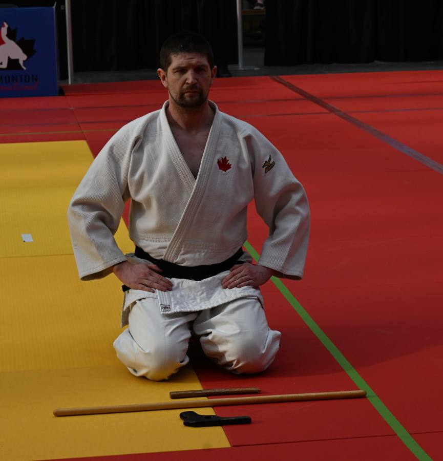

*Le tre armi del Goshin-jutsu: tantō, jō e modello di pistola (foto: Edmonton International Judo Championship 2024, pubblico dominio)*

Il *Buki no Bu* (武器の部, sezione delle armi) del Goshin-jutsu impiega tre armi da allenamento, ciascuna rappresentativa di una categoria di aggressione: il *tantō* per l'arma bianca corta, lo *jō* per il contundente, il *kenjū* (拳銃, pistola) per l'arma da fuoco.

Il **tantō** è un pugnale di legno lungo circa 30 cm. Si porta nella giacca con il **taglio rivolto in su**, e si impugna in **presa normale** nelle minacce e negli affondi lineari (*Tsukkake*, *Choku-tsuki*) o in **presa inversa**, con la lama che esce dal lato del mignolo, nelle pugnalate discendenti dall'alto (*Naname-tsuki*). Regola assoluta del disarmo: mai afferrare il lato della lama.

Lo **jō da judo** è un bastone di legno lungo circa 1 m con diametro di circa 2,5 cm. Va distinto con cura dallo jō di *jōdō* (杖道) e aikidō, lungo 128 cm: il bastone del Goshin-jutsu è un attrezzo specifico del judo, più corto e maneggevole, pensato per i colpi fendenti e le stoccate a due mani previsti dal kata.

Il **kenjū** è un modello di pistola che riproduce l'arma d'ordinanza della polizia giapponese. Per sicurezza **non presenta il foro del grilletto**: nessun dito può entrare nella guardia, il che impedisce sia il gesto riflesso di "premere" sia infortuni alle dita durante le leve di disarmo (in *Koshi-gamae* la leva sul polso, con un'arma reale, travolgerebbe il dito indice di Uke: in allenamento è solo simulata).

Perché armi moderne? Il *Kime no Kata* (極の形, 1888) codificava la difesa contro spada e pugnale, le armi del suo tempo. Nel **1956** il Kodokan, coerente con la stessa logica, creò un kata adeguato alla società contemporanea — rapine a mano armata, bastoni improvvisati, armi da fuoco — conservando i principi del jūdō (*seiryoku zen'yō*, massima efficienza; minimo danno all'aggressore) e accogliendo influssi dell'aikidō di Tomiki. Le armi cambiano, il principio resta.

### 4.2 Maneggio, trasporto e deposizione

Le regole di maneggio derivano direttamente dal cerimoniale descritto nel Capitolo 3:

- **Trasporto**: Uke porta la pistola dentro la giacca; jō e tantō viaggiano insieme nella mano destra, tantō all'interno con il taglio in su, punte in giù e all'indietro.
- **Deposizione**: in *seiza*, nell'ordine bastone → tantō → pistola; tantō con punta a sinistra e taglio verso di sé; pistola con volata a sinistra e impugnatura verso di sé, allineata al fodero.
- **Raccolta e deposizione tra le tecniche**: ginocchio sinistro a terra, mai di schiena a Tori.
- **Restituzione dopo i disarmi**: sempre **a due mani**. Il tantō si restituisce con il **taglio verso di sé**; la pistola con l'**impugnatura verso Uke** e la volata orientata in sicurezza; lo jō parimenti a due mani. È vietato colpire Uke con l'arma sottratta.

La restituzione a due mani non è cortesia superflua: dichiarare l'arma "resa" con entrambe le mani occupate è un gesto tecnico che certifica l'assenza di intenzione residua e conclude lo *zanshin* della tecnica.

### 4.3 Sicurezza e galateo

1. **La pistola è trattata sempre come se fosse carica.** Il modello è inerte per costruzione, ma l'abitudine mentale deve essere quella dell'arma vera: il rispetto del protocollo in palestra forma il comportamento corretto fuori.
2. **La volata non incrocia mai nessuno**: né Tori, né Uke stesso, né il pubblico, né terzi presenti in sala. Durante i controlli (si veda *Haimen-zuke*) la pistola resta puntata in alto.
3. **Nessun dito sul grilletto**: il modello senza foro lo impedisce materialmente, ma la disciplina di non cercare la guardia del grilletto va mantenuta anche nel maneggio.
4. **Mai afferrare la lama del tantō** nei disarmi: la mano che sottrae il pugnale agisce sotto il braccio di Uke, uncinando il polso, e prende l'impugnatura senza toccare il taglio.
5. **Ginocchio vietato sulla schiena** dell'avversario nelle immobilizzazioni: il controllo si esercita sul braccio, non schiacciando il corpo.
6. **Resa**: Uke segnala la resa con due colpi della mano libera — sul tatami o sul proprio corpo — pronunciando l'equivalente di *«mairi»* (参り, "mi arrendo"); Tori rilascia immediatamente.

In ambito agonistico, le regole **IJF** per i kata in gara precisano gli standard degli attrezzi: armi esclusivamente **in legno**, **nessuna parte metallica**, bastone di lunghezza compresa indicativamente tra **92 e 100 cm**. Prima di una competizione o di un esame è obbligo del praticante verificare la conformità dei propri attrezzi allo standard vigente.

Il galateo delle armi, infine, si riassume in un'unica attitudine: ogni arma, anche di legno, è trattata con la serietà dell'arma che rappresenta. È questa serietà condivisa che rende possibile allenare a piena intenzione scenari altrimenti inallenabili.

## 5. Le tecniche Toshu no bu (a mani nude)

### 5.1 Principi comuni della serie

La serie *Toshu no bu* (徒手の部) comprende dodici tecniche di difesa a mani nude: sette contro prese e cinque contro colpi. Ogni esecuzione parte con Tori e Uke frontali a circa 5,5 metri (tre *ken* 間), in *shizen-hontai* (自然本体, postura naturale). L'avvicinamento avviene camminando, con passi ordinari: il kata rappresenta un'aggressione quotidiana, non un combattimento sportivo. Nelle tre tecniche da dietro — *Ushiro-eri-dori*, *Ushiro-jime*, *Kakae-dori* — è Tori che cammina mentre Uke lo segue, cogliendo l'istante per attaccare alle spalle.

La serie si divide in due famiglie didattiche. Contro **le prese** il contatto esiste già: vale il principio del *ju* (柔, cedevolezza), assecondando spinta, trazione o abbraccio e rovesciandoli contro l'aggressore, con un *atemi-waza* (当身技, colpo ai punti vitali) che apre la chiusura finale. Contro **i colpi** il contatto non c'è ancora: la difesa nasce dal controllo della distanza, dal *tai-sabaki* (体捌, spostamento del corpo) che sottrae il bersaglio alla linea d'attacco, e dall'entrata decisa nello spazio lasciato libero. Il colpo più caricato è il più squilibrante: lo si accompagna, non lo si fronteggia.

Il *kiai* (気合) ha regole precise. Lo emette Uke attaccando in *Ryote-dori*, *Naname-uchi*, *Ago-tsuki*, *Ganmen-tsuki* e *Yoko-geri*; lo emette Tori contrattaccando in *Ryote-dori*, *Hidari-eri-dori*, *Migi-eri-dori*, *Kataude-dori*, *Ushiro-eri-dori*, *Kakae-dori*, *Naname-uchi* e *Ganmen-tsuki*. Nessun kiai in *Ushiro-jime* (il difensore lotta per respirare) e in *Mae-geri* (la schivata deve restare fulminea e silenziosa).

La resa è il *mairi* (参り): due battiti. Si batte il tatami con la mano per le leve al suolo, il corpo di Tori per le leve in piedi; in *Ganmen-tsuki*, avendo le mani impegnate nello strangolamento, Uke batte il tatami col piede. Le tecniche che terminano in proiezione non prevedono mairi: Uke esegue solo l'*ukemi* (受身, caduta).

### 5.2 Ryote-dori (両手取) — presa dei due polsi

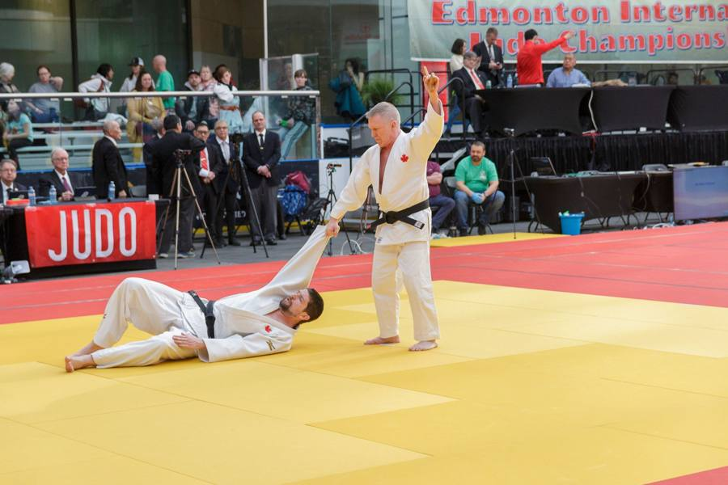

*Ryote-dori: il controllo finale in kote-hineri (foto: EIJC 2025 / David Moulds, pubblico dominio)*

**Lo scenario.** Tori è a destra dello *shomen* (正面). Uke afferra entrambi i polsi di Tori e, con kiai, avanza col sinistro sferrando una ginocchiata destra all'inguine (*kokan* 股間): l'aggressione da strada tipica — immobilizzare le braccia per colpire ai genitali.

**Perché questa difesa.** Ogni presa cede in direzione del pollice: Tori sfila la mano di leva, non di strappo. L'atemi alla tempia (*kasumi* 霞) interrompe l'azione e la leva al polso (*kote-hineri* 小手捻) trasforma il braccio proteso in strumento di controllo: minima forza, massimo dominio.

**La sequenza passo per passo.**

1. Tori indietreggia col sinistro in diagonale e sfila la mano destra flettendo il gomito (leva sul pollice).
2. Con kiai, colpisce la tempia destra di Uke col *te-gatana* (手刀, taglio della mano).
3. Afferra il polso destro di Uke in kote-hineri, rinforzando con la sinistra, dita in alto.
4. Indietreggia col destro ruotando a destra e blocca il braccio sotto l'ascella sinistra.
5. Mairi: due battiti della mano sinistra sul corpo.

**Punti didattici.**

- Sgancio di leva, mai di strappo; presa salda e schiena dritta.
- Atemi simultaneo al passo; *zanshin* (残心, attenzione residua) dopo la resa.

**Errori comuni.**

- Tirare la presa invece di far leva sul pollice.
- Te-gatana senza estensione; braccio non incastrato sotto l'ascella.

### 5.3 Hidari-eri-dori (左襟取) — presa al bavero sinistro

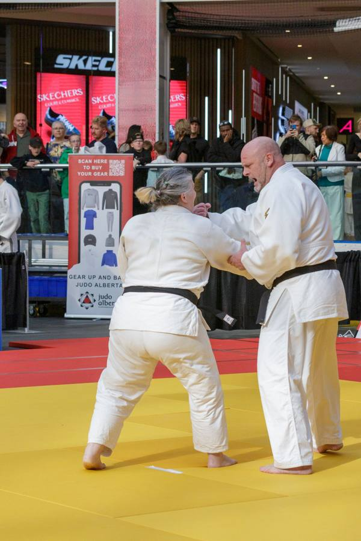

*Hidari-eri-dori: controllo del polso in kote-hineri senza staccare la mano dal bavero (foto: EIJC 2025 / David Moulds, pubblico dominio)*

**Lo scenario.** Tori è a sinistra dello shomen. Uke afferra il bavero sinistro di Tori con la destra, avanza col destro e spinge per abbatterlo: lo spintone da litigio, preludio abituale dei pugni.

**Perché questa difesa.** Alla spinta non si resiste: si asseconda (ju). Indietreggiando nella direzione della forza, Tori acceca l'avversario col *me-tsubushi* (目潰し, colpo agli occhi) e usa la mano di Uke, volutamente lasciata al bavero, come fulcro di una doppia leva: kote-hineri e, al suolo, *ude-hishigi-te-gatame* (腕挫手固).

**La sequenza passo per passo.**

1. Aprendo il bavero con la sinistra, Tori indietreggia in diagonale e con kiai sferra il me-tsubushi agli occhi col dorso della mano destra aperta.
2. Controlla il polso in kote-hineri senza staccarlo dal bavero, gomito fissato in *yahazu* (矢筈, presa a V dell'incavo del gomito).
3. Ruota indietro a destra tirando Uke prono al suolo.
4. Ginocchio sinistro sulla schiena, spinge il braccio verso la testa in *te-gatame* (手固).
5. Mairi: due battiti della mano sinistra al tatami.

**Punti didattici.**

- Mano aperta nel me-tsubushi, mai pugno.
- Tempismo spinta-passo; la mano di Uke resta al bavero; ginocchio come perno.

**Errori comuni.**

- Staccare la mano di Uke dal bavero.
- Arretrare dritto; leva senza fissare il gomito.

### 5.4 Migi-eri-dori (右襟取) — presa al bavero destro

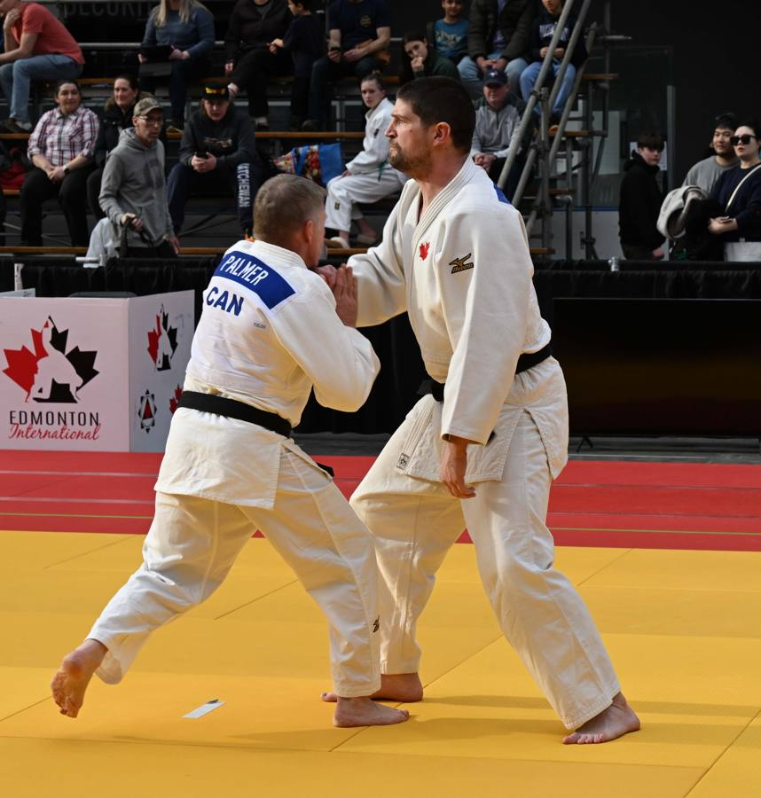

*Migi-eri-dori: chiusura in kote-gaeshi, leva al polso (foto: EIJC 2024, pubblico dominio)*

**Lo scenario.** Tori è a destra dello shomen. Uke afferra il bavero destro di Tori con la destra, quattro dita dentro, e indietreggia col sinistro tirando per atterrarlo: il trascinamento che sbilancia la vittima prima di colpirla.

**Perché questa difesa.** Tori cavalca la trazione: entra col passo nella direzione in cui viene tirato, l'atemi al mento (*shita-ago* 下顎) rompe la struttura e la presa di Uke — che non può mollare il bavero — diventa il vincolo della leva *kote-gaeshi* (小手返, ribaltamento del polso), che lo proietta.

**La sequenza passo per passo.**

1. Tori avanza col destro e con kiai sferra un montante al mento col pugno destro, dorso in basso.
2. Afferra il polso in kote-gaeshi con la sinistra, senza staccarlo dal bavero.
3. Aggiunge la destra, bloccando il polso al proprio petto.
4. Indietreggia col sinistro ruotando a sinistra e proietta Uke per la leva al polso.
5. Uke cade in ukemi: nessun mairi.

**Punti didattici.**

- Entrare nella direzione della trazione; kiai sul montante.
- Leva decisa ma progressiva, per consentire l'ukemi; zanshin.

**Errori comuni.**

- Opporsi alla trazione.
- Appoggiare il ginocchio sul gomito: vietato. Staccare la presa dal bavero.

### 5.5 Kataude-dori (片腕取) — presa di un braccio

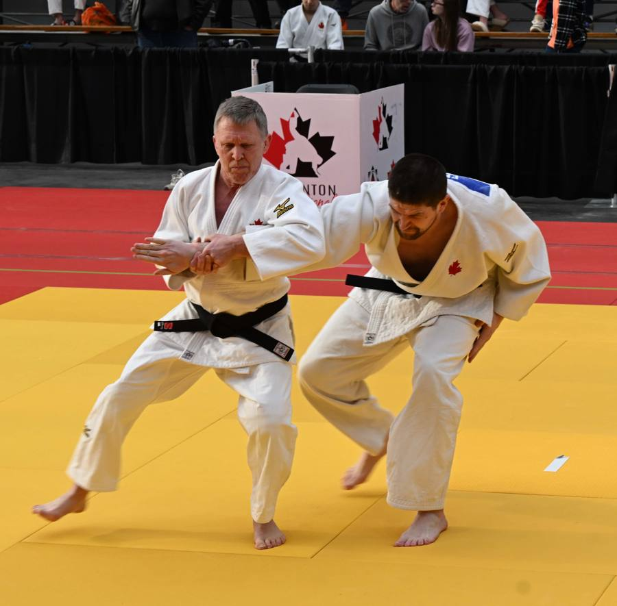

*Kataude-dori: la leva finale ude-hishigi-waki-gatame (foto: EIJC 2024, pubblico dominio)*

**Lo scenario.** Tori è a sinistra dello shomen; Uke, dietro alla sua destra, avanza col sinistro, afferra il polso destro di Tori con la destra e il gomito con la sinistra, spingendolo per tre passi in avanti-diagonale: lo «scortamento» coercitivo, condurre via la vittima per un braccio.

**Perché questa difesa.** Adattamento al movimento: Tori segue i passi senza irrigidirsi, poi il calcio all'interno del ginocchio col *sokuto* (足刀, taglio del piede) spezza la base di Uke e la presa subita si rovescia in *ude-hishigi-waki-gatame* (腕挫脇固, leva al braccio sotto l'ascella).

**La sequenza passo per passo.**

1. Tori segue i tre passi imposti (sinistro-destro-sinistro) ruotando il corpo.
2. Con kiai, calcia l'interno del ginocchio sinistro di Uke col sokuto destro e ripone il piede.
3. Avanza col sinistro e afferra dal basso il polso destro di Uke (yahazu, pollice dentro).
4. Indietreggia col destro ruotando a destra e blocca il gomito in waki-gatame.
5. Mairi: due battiti della mano sinistra sul corpo.

**Punti didattici.**

- Portare il sinistro davanti al destro prima del calcio.
- Presa dal basso corretta; baricentro basso; kiai sul calcio.

**Errori comuni.**

- Irrigidirsi contro la spinta.
- Calcio senza spostamento prelimare; leva senza controllo del polso.

### 5.6 Ushiro-eri-dori (後襟取) — presa al bavero da dietro

**Lo scenario.** Tori, a destra dello shomen, cammina e Uke lo segue. Uke afferra il bavero posteriore con la destra, indietreggia col sinistro e tira per abbatterlo: l'aggressione alle spalle più comune, lo strattonamento che trascina a terra.

**Perché questa difesa.** Tori asseconda la trazione con una rotazione che lo riporta di fronte all'aggressore, col viso protetto dal braccio sinistro. L'atemi al plesso solare (*suigetsu* 水月) toglie respiro e forza; il polso di Uke, ancora aggrappato al bavero, viene incastrato tra collo e spalla e diventa il perno della leva *ude-hishigi-ude-gatame* (腕挫腕固).

**La sequenza passo per passo.**

1. Un passo indietro col sinistro dietro il destro, perno sul tallone sinistro, rotazione a sinistra abbassando il baricentro, viso coperto.
2. Con kiai, pugno destro al suigetsu, dorso in alto.
3. Tori imprigiona il polso destro di Uke tra spalla sinistra e collo.
4. Blocca il gomito in ude-gatame, mano destra sopra la sinistra.
5. Mairi: due battiti della mano sinistra sul corpo.

**Punti didattici.**

- Rotazione bassa e compatta; coprire sempre il volto.
- Pugno sulla linea centrale; doppia presa sulla leva.

**Errori comuni.**

- Girarsi senza coprire il viso; baricentro alto.
- Leva col polso non incastrato tra spalla e collo.

### 5.7 Ushiro-jime (後絞) — strangolamento da dietro

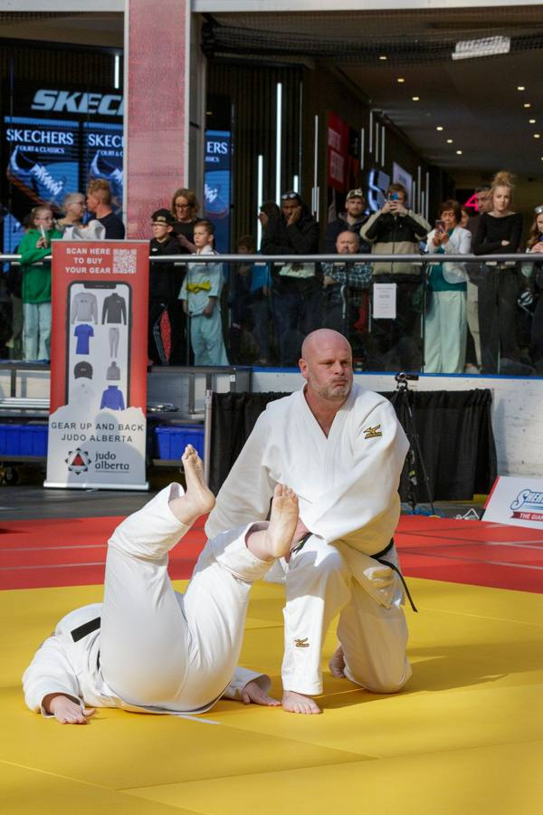

*Ushiro-jime: il controllo finale a terra in te-gatame (foto: EIJC 2025 / David Moulds, pubblico dominio)*

**Lo scenario.** Tori, a sinistra dello shomen, cammina e Uke lo segue. Uke passa il braccio destro oltre la spalla di Tori e tenta *hadaka-jime* (裸絞, strangolamento nudo): l'attacco più letale della serie — la compressione delle carotidi provoca lo svenimento in pochi secondi. Nessun kiai in questa tecnica.

**Perché questa difesa.** Priorità assoluta alle carotidi: mento basso e trazione dell'avambraccio guadagnano tempo. L'uscita avviene sotto l'ascella usando la spalla come leva; il braccio strangolante diventa poi il mezzo della proiezione e della chiusura in te-gatame.

**La sequenza passo per passo.**

1. Mento stretto, entrambe le mani sull'avambraccio di Uke, passo avanti col destro tirando giù.
2. Tori si abbassa ruotando a sinistra.
3. Controlla il braccio con la spalla destra e passa la testa sotto l'ascella, presa sinistra dal basso al polso.
4. Preme il gomito dall'alto con la destra e indietreggia col sinistro, proiettando Uke prono.
5. Leva in te-gatame tirando e sollevando verso la testa. Mairi: due battiti della mano sinistra al tatami.

**Punti didattici.**

- Prima il mento, poi le mani; controllo di spalla nell'uscita.
- La leva agisce tirando E sollevando.

**Errori comuni.**

- Alzare il mento; strappare la presa senza ruotare.
- Leva senza sollevare il braccio verso la testa di Uke.

### 5.8 Kakae-dori (抱取) — abbraccio da dietro

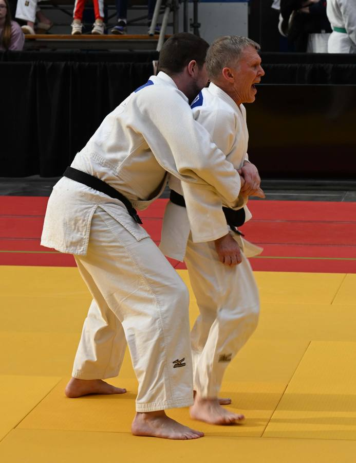

*Kakae-dori: la fase dell’abbraccio da dietro (foto: EIJC 2024, pubblico dominio)*

**Lo scenario.** Tori, a destra dello shomen, cammina e Uke lo segue. Uke avanza col destro e cinge Tori alle anche, sopra le braccia: il *bear hug*, per sollevare o trascinare la vittima bloccandole corpo e braccia.

**Perché questa difesa.** Un atemi doloroso — tallone sul collo del piede — allenta istintivamente la presa; baricentro basso e gomiti in fuori spezzano la cintura. Il braccio più vicino diventa leva al gomito e la stessa forza dell'abbraccio si rovescia nello squilibrio che proietta Uke.

**La sequenza passo per passo.**

1. Con kiai, Tori pesta il collo del piede destro di Uke col tallone destro.
2. Si abbassa spingendo entrambi i gomiti in fuori e spezza la presa.
3. Afferra dall'alto il polso destro di Uke con la sinistra, avambraccio destro sotto il gomito.
4. Avanza col sinistro due volte, poi indietreggia col destro ruotando a destra.
5. Proietta Uke dietro di sé torcendo e spingendo in su il gomito. Ukemi: nessun mairi.

**Punti didattici.**

- Kiai sulla pestata; baricentro basso PRIMA di aprire i gomiti.
- Presa polso-gomito simultanea; zanshin.

**Errori comuni.**

- Aprire i gomiti da stazione alta; pestata debole.
- Torsione eccessiva del braccio, con rischio per il partner.

### 5.9 Naname-uchi (斜打) — colpo obliquo alla tempia

**Lo scenario.** Tori è a destra dello shomen. Uke alza il pugno destro, avanza col destro e con kiai colpisce la tempia sinistra di Tori col fondo del pugno (*uzumaki* 渦巻): lo *haymaker*, il pugno largo della rissa — caricato, telegrafato, squilibrante.

**Perché questa difesa.** Tori esce dalla linea con una rotazione e devia il pugno accompagnandolo nella sua direzione, mai parandolo contro. L'atemi al mento ferma l'avanzata; la mano in yahazu alla parte anteriore del collo (*zen-keibu* 前頸部) controlla la testa — e chi controlla la testa controlla il corpo — per la proiezione con *osoto-otoshi* (大外落, grande falciamento esterno).

**La sequenza passo per passo.**

1. Tori indietreggia col destro ruotando a destra e spazza il braccio di Uke in giù-diagonale con la sinistra, dita in alto.
2. Con kiai, montante destro al mento, dorso in basso.
3. Mano destra in yahazu alla parte anteriore del collo (zen-keibu).
4. La sinistra afferra la manica medio-esterna destra.
5. Proiezione con osoto-otoshi destro. Ukemi: nessun mairi.

**Punti didattici.**

- Non partire prima del *ma-ai* (間合, distanza d'azione); accompagnare il pugno, non pararlo.
- Kiai sul montante; *kuzushi* (崩し, squilibrio) all'indietro prima del falciamento.

**Errori comuni.**

- Parare «contro» il pugno; mano al collo senza yahazu.
- Osoto-otoshi senza squilibrio prelimare.

### 5.10 Ago-tsuki (顎突) — montante al mento

**Lo scenario.** Tori è a sinistra dello shomen. Uke avanza col destro e con kiai sferra un montante destro al mento di Tori, dorso in basso: il colpo caricato dal basso della «rissa da bar», a distanza corta.

**Perché questa difesa.** La deviazione agisce dal basso verso l'alto, usando l'energia stessa del colpo secondo il *ju-no-ri* (柔の理, principio della cedevolezza). Afferrati polso e gomito, il braccio diventa leva: il gomito spinto verso il volto di Uke è un kuzushi strutturale, e il lungo passo finale lo proietta.

**La sequenza passo per passo.**

1. Tori arretra appena col sinistro e spazza in su l'avambraccio destro di Uke con la destra.
2. Afferra il polso destro, pollice in basso.
3. Torce e solleva il braccio.
4. La sinistra afferra il gomito spingendolo verso il volto di Uke.
5. Lungo passo sinistro davanti al piede sinistro di Uke, braccio teso: proiezione in avanti-diagonale. Ukemi: nessun mairi.

**Punti didattici.**

- Deviazione dal basso, mai blocco frontale; presa polso-gomito immediata.
- Passo finale ampio; leva progressiva.

**Errori comuni.**

- Bloccare rigidamente il montante.
- Torcere senza sollevare; passo finale corto.

### 5.11 Ganmen-tsuki (顔面突) — pugno diretto al volto

**Lo scenario.** Tori è a destra dello shomen. Uke avanza col sinistro e con kiai colpisce il volto di Tori col pugno sinistro, dorso in alto: il diretto, il pugno più veloce e comune.

**Perché questa difesa.** Tori non indietreggia: entra in diagonale e occupa il fianco e il retro di Uke, la sua zona cieca, dove non può più colpire né vedere. L'atemi al fianco (*waki-bara* 脇腹) spezza la postura e *hadaka-jime* da dietro chiude il confronto.

**La sequenza passo per passo.**

1. Passo diagonale avanti-destro: schivata del pugno e ingresso dietro il fianco sinistro di Uke.
2. Con kiai, pugno destro al waki-bara.
3. *Tsugi-ashi* (継足, passo susseguente) dietro Uke, avambraccio destro oltre la spalla davanti al collo.
4. Indietreggia in tsugi-ashi e stringe hadaka-jime.
5. Uke cede: mairi battendo due volte il tatami col piede. Tori rilascia spostandosi a sinistra; Uke cade all'indietro in ukemi.

**Punti didattici.**

- Entrata angolare decisa; tsugi-ashi rapido.
- Strozzatura «a V» sulle carotidi, mai sulla trachea; rilascio immediato al mairi.

**Errori comuni.**

- Indietreggiare invece di entrare; presa sulla trachea.
- Tirare giù Uke dopo il mairi: vietato.

### 5.12 Mae-geri (前蹴) — calcio frontale

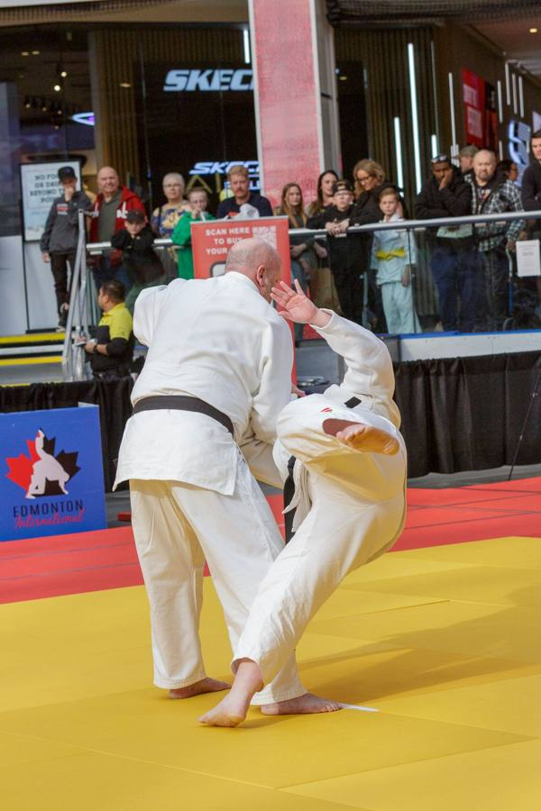

*Mae-geri: la schivata del calcio frontale (foto: EIJC 2025 / David Moulds, pubblico dominio)*

**Lo scenario.** Tori è a sinistra dello shomen. Uke calcia l'inguine (kokan) di Tori col collo del piede destro (*sekito* 跡蹴): il calcio basso da strada, istintivo e diretto a un punto vitale. Nessun kiai in questa tecnica.

**Perché questa difesa.** Con la rotazione del busto il bersaglio sparisce. La gamba, catturata al massimo dell'estensione — con Uke su un solo piede — diventa leva: sollevandola e torcendola si ottiene un kuzushi strutturale che lo atterra.

**La sequenza passo per passo.**

1. Tori indietreggia col destro ruotando a destra e schiva il calcio.
2. Afferra dal basso la caviglia destra di Uke con la sinistra.
3. Pone la destra sulla pianta del piede.
4. Solleva «a cucchiaio» spingendo con entrambe le mani e torcendo la caviglia verso l'esterno.
5. Proietta Uke supino all'indietro. Ukemi: nessun mairi.

**Punti didattici.**

- Afferrare a calcio disteso, non in salita; presa doppia caviglia+pianta.
- Torsione esterna controllata; zanshin.

**Errori comuni.**

- Schivata solo di busto, senza il passo.
- Presa sotto il collo del piede; sollevare senza torsione.

### 5.13 Yoko-geri (横蹴) — calcio laterale

**Lo scenario.** Tori è a destra dello shomen. Uke passa in diagonale col sinistro ruotando il corpo e con kiai calcia il fianco destro di Tori (waki-bara) col sokuto destro: il calcio laterale di potenza, l'attacco «decisivo» di chi ha basi marziali.

**Perché questa difesa.** Contro la potenza non si fugge: si accorcia la distanza verso la gamba d'appoggio, dove il calcio laterale non ha forza. L'avambraccio teso devia, le mani prendono le spalle da dietro e la trazione scatta nell'istante in cui Uke si raddrizza per stabilizzarsi: kuzushi sull'attimo di riassetto.

**La sequenza passo per passo.**

1. Tori entra in diagonale a sinistra spazzando il calcio con l'avambraccio destro teso, dita unite e tese.
2. Porta il sinistro avanti passando dietro Uke.
3. Entrambe le mani sulle spalle di Uke.
4. Quando Uke si raddrizza, Tori tira in diagonale-indietro-destra inginocchiando il sinistro.
5. Uke cade supino in ukemi. Nessun mairi.

**Punti didattici.**

- Entrare incontro al calcio, mai fuggire; avambraccio teso.
- Attendere il rialzo prima di tirare; ginocchio sinistro come ancora; zanshin.

**Errori comuni.**

- Parare allontanandosi, subendo la massima potenza.
- Tirare mentre Uke è ancora sbilanciato in avanti; dita rilassate.

## 6. Le tecniche Buki no bu (contro le armi)

### 6.1 Principi comuni della serie armata

Il *Buki no bu* (武器の部), la serie contro le armi, chiude il Kōdōkan Goshin-jutsu portando il judoka di fronte al problema più arduo della difesa personale: l'aggressore armato. Le nove tecniche si dividono in tre gruppi: tre contro il pugnale (*tantō*, 短刀), tre contro il bastone (*jō*, 杖) e tre contro la pistola (*kenjū*, 拳銃). Va notata subito una finezza terminologica del Kōdōkan: per il coltello e il bastone gli attacchi si chiamano *tsuki* (突, "affondo"), per la pistola *zuke* (付, "applicazione"), perché l'arma da fuoco non colpisce ma viene puntata addosso al bersaglio.

Il primo principio è il *ma-ai* (間合), la distanza d'ingaggio, che cambia radicalmente con l'arma. Contro lo *jō*, che misura circa un metro e richiede spazio per il caricamento, i partner camminano a distanza di circa tre passi; l'attacco scatta quando la distanza si è chiusa. Contro il *tantō* il ma-ai si riduce a mezzo passo: la lama corta è letale solo a contatto ravvicinato, e tutta la tattica dell'aggressore consiste nel fingere, avvicinarsi ed estrarre. Contro la pistola il ma-ai è il contatto stesso: il rapinatore preme la volata sul corpo della vittima, ed è proprio questa vicinanza — il suo errore tattico — a rendere possibile la difesa. In tutta la serie i due partner avanzano l'uno verso l'altro in camminata naturale e l'attacco parte esattamente al raggiungimento del ma-ai: Tori (取, colui che esegue la difesa) deve leggere l'istante, non anticiparlo né subirlo.

Il secondo principio è l'uso del *kiai* (気合), il grido di concentrazione energetica. Il kiai accompagna tutti gli attacchi veri e tutti gli *atemi* (当身, colpi ai punti vitali) di Tori: segna l'esplosione dell'azione. È invece deliberatamente assente nei caricamenti — l'estrazione intimidatoria del pugnale in Tsukkake e il sollevamento del bastone in Furi-age — perché un aggressore reale non annuncia con un grido il momento in cui prepara il colpo. Questo realismo fonetico è anche un indizio didattico prezioso: insegna a riconoscere la fase preparatoria silenziosa, che è proprio la finestra di opportunità per la difesa.

Il terzo principio è etico prima che tecnico: "fermare l'alabarda col minimo danno". Come nel Kime no Kata si neutralizza il portatore della lama senza annientarlo, così qui Tori impiega la misura minima di forza necessaria: uno squilibrio, un atemi secco, una leva articolare che induce la resa. È il principio di massima efficienza applicato alla coscienza del difensore: l'arma impone fermezza, la filosofia del jūdō impone controllo.

Quarto principio: la gestione dell'arma catturata. I disarmi non sono sistematici ma ragionati. Si disarma quando l'arma, dopo l'azione, resta disponibile e pericolosa — Naname-tsuki, Furi-oroshi, Morote-tsuki e tutte e tre le tecniche di pistola. Non si disarma in Tsukkake, Choku-tsuki e Furi-age: in Tsukkake la tecnica termina con una leva a terra e Uke (受, colui che riceve) ripone da sé il pugnale rialzandosi; in Choku-tsuki la leva in piedi sull'armato occupa entrambe le mani di Tori; in Furi-age Uke conserva il bastone durante l'*ukemi* (受身, la caduta controllata). Quando il disarmo avviene, la restituzione è sempre a due mani: il tantō con il taglio verso di sé, lo jō orizzontale, la pistola con l'impugnatura verso Uke e la volata che non incrocia mai nessuno. Trattare l'arma restituita come sempre carica e pericolosa è galateo e insieme addestramento alla realtà.

Ultimo principio, lo *zanshin* (残心), l'attenzione residua. La tecnica non finisce con la proiezione o la resa: finisce con il controllo vigile — la guardia finale col bastone puntato su Uke in Morote-tsuki, la distanza mantenuta, il non voltare mai le spalle. Lo zanshin trasforma un trucco di disarmo in un comportamento di sopravvivenza.

### 6.2 Tsukkake (突掛) — la minaccia del coltello

**Lo scenario.** A distanza breve, mezzo passo, Uke estrae il tantō dalla giacca indietreggiando col piede destro e porta la lama in su, pronta al fianco destro. Non colpisce ancora: mostra l'arma. L'aggressore reale fa quasi sempre così — brandisce il coltello per paralizzare la vittima prima della pugnalata, per rapinarla o umiliarla. Ma nel gesto intimidatorio si concede, per un istante, vulnerabile.

**Perché questa difesa.** La risposta è un'azione preventiva sul principio del *sen-sen-no-sen* (先々の先, anticipare l'anticipo): Tori non tocca la lama, colpisce l'equilibrio e gli occhi di Uke prima che la pugnalata possa partire. Si attacca l'uomo, non l'arma.

**La sequenza passo per passo.**

1. Tori entra profondo, destro-sinistro, sul fianco sinistro di Uke, fuori dalla traiettoria della lama.
2. Con la mano destra controlla il gomito sinistro di Uke, pollice in su.
3. Porta il *me-tsubushi* (目潰し, accecamento) agli occhi col palmo sinistro, con kiai.
4. Afferra dall'alto il polso sinistro di Uke, lo torce e lo solleva spingendo sul gomito.
5. In *tsugi-ashi* (継足, passo di trascinamento) all'indietro, trascina Uke fino a metterlo prono.
6. Applica *ude-hishigi-te-gatame* (腕挫手固) sul gomito sinistro. Uke cede battendo due colpi col destro (*mairi*, 参り, "mi arrendo").

**Punti didattici.** Nessun disarmo è previsto: Uke ripone il pugnale rialzandosi, perché la leva occupa Tori e l'arma non è più minacciosa. Tutto dipende dall'entrare prima che la pugnalata parta.

**Errori comuni.** Attendere l'affondo anziché agire sul caricamento; mettere il ginocchio sulla schiena di Uke (vietato); estrarre il tantō con la lama non rivolta in su.

### 6.3 Choku-tsuki (直突) — affondo diretto del coltello

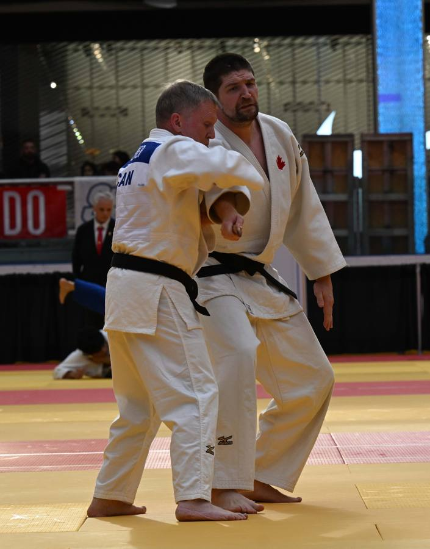

*Choku-tsuki: la difesa dall’affondo diretto del coltello (foto: EIJC 2024, pubblico dominio)*

**Lo scenario.** Uke estrae il tantō avanzando col piede sinistro e affonda col destro, in linea retta, al ventre di Tori, con kiai. È la pugnalata più istintiva e più veloce a distanza corta: un vettore lineare che non ammette parate statiche.

**Perché questa difesa.** Si risponde con il *tai-sabaki* (体捌, gestione del corpo) che toglie il bersaglio dalla linea, con un atemi che rompe il kuzushi e con una leva sul gomito del braccio armato. Corpo fuori linea, mani sulla leva: mai il contrario.

**La sequenza passo per passo.**

1. Tori avanza col piede sinistro ruotando il corpo a destra, uscendo dalla traiettoria.
2. Con la sinistra controlla il gomito destro di Uke, dita in giù.
3. Porta un pugno destro dal basso al mento — *shita-ago* (下顎) — con kiai.
4. Afferra il polso destro di Uke dal basso con la destra, ponendo la sinistra sopra.
5. Sbilancia Uke verso l'angolo anteriore destro.
6. Applica *ude-hishigi-waki-gatame* (腕挫腋固) in piedi. Resa: due colpi con la sinistra.

**Punti didattici.** Si para spostando il corpo, non il braccio; il waki-gatame si esegue avanzando in tsugi-ashi verso l'angolo destro, in movimento continuo.

**Errori comuni.** Parare senza spostare il corpo; applicare la leva da fermi, staticamente, senza il passo che la alimenta.

### 6.4 Naname-tsuki (斜突) — pugnalata obliqua dall'alto

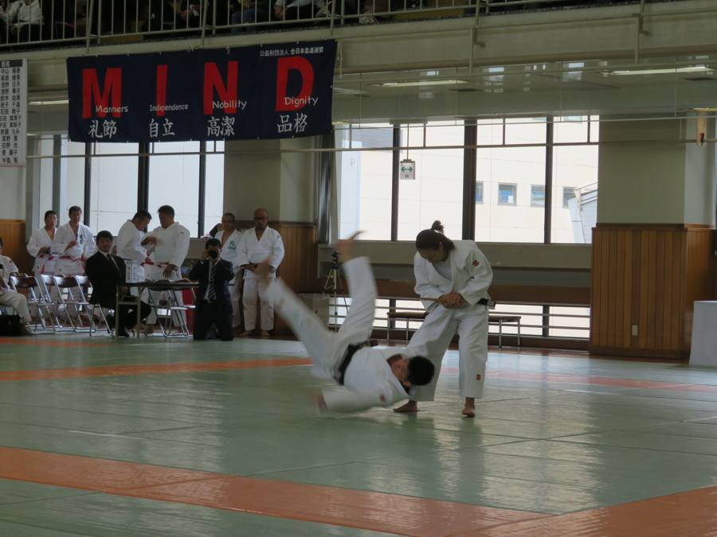

*Naname-tsuki: la pugnalata obliqua dall’alto, All Japan Kata 2019 (foto: Sanshiro5304, CC BY-SA 4.0)*

**Lo scenario.** Uke estrae il tantō in presa inversa, lama in su sopra la testa, e colpisce in diagonale discendente il lato sinistro del collo di Tori, con kiai. È l'attacco "ice-pick": sfrutta la gravità e la forza di tutto il corpo, ed è devastante se giunge a segno.

**Perché questa difesa.** La schivata laterale sottrae il collo, e il *kote-gaeshi* (小手返, rovesciamento del polso) impiega l'energia discendente dell'attacco come motore della proiezione: più Uke colpisce forte, più cade.

**La sequenza passo per passo.**

1. Tori indietreggia col destro ruotando a destra e schiva il colpo.
2. Afferra il polso destro di Uke in kote-gaeshi con la sinistra, e subito sovrappone la destra.
3. Avanti col destro, indietro col sinistro: rotazione e proiezione.
4. Porta il ginocchio destro al fianco di Uke a terra.
5. **Disarmo:** la mano destra passa sotto il braccio di Uke ad uncinargli il polso, la sinistra sottrae il pugnale senza toccare il taglio, applicando ude-hishigi-te-gatame.
6. Restituisce il tantō a due mani, taglio verso di sé.

**Punti didattici.** La rotazione di 180° nel tai-sabaki è ciò che genera la proiezione; il ginocchio al fianco fissa Uke per un disarmo sicuro.

**Errori comuni.** Afferrare la lama durante il disarmo; bloccare il braccio invece di schivare il colpo.

### 6.5 Furi-age (振上) — il caricamento del bastone

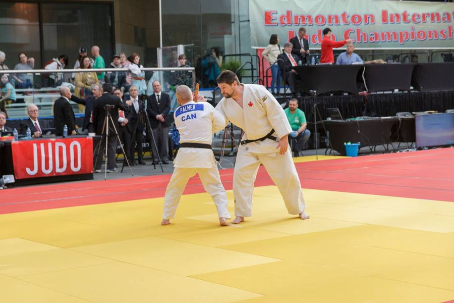

*Furi-age: il caricamento del bastone, Uke solleva lo jō sopra la testa (foto: EIJC 2024, pubblico dominio)*

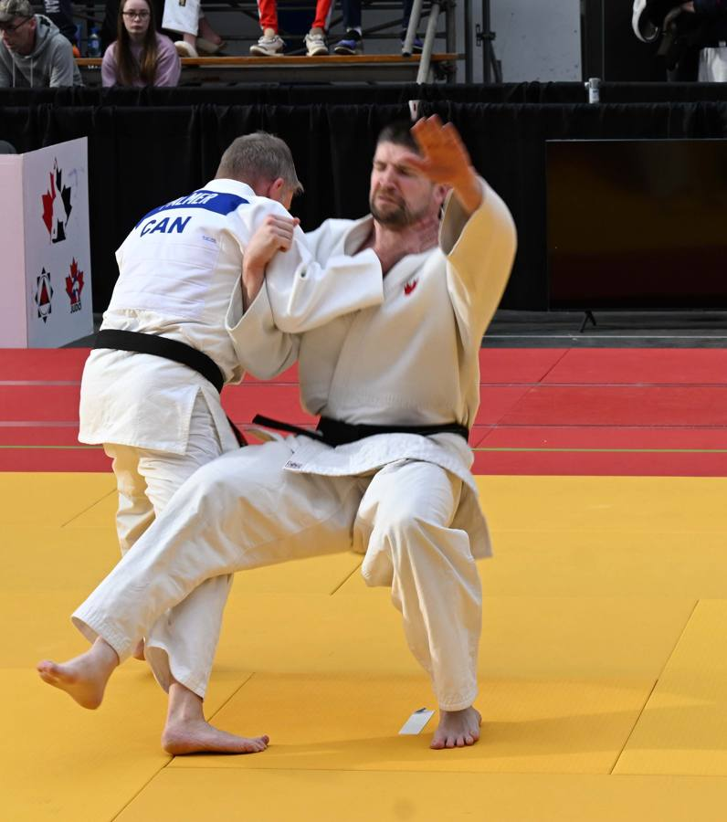

*Furi-age: la risposta di Tori (foto: EIJC 2024, pubblico dominio)*

**Lo scenario.** Uke indietreggia col destro e solleva lo jō sopra la testa, in silenzio: nessun kiai, perché è il caricamento, non ancora il colpo. Chi attacca con un bastone ha bisogno di un movimento ampio per imprimere forza — e quel movimento ampio è la sua confessione.

**Perché questa difesa.** Il caricamento è una finestra di opportunità: Tori irrompe in profondità prima che il colpo cada, blocca il braccio che regge l'arma e colpisce il mento con la base del palmo, *shōtei* (掌底), chiudendo con *o-soto-gari* (大外刈). Non c'è disarmo: Uke mantiene la presa sul bastone durante l'ukemi, e la caduta risolve il pericolo.

**La sequenza passo per passo.**

1. Tori balza in avanti col sinistro sul fianco destro di Uke.
2. Blocca il braccio destro di Uke con l'avambraccio sinistro.
3. Spinge lo shōtei destro sotto il mento, con kiai.
4. Afferra il bavero sinistro di Uke.
5. Proietta con o-soto-gari destro.

**Punti didattici.** L'entrata deve essere un balzo, non un passo: il bastone alto non concede tempo. Lo shōtei al mento è insieme atemi e kuzushi.

**Errori comuni.** Entrare in ritardo, quando il fendente è già partito; shōtei debole, senza squilibrio, che lascia Uke eretto e armato.

### 6.6 Furi-oroshi (振下) — il fendente del bastone

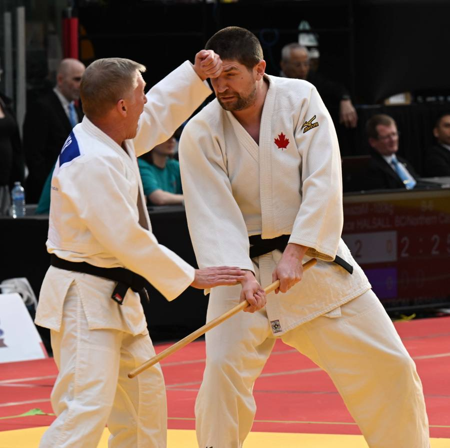

*Furi-oroshi: la schivata del fendente del bastone (foto: EIJC 2024, pubblico dominio)*

**Lo scenario.** Uke solleva lo jō a due mani in alto a destra e abbatte il colpo sul lato sinistro della testa di Tori, con kiai. Il fendente alla testa è l'attacco più istintivo e più comune con un bastone: lo si incontrerà quasi certamente.

**Perché questa difesa.** Schivata fuori linea, doppio atemi per spezzare volontà ed equilibrio, poi strappo dell'arma. Qui il disarmo c'è, perché il bastone di un aggressore colpito ma non controllato resta letale: va tolto subito.

**La sequenza passo per passo.**

1. Tori arretra col destro in guardia sinistra e schiva il fendente.
2. Balza in avanti dal sinistro e colpisce il volto con l'*uraken* (裏拳, dorso del pugno), con kiai.
3. Porta il *te-gatana* (手刀, taglio della mano) sinistro a *uto* (兎臼, il punto fra le sopracciglia), con kiai.
4. La destra afferra il bastone.
5. Spinge Uke all'indietro fino a terra e **strappa lo jō: disarmo**.
6. Restituisce l'arma a due mani.

**Punti didattici.** La mano dell'atemi continua a spingere durante la caduta di Uke: la pressione non si interrompe mai.

**Errori comuni.** Schivata insufficiente, che lascia la testa sul percorso dello jō; afferrare il bastone prima di aver completato gli atemi.

### 6.7 Morote-tsuki (双手突) — l'affondo a due mani del bastone

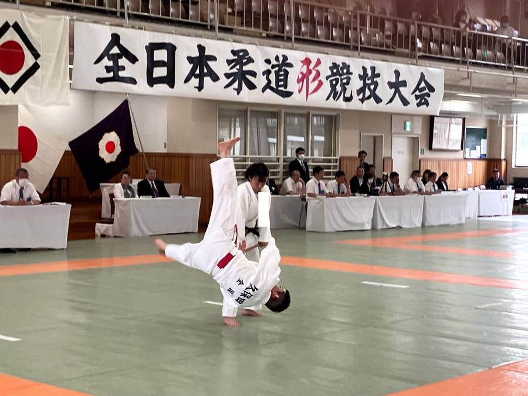

*Morote-tsuki: lo jō puntato al suigetsu (foto: EIJC 2024, pubblico dominio)*

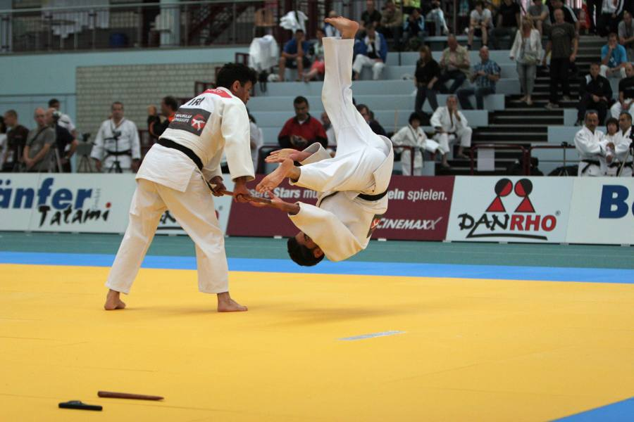

*Morote-tsuki: la difesa di Tori (foto: EIJC 2024, pubblico dominio)*

**Lo scenario.** In guardia sinistra, Uke punta l'estremità dello jō al *suigetsu* (水月, il plesso solare) di Tori e affonda in tsugi-ashi, con kiai. La stoccata è veloce, difficile da vedere, diretta a un punto vitale: è il modo "intelligente" di usare un bastone corto.

**Perché questa difesa.** Una deviazione diagonale toglie la punta dalla linea, e la presa multipla sull'arma trasforma lo jō stesso in una leva sul gomito di Uke: l'aggressore viene proiettato dalla propria arma.

**La sequenza passo per passo.**

1. Tori avanza col destro ruotando il corpo a sinistra.
2. Devia lo jō a sinistra con la mano destra, dita in su.
3. La sinistra afferra il bastone davanti alla presa sinistra di Uke.
4. La destra afferra lo jō fra le mani di Uke passando sotto il suo braccio, col piede destro davanti ai piedi di Uke.
5. Tsugi-ashi applicando la leva sul gomito sinistro.
6. Proiezione all'angolo anteriore destro; Tori mantiene il bastone: **disarmo**.
7. Guardia finale sinistra con la punta dello jō verso Uke: **zanshin**.

**Punti didattici.** Uke esegue *zenpō-kaiten ukemi* (前方回転受身, caduta ruotata in avanti), resta un respiro a terra e si rialza naturalmente. La guardia finale col bastone è lo zanshin esplicito della serie.

**Errori comuni.** Deviare lo jō senza entrare col corpo; dimenticare la guardia finale, che chiude la tecnica.

### 6.8 Shomen-zuke (正面付) — pistola all'addome

**Lo scenario.** Rapina. Uke intima *"Te wo agero!"* (手を上げろ, "mani in alto!") e Tori alza lentamente le mani. La volata è premuta sul ventre, a mezzo passo destro: il rapinatore ha avvicinato l'arma per perquisire, commettendo il suo errore tattico. Il momento d'oro è quando Uke guarda in basso per la perquisizione — una distrazione reale, documentata nelle rapine.

**Perché questa difesa.** Regola assoluta della serie armata da fuoco: PRIMA si esce dalla linea di tiro, POI si tocca l'arma. Qui l'uscita avviene per rotazione dei fianchi con i piedi fermi; il disarmo si ottiene per leva combinata su polso e dita.

**La sequenza passo per passo.**

1. Tori ruota i fianchi a destra senza muovere i piedi: l'addome esce dalla volata.
2. Afferra la canna con la sinistra, pollice in su, e la devia.
3. La destra afferra il polso di Uke dall'alto.
4. Tira il polso a sé e spinge la volata verso l'ascella destra di Uke.
5. **Disarmo per leva:** le dita di Uke finiscono puntate verso la propria ascella.
6. Restituzione a due mani, impugnatura verso Uke, volata a destra.

**Punti didattici.** Durante tutta l'azione la volata non incrocia mai Tori, Uke in modo incontrollato, né terzi. Vietato colpire Uke con la pistola catturata.

**Errori comuni.** Muovere i piedi prima delle anche; afferrare l'arma prima di essere usciti dalla linea di tiro.

### 6.9 Koshi-gamae (腰構) — pistola all'anca

**Lo scenario.** Uke, tiratore "prudente", tiene la pistola al fianco destro, retratta e lontana da Tori, puntata all'addome con il sinistro avanti; poi si avvicina per perquisire, intimando "Te wo agero!". Anche qui l'istante propizio è lo sguardo in basso.

**Perché questa difesa.** L'arma retratta non si può deviare con una mano sola: serve la presa a due mani sulla canna, e la torsione dei fianchi piega il polso di Uke verso l'esterno fino al cedimento. È l'unica tecnica della serie in cui è previsto colpire Uke con la pistola — col calcio, non con la volata.

**La sequenza passo per passo.**

1. Tori ruota i fianchi a sinistra uscendo dalla linea di tiro.
2. La destra afferra la canna dall'alto, dita in su.
3. La sinistra afferra da sotto: presa doppia.
4. Trazione a destra torcendo i fianchi: **disarmo per leva sul polso**.
5. Colpo al volto con il calcio della pistola, con kiai.
6. Restituzione standard a due mani.

**Punti didattici.** Il modello da judo della kenjū non ha foro del grilletto per sicurezza: la leva "romperebbe" il dito di Uke, quindi in allenamento va solo simulata con controllo assoluto.

**Errori comuni.** Trazione fatta solo di braccia, senza i fianchi; volata che durante la torsione incrocia il proprio corpo.

### 6.10 Haimen-zuke (背面付) — pistola alla schiena

**Lo scenario.** Uke è dietro Tori: entrambi camminano. Al comando, la volata si preme al centro della schiena e Uke inizia la perquisizione del fianco sinistro. Il rapinatore da tergo, per frugare la vittima, si avvicina troppo: la pistola diventa raggiungibile.

**Perché questa difesa.** Non si può deviare ciò che non si vede: la rotazione sul posto, abbassandosi, toglie la colonna vertebrale dalla linea di tiro senza bisogno di guardare l'arma. Poi il blocco dell'avambraccio contro il corpo e il kote-gaeshi completano disarmo e proiezione.

**La sequenza passo per passo.**

1. Tori ruota il corpo in basso a destra, sul posto: la schiena lascia la volata.
2. Il braccio destro passa sotto il braccio armato di Uke intrappolandogli l'avambraccio contro il proprio corpo, pistola rivolta verso l'alto.
3. Passo laterale col sinistro.
4. La sinistra afferra la canna, pollice in su.
5. Passo indietro col sinistro e proiezione con **disarmo**, sul principio del kote-gaeshi.
6. Restituzione standard a due mani.

**Punti didattici.** Per tutto il controllo la pistola punta in alto, mai verso Tori né verso terzi: la volata non incrocia nessuno, in nessuna fase.

**Errori comuni.** Girarsi guardando indietro prima di ruotare; rotazione lenta del busto, che lascia la schiena esposta durante l'intrappolamento.

*Le nove tecniche del Buki no bu completano il percorso del Goshin-jutsu: dallo studio del corpo disarmato a quello della minaccia armata, il principio resta unico — leggere l'attacco nell'istante in cui nasce, rispondere con la misura esatta, restare vigili oltre la resa.*

## 7. Principi didattici trasversali e note di studio

Chi ha studiato con attenzione le ventuno tecniche del Kōdōkan Goshin-jutsu avrà notato che, pur cambiando scenario, arma e ruolo, ogni difesa risponde alla stessa logica. Il kata non è una raccolta di ricette isolate: è un sistema. Riconoscerlo è il primo passo per smettere di memorizzare e cominciare a capire.

### 7.1 Lo schema ricorrente di ogni difesa

Ogni tecnica, dalla presa di Ryote-dori alla pistola puntata alla schiena di Haimen-zuke, si svolge in quattro fasi. Imparate a vederle, e il kata vi apparirà come un'unica forma ripetuta ventuno volte.

**Fase 1 — Gestione della distanza e uscita dalla linea d'attacco.** Prima di qualsiasi tecnica c'è il corpo che si sposta. Contro le prese (dori) la risposta non è tirare contro ma *assecondare*: si entra nella direzione della presa, cedendo con il ju, e si usa la forza stessa dell'aggressore per aprire lo spazio dell'atemi. Contro i colpi (uchi, geri) ci si sposta in diagonale, fuori dalla traiettoria, con tai-sabaki: il colpo passa dove noi non siamo più. Contro le armi la regola è ancora più severa: *prima* si ruotano i fianchi e si esce dalla linea della lama o della canna, *poi* — e solo poi — si tocca l'arma. Chi tocca prima l'arma e poi si sposta ha invertito l'ordine e rischia di essere colpito.

**Fase 2 — Atemi di neutralizzazione.** L'atemi colpisce punti vitali precisi — kasumi (tempia), shita-ago (sotto il mento), suigetsu (plesso solare), waki-bara (fianco), kokan (inguine) — ma il suo scopo didattico non è il KO. L'atemi *rompe la concentrazione* dell'aggressore: il colpo al suigetsu toglie il respiro, quello al kasumi toglie l'equilibrio, il calcio al kokan interrompe ogni intenzione. È la kuzushi della difesa personale: senza questa rottura, qualsiasi leva o proiezione successiva sarebbe forzata e pericolosa.

**Fase 3 — Controllo della fonte della minaccia.** Neutralizzato l'aggressore, si controlla ciò che rende pericolosa la situazione. A mani nude la minaccia è il braccio che colpisce o la mano che afferra: la si controlla con leve al polso (kote-hineri, kote-gaeshi) o con la presa yahazu sul gomito, che prepara le chiusure articolari. Contro un'arma la minaccia è l'arma stessa: si controlla *il polso che la regge*, mai la lama, mai la volata. Afferrare la lama del tantō o la canna della pistola significa regalare all'aggressore il controllo del duello.

**Fase 4 — Chiusura proporzionata.** Solo ora arriva la tecnica di definizione: una leva articolare (te-gatame, waki-gatame, ude-gatame), una proiezione (o-soto-gari, osoto-otoshi), uno strangolamento (hadaka-jime), con il disarmo dove previsto. La scelta non è casuale: la chiusura deve essere *proporzionata* alla minaccia. Il criterio guida è il "minimo danno": il difensore ferma l'aggressione con la misura minima necessaria, come lo yari-dome del Kime no Kata ferma l'alabarda senza abbattere il cavaliere. Il Goshin-jutsu non insegna a punire: insegna a risolvere.

Attraverso tutte e quattro le fasi domina il **ju-no-ri**, il principio di cedevolezza. La forza dell'aggressore non viene mai contrastata frontalmente: viene cavalcata, deviata, prolungata oltre il suo punto di equilibrio. Chi resiste alla presa la rafforza; chi cede nella direzione giusta la trasforma nella propria opportunità.

### 7.2 Kiai, zanshin e mairi: il linguaggio del kata

Il kata parla anche attraverso la voce, lo sguardo e l'inclinazione del capo. Questi elementi non sono decorazione: sono parte della tecnica.

**Kiai.** Il grido marziale ha una grammatica precisa. Uke emette il kiai *sugli attacchi*: è l'espressione dell'intento reale di colpire o afferrare, senza il quale la pratica diventerebbe una danza. Tori risponde con il kiai *sugli atemi*, quando l'energia si concentra sulla neutralizzazione. Per realismo il kiai è invece *assente* dove un aggressore vero non griderebbe: nei caricamenti silenziosi di Tsukkake (coltello) e Furi-age (bastone), e negli attacchi a sorpresa come Ushiro-jime e Mae-geri. Il silenzio di Uke è una scelta didattica: la minaccia reale non sempre si annuncia.

**Zanshin.** Dopo ogni chiusura, la tecnica non è finita. Zanshin — la "mente che resta" — si manifesta concretamente: nella guardia finale mantenuta in Morote-tsuki, dove Tori conserva il controllo con il jō sottratto; nelle restituzioni formali delle armi, eseguite con l'etichetta corretta; nel non voltare mai le spalle all'avversario abbattuto. Lo zanshin è la prova che il "minimo danno" non è casualità: è controllo prolungato finché la minaccia è davvero cessata.

**Mairi.** Il leggero inchino del capo — mairi, letteralmente "visita", omaggio — punteggia il kata. Si esegue di regola con *due battiti*, atteso e misurato, mai frettoloso. In Ganmen-tsuki il mairi è marcato dal piede che scandisce il passo. Dopo le proiezioni, invece, Uke esegue l'ukemi *senza* mairi: il corpo che cade è già impegnato nella protezione, e il cerimoniale cede alla sicurezza del ruolo. Nella serie contro la pistola, infine, il comando **"Te wo agero!"** ("Mani in alto!") sostituisce la gestualità formale: è Tori che detta i termini della resa, e la voce diventa parte del dispositivo di controllo.

### 7.3 Consigli di studio e preparazione

**Imparate lo schema prima delle varianti.** Le quattro fasi del §7.1 sono la chiave di volta: chi le possiede ricostruisce ragionando una tecnica dimenticata; chi ha memorizzato solo le sequenze resta in panne al primo errore del partner. Studiate ogni tecnica chiedendovi: dove esco di linea? Quale atemi rompe la concentrazione? Cosa controllo? Con quale misura chiudo?

**Allenate i ruoli separatamente.** Uke non è una parte minore: attacchi credibili, prese salde ma non rigide, ukemi sicuri, kiai nei punti giusti. Un Tori eccellente con un Uke mediocre produce un kata mediocre. Cambiate ruolo spesso: è il modo più rapido per capire cosa l'attacco pretende dalla difesa.

**Usate i nomi corretti.** La precisione terminologica è rispetto per la forma: si dice *Kataude-dori* (non "Kata-ate-dori", errore diffuso nei testi non ufficiali), *Ganmen-tsuki* (non "Gammen-tsuki"). Controllate sempre i nomi contro il testo ufficiale.

**Cura e sicurezza delle armi.** Tantō, jō e pistola si trattano come armi vere, sempre: si trasportano e si depongono con l'etichetta prevista, non si abbandonano mai a terra fuori dal cerimoniale. La pistola modello deve essere priva del foro del grilletto (a norma di sicurezza per le competizioni) e la volata non deve *mai* essere puntata verso persone, nemmeno per scherzo, nemmeno con un modello inerte.

**Studiate sulle fonti ufficiali.** Il riferimento testuale è il *Kodokan Kata Textbook* dedicato al Goshin-jutsu; il riferimento visivo sono le esecuzioni dei *World Kata Championships*, dove le coppie di altissimo livello mostrano il kata nella forma attesa oggi. I video non sostituiscono il maestro, ma correggono le derive di chi apprende solo da testi scritti.

**Praticate lentamente, con intento reale.** La velocità è una conseguenza, non un obiettivo. Ogni ripetizione deve avere *iki-ai* — la respirazione e l'intenzione allineate tra i due partner —: Uke attacca come se volesse davvero colpire, Tori difende come se dovesse davvero proteggersi, entrambi a un ritmo che permette di sentire ogni fase. Il kata eseguito in fretta e senza intento è ginnastica; il kata lento e sincero è già difesa personale.

## 8. Glossario dei termini giapponesi

| Termine | Kanji | Significato |
|---|---|---|
| Kōdōkan Goshin-jutsu | 講道館護身術 | L'arte di difesa personale del Kōdōkan; kata in 21 tecniche istituito nel 1956 |
| Toshu no bu | 徒手の部 | Serie "a mani nude" del kata: 12 difese contro prese e colpi |
| Buki no bu | 武器の部 | Serie "delle armi": 9 difese contro coltello, bastone e pistola |
| Tori | 取 | Chi esegue la tecnica; nel Goshin-jutsu, il difensore |
| Uke | 受 | Chi riceve la tecnica; nel Goshin-jutsu, l'aggressore |
| Shōmen | 正面 | Fronte; punto di riferimento frontale del dojo per saluti e posizionamento |
| Shizen-hontai | 自然本体 | Postura naturale fondamentale, posizione eretta rilassata |
| Ritsurei | 立礼 | Saluto in piedi |
| Ma-ai | 間合 | Distanza di ingaggio corretta tra i due partner |
| Tai-sabaki | 体捌 | Gestione e spostamento del corpo; uscita dalla linea d'attacco |
| Kuzushi | 崩 | Rottura dell'equilibrio e della postura dell'avversario |
| Ju-no-ri | 柔の理 | Principio di cedevolezza: cavalcare la forza altrui invece di contrastarla |
| Atemi-waza | 当身技 | Tecniche di percussione ai punti vitali |
| Kansetsu-waza | 関節技 | Tecniche di leva articolare |
| Kote-hineri | 小手捻 | Leva di torsione al polso ("torsione dell'avambraccio/mano") |
| Kote-gaeshi | 小手返 | Leva di rovesciamento del polso verso l'esterno |
| Yahazu | 矢筈 | Presa "a tacca di freccia": pollice e indice a V sul gomito per controllarlo |
| Te-gatana | 手刀 | "Mano a spada": taglio della mano usato per colpire |
| Shōtei | 掌底 | Palmo/pianta della mano: colpo portato con la base del palmo |
| Uraken | 裏拳 | "Pugno rovescio": colpo portato col dorso del pugno |
| Sokuto | 足刀 | "Piede a spada": taglio esterno del piede usato per calciare |
| Me-tsubushi | 目潰し | "Accecamento": azione disturbatrice verso gli occhi |
| Hadaka-jime | 裸絞 | Strangolamento "nudo", eseguito con il solo avambraccio |
| Ude-hishigi-te-gatame | 腕挫手固 | Leva al gomito controllata con le mani (te-gatame) |
| Ude-hishigi-waki-gatame | 腕挫腋固 | Leva al gomito bloccata sotto l'ascella (waki-gatame) |
| Tantō | 短刀 | Pugnale/coltello corto; arma della prima serie armata |
| Jō | 杖 | Bastone (circa 128 cm); arma della seconda serie armata |
| Kenjū | 拳銃 | Pistola; arma della terza serie armata (modello inerte in pratica) |
| Kiai | 気合 | Gridio di unione dell'energia: Uke sugli attacchi, Tori sugli atemi |
| Zanshin | 残心 | "Mente che resta": stato di vigilanza mantenuto dopo la tecnica |
| Mairi | 参り | Inchino del capo (due battiti) che conclude le fasi del kata |
| Tsugi-ashi | 継足 | Passo "a inseguimento": il piede arretrato raggiunge quello avanzato |
| Iki-ai | 息合 | Unione dei respiri e delle intenzioni tra Tori e Uke |
| Kokan | 股間 | Inguine; punto vitale degli atemi con calcio |
| Kasumi | 霞 | Tempia (lett. "nebbia"); punto vitale degli atemi |
| Suigetsu | 水月 | Plesso solare (lett. "luna nell'acqua"); punto vitale |
| Waki-bara | 脇腹 | Fianco/regione laterale dell'addome; punto vitale |
| Shita-ago | 下顎 | Sotto il mento/mandibola; bersaglio dell'atemi in Ago-tsuki |
| Zen-keibu | 前頸部 | Regione anteriore del collo; bersaglio di controllo |
| Ukemi | 受身 | Arte della caduta; protezione del corpo nelle proiezioni |
| Ayumi-ashi | 歩み足 | Passo ordinario di camminata usato negli spostamenti |

## Fonti e approfondimenti

### Testi ufficiali e di riferimento

- **Kōdōkan**, *Kodokan Judo Kata Textbook — Kime-no-Kata e Kodokan Goshin-jutsu* (testo ufficiale del Kōdōkan, riferimento normativo per tutte le sequenze descritte in questo manuale).
- **Kōdōkan** — sito ufficiale, sezione dedicata al Kodokan Goshin-jutsu: storia della commissione del 1952, finalità del kata e lista ufficiale delle 21 tecniche (kodokanjudoinstitute.org).
- **IJF — International Judo Federation**, *Sport and Organisation Rules* e criteri di valutazione dei World Kata Championships: regole di gara per il Goshin-jutsu, caratteristiche regolamentari delle armi (legno, niente parti metalliche, bastone di 92–100 cm).

### Storia e retroscena della commissione

- **Risei Kanō**, *The Origin of Kodokan Goshin-jutsu* (1958): documenta il ruolo guida di Kenji Tomiki nella commissione e le influenze dell'aikidō.
- **Kenji Tomiki**, *Judo, Appendix: Aikido* (1956): descrizione dell'apparato tecnico di Goshin-jutsu di Tomiki.
- Letteratura sulla commissione *Kōdōkan Goshinhō Seitei Iinkai* (1952–1956) e sulle radici pre-belliche del kata: *rikakutaisei no waza* (1941), documenti di Mifune Kyūzō (1943) e *Joshi-jūdō-goshinhō* (1943).

## Fonti video e fotografiche

*Collegamenti verificati a novembre 2026; le esecuzioni di gara sono caricate da terzi. Raccolta completa: capitolo «Video e risorse online». Per memorizzare nomi e ordine delle 21 tecniche: [capitolo 17, Memorizzazione](17-memorizzazione.html).*

### Il riferimento ufficiale

| Video | Note |
| --- | --- |
| [Kōdōkan — Kodokan Goshin-jutsu (English ver.)](https://www.youtube.com/watch?v=ZbjWCm53Osg) | la forma ufficiale, canale KODOKAN (circa 37 minuti) |
| [Kōdōkan — Kagami Biraki 2025, Goshin-jutsu](https://www.youtube.com/watch?v=qevL9YVZsbo) | esecuzione al Kōdōkan (circa 8 minuti) |
| [All Japan Judo Kata Championships 2026](https://www.youtube.com/watch?v=DNDC3X8usnQ) | campionato nazionale giapponese, registrazione completa (circa 1 h 40) |

### Gare mondiali ed europee recenti

| Video | Note |
| --- | --- |
| [Campionati mondiali di kata, Parigi 2025](https://www.youtube.com/watch?v=pBLGlf6Nap0) | coppia belga, video del competitore. Al primo posto Ikeda – Sakamaki (JPN) |
| [Campionati europei di kata, Sarajevo 2026](https://www.youtube.com/watch?v=BPQ2yJNBghM) | stessa coppia belga, video del competitore |
| [IJF Kata World Series, Louvain-la-Neuve 2026](https://www.youtube.com/watch?v=4BRiIDZgl8M) | stessa coppia, finale |
| [Mondiali di Cracovia 2022, Giappone](https://www.youtube.com/watch?v=ubw35T1OZj0) | esecuzione giapponese di riferimento |

*Non ho trovato un video pubblico della coppia vincitrice dei Mondiali 2025; il collegamento al primo posto giapponese è quindi quello del 2022.*

### Video storici

| Video | Note |
| --- | --- |
| [IJF World Kata Championships 2011, Francoforte, finale Giappone](https://www.youtube.com/watch?v=DyJ7nAFf7fk) | finale mondiale con la coppia giapponese |
| [Goshin-jutsu del Kōdōkan, DVD ufficiale vs campione del mondo](https://www.youtube.com/watch?v=E5KM2KbGE1E) | confronto fra la dimostrazione ufficiale e l'esecuzione di un campione |

### Foto

- Fotografie dell'**Edmonton International Judo Championship** (2024 e 2025, David Moulds, pubblico dominio) e degli **All Japan Kata Championships** (Sanshiro5304, CC BY-SA 4.0 / CC0; Gotcha2, CC BY-SA 3.0), pubblicate su Wikimedia Commons e riprodotte in questo manuale nel rispetto delle rispettive licenze.

### Requisiti per gli esami di grado

- **USJF — United States Judo Federation**: Kodokan Goshin-jutsu richiesto per il 4° dan.
- **USA Judo**: Kodokan Goshin-jutsu richiesto per il 3° dan.
- I requisiti variano da federazione a federazione: verificare sempre il regolamento d'esame della propria organizzazione nazionale.

*Documento di studio redatto a scopo personale. Per dubbi tecnici fare sempre riferimento al Kodokan Kata Textbook ufficiale e al proprio insegnante.*  